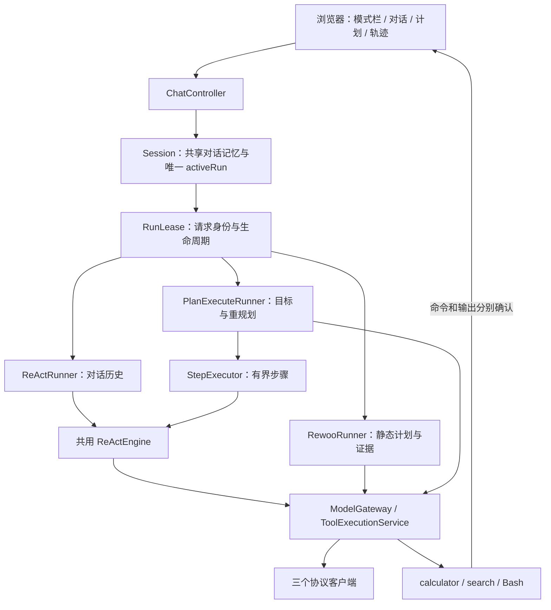
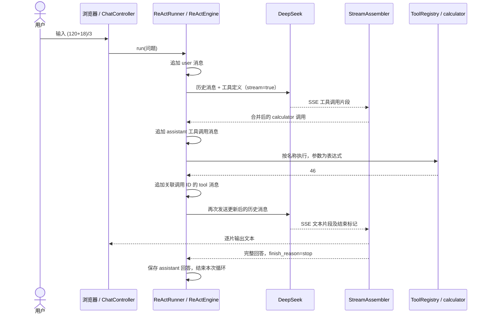

# Java Agent Loop

这是学习 [The Agent Loop](../../phases/14-agent-engineering/01-the-agent-loop/docs/en.md) 与 [ReWOO / Plan-and-Execute](../../phases/14-agent-engineering/02-rewoo-plan-and-execute/docs/en.md) 后的 Java Maven 练习。在同一个界面中比较三种执行方式，模型、工具和协议客户端由三者共用。

程序以 Spring Boot 提供本地浏览器聊天界面。回答会实时显示，工具包括四则运算、Bash、Exa 搜索，以及免注册的 Open-Meteo 当前天气和七日预报。默认使用 `deepseek-flash`，思考模式关闭；可在输入框中切换模型和推理等级。每个浏览器页面拥有独立的内存会话；刷新页面会开始新会话。

想通过代码理解项目，可以从 [docs/Agent Loop 学习指南](docs/README.md) 开始，按顺序了解项目结构、一次对话的执行过程、协议适配和调试方法。

[三模式技术方案](docs/design/agent-execution-technical-design.md) 是 ReAct / ReWOO / Plan-and-Execute 的统一开发依据，包含 Java 接口、执行算法、状态机、逐文件改动和验收计划；[研究记录](docs/design/agent-execution-research.md)保留来源与离线实测。每条消息发送前均可选择模式，本轮运行中固定；三种模式均已实现；[实施验证](docs/design/agent-execution-research.md#实施后验证2026-11-01)记录初版测试、真实接口矩阵和验证边界。

[天气能力实现方案](docs/design/weather-capability-implementation-plan.md) 说明已接入的 Open-Meteo 当前天气与 1–7 天逐日预报，包含参数、地点消歧、通用工具扩展和实际验收记录。

[Trace 接入技术方案](docs/design/observability-trace-implementation-plan.md) 说明如何通过原生 OpenTelemetry Java SDK 对接已安装的本机 Langfuse，包含规范研究、span 清单、字段映射与实际验收记录；[Trace 阅读指南](docs/07-reading-agent-traces.md)用三种模式和天气案例帮助理解项目。已通过原生 OTel SDK 接入独立的 `agent-loop-learning` 项目；指南区分示意树与可直接打开的真实 Trace。

[三种协议图解](docs/06-three-protocols-by-example.md) 用同一次真实计算对话，逐项标注规则、用户、助手、工具结果和宿主程序，展示完整请求与响应，并解释 developer 与思考内容的归属。

[工具调用实验](docs/05-tool-calls-and-transcripts.md) 对比少回一个结果、执行上限和倒序返回三个场景，并梳理 Chat Completions、Responses、Anthropic Messages 与 Bedrock Converse 的对话记录。实验无需 API key，在本目录运行 `mvn -Dtest=ToolTranscriptExperimentTest,ReActRunnerTest test`，可在 `target/tool-transcript-experiment/` 查看生成的请求 JSON。

同一文档也记录了 2026-11-01 的 DeepSeek 真实 API 对照实验：三个兼容接口在缺少第三个结果时均返回 HTTP 400，补上未执行错误后均返回 HTTP 200。已设置 `DEEPSEEK_API_KEY` 时，可用 `python3 experiments/deepseek_tool_limit.py --protocol chat` 复现真实请求。

## 快速运行

需要 Java 17 或更高版本、Maven，以及可用的 DeepSeek API key。在本项目目录运行：

```bash
source ~/.bashrc
mvn test
node --test src/test/js/*.test.js
mvn spring-boot:run
```

打开 `http://127.0.0.1:8080`，在对话框上方选择本轮执行模式，输入问题并查看回答。发送后模式栏暂时改为只读，结束或失败并清理完成后恢复选择；下一条消息可以切换为其他模式，仍保留当前对话上下文。每条回答和对应轨迹标明其实际模式。“新建对话”用于清空上下文，切换模式无需新建。Bash 命令执行前以及命令输出发送给 DeepSeek 前，页面会分别要求确认。按 `Ctrl+C` 停止服务。服务只监听本机；端口可由 `AGENT_PORT` 调整。检测到 HTTP 断连或超时后取消本轮资源；普通浏览器关闭不保证立刻被服务端检测。确认最多等待 5 分钟，整轮最多 15 分钟。

输入框下方可选 `DeepSeek V4.1 Flash` 或 `DeepSeek V4 Pro`，推理等级可选 `Off`、`Low`、`High`、`Max`。默认 `Off`；选择其他等级会开启 Think，并将该等级用于这一轮用户请求的所有模型调用。下一轮可重新选择。模型 ID 和等级按 2026-10-31 的 [DeepSeek 模型列表](https://api-docs.deepseek.com/api/list-models/) 与 [思考模式文档](https://api-docs.deepseek.com/guides/thinking_mode/) 配置。

页面左下角的 **设置** 可选择 DeepSeek 的 Chat Completions、Responses 或 Anthropic Messages 协议。默认使用 Chat Completions。保存后手动重启应用，新的协议才会生效；页面同时显示当前协议和待生效的设置。重启会清空进程内的会话。设置保存在本项目的 `config/settings.json`，该文件被 Git 忽略，API key 仍只从环境变量读取。

三种协议使用同一组模型、工具和推理等级。Responses 的 `Off` 对应 `reasoning.effort=none`；Anthropic 的 `Off` 关闭 thinking，其他等级会开启 thinking 并设置 `output_config.effort`。Responses 接口无服务端会话状态，每次发送完整历史。工具执行后的结果和思考内容按各自协议回传。

页面顶部可切换 **对话 / 轨迹**。轨迹页按用户轮次列出模型设置、模型请求、实际返回的思考内容、助手消息和工具调用；上方时间线显示输入、模型与工具阶段的耗时。点击时间线或列表行可查看模型结束原因、工具参数和返回结果，搜索框可筛选轨迹。推理等级为 `Off` 时没有思考内容；选择其他等级后，模型返回的 `reasoning_content` 会在轨迹中显示。轨迹和对话一样仅保存在当前页面，刷新后清空。

| 环境变量 | 用途 |
| --- | --- |
| `DEEPSEEK_API_KEY` | 必填，用于调用 DeepSeek。 |
| `EXA_AI_KEY` | 搜索工具使用的 Exa key；也兼容 `EXA_API_KEY`，优先使用前者。未配置时，搜索会返回错误观察，其他工具仍可使用。 |
| `DEEPSEEK_BASE_URL` | 可选，默认 `https://api.deepseek.com`，必须使用 HTTPS。 |
| `AGENT_PORT` | 可选，浏览器服务端口，默认 `8080`。 |

请从环境变量提供 key，不要把 key 写入代码或提交到 Git。

### 开启 Langfuse Trace

本机已创建独立的 `agent-loop-learning` 项目，配置保存在仓库外的 `~/.config/langfuse/agent-loop.env`（权限 `0600`）。DeepSeek key 仍从启动进程的环境读取：

```bash
./run-with-tracing.sh
```

普通 `mvn spring-boot:run` 默认关闭 tracing。脚本加载私有配置并启动应用；其他机器可用 `AGENT_TRACE_ENV_FILE` 指定自己的环境文件。开启后每轮回答与轨迹摘要显示 Trace 链接，跳转本机 Langfuse 查看执行树。同一对话可以逐轮切换执行模式，每轮独立建 trace，通过观测 Session ID 分组。

| 环境变量 | 用途 |
| --- | --- |
| `AGENT_TRACING_ENABLED` | `true` 开启；默认 `false`，关闭时使用 Noop。 |
| `LANGFUSE_BASE_URL` | 默认 `http://127.0.0.1:3035`；远程地址须 HTTPS。 |
| `LANGFUSE_PUBLIC_KEY` / `LANGFUSE_SECRET_KEY` | 开启时必填，使用本项目 key。 |
| `LANGFUSE_PROJECT_ID` | 用于生成页面链接；未设置时仍显示 traceId。 |
| `AGENT_TRACE_CONTENT` | 默认 `metadata`；`learning` 额外保存脱敏限长的教学预览。 |
| `AGENT_TRACE_SAMPLE_RATIO` | 默认 `1.0`，范围 `0–1`。 |
| `AGENT_RELEASE` | 构建版本标识，默认 `1.0-SNAPSHOT`。 |

默认只保存结构、状态、计数、Token 和安全摘要。需要对照受控练习的文字时运行 `AGENT_TRACE_CONTENT=learning ./run-with-tracing.sh`。两种模式都不上传完整提示词、历史、reasoning 或 Bash 原文；涉及 Bash 后，该 Session 后续自由文本预览关闭。网页本地轨迹依然能显示模型实际返回的思考内容。

三协议 × 三模式 × 计算 / 天气的 **18 组真实运行均已写入并回读 Langfuse**；Java 147 项、前端 10 项测试通过。复现使用 `mvn package` 后运行 `python3 experiments/trace_verification.py`，该脚本会真实调用模型和天气 API，并以 learning 模式保存受控样本。可读案例见 [Trace 阅读指南](docs/07-reading-agent-traces.md#10-用真实-trace-复盘)。

## 系统架构



代码按职责组织，建议按下表顺序阅读。路径均相对于本项目。

| 位置 | 职责 |
| --- | --- |
| [`app/`](src/main/java/dev/learning/agent/app/) | Spring Boot 入口、本地来源检查；`chat` 管理会话、HTTP 流和确认，`settings` 管理设置。 |
| [`core/`](src/main/java/dev/learning/agent/core/) | 三种模式共同使用的入口与结果：AgentRunner、ExecutionRequest、RunResult、模式和状态。 |
| [`core/runtime/`](src/main/java/dev/learning/agent/core/runtime/) | 一轮请求的 RunContext、预算、取消、证据、确认接口和运行事件。 |
| [`core/react/`](src/main/java/dev/learning/agent/core/react/) | ReActRunner 保存历史；ReActEngine 执行可复用的反馈循环。 |
| [`core/rewoo/`](src/main/java/dev/learning/agent/core/rewoo/) | 静态工具计划、依赖校验、参数绑定与 ReWOO Runner。 |
| [`core/planexecute/`](src/main/java/dev/learning/agent/core/planexecute/) | 高层目标、步骤执行、计划版本、决策与 P&E Runner。 |
| [`core/planning/`](src/main/java/dev/learning/agent/core/planning/) | 两种规划模式共用的任务快照、问答记忆、结构化模型请求和引用检查。 |
| [`model/`](src/main/java/dev/learning/agent/model/) | 模型调用入口、Gateway，以及三种协议共用的消息、回复、工具描述和用量契约。 |
| [`deepseek/`](src/main/java/dev/learning/agent/deepseek/) | 三个协议客户端、HTTP/SSE；`deepseek.model` 仅保留 ChatRequest、ChatChunk、ProviderUsage 协议 DTO。 |
| [`tool/`](src/main/java/dev/learning/agent/tool/) | 通用参数契约、工具自主解码、注册与执行服务；天气能力位于 tool/weather。 |
| [`observability/`](src/main/java/dev/learning/agent/observability/) | OTel SDK 初始化、span / 字段映射、内容策略与用量归一化；业务只依赖 runtime 观测接口。 |
| [`support/json/`](src/main/java/dev/learning/agent/support/json/) | 严格 JSON 解析、字段读取与序列化；不认识具体工具或执行策略。 |
| [`static/`](src/main/resources/static/) | 浏览器页面、样式、对话状态与轨迹脚本。 |
| [`logback.xml`](src/main/resources/logback.xml) | 文件日志配置。 |

上述 Java 路径的共同前缀是 `src/main/java/dev/learning/agent/`。JSON 通过 Jackson 转换为明确的 Java 类型；业务代码通过 SLF4J 记录日志，由 Logback 输出。

## 执行内核改造

现有 ReAct 已拆成 `ReActRunner`（会话历史）和 `DefaultReActEngine`（模型与工具反馈循环）。`DefaultModelGateway` 统一模型调用、预算与轨迹，`DefaultToolExecutionService` 保存结构化证据；三个协议客户端支持纯文本请求与明确输出上限。工具结果通过调用 ID 配对，并包含宿主证据 ID 和状态。ReWOO 直接执行验证后的工具计划；Plan-and-Execute 通过 StepExecutor 复用内核，步骤后检查是否继续或修订。

[逐轮模式验证](docs/design/agent-execution-research.md#逐轮模式与共享记忆验证2026-11-02)记录 129 项 Java 测试、10 项前端测试、三协议 12/12 轮真实请求与浏览器操作。可在设置好环境变量后运行 `python3 experiments/session_mode_switch.py` 复现。

Session 额外维护最近最多 4 轮、总计约 24,000 字符的共享问答及运行摘要。连续使用同一模式时保留 Runner；切换时基于共享快照创建新的 Runner，切回原模式也包含中间的对话。跨模式不迁移原生 tool 消息、reasoning blocks、计划或旧 EvidenceStore；本轮工具证据和确认重新建立。失败或取消保留状态与工具是否执行的摘要，不把任务当成成功。

## 三种模式如何比较

| 模式 | 谁决定下一步 | 适用的学习观察点 |
| --- | --- | --- |
| ReAct | 每次模型响应结合工具观察决定下一步 | 工具反馈如何改变后续调用 |
| ReWOO | Planner 一次生成工具、参数与 `#E1` 引用；Worker 串行执行；Solver 汇总 | 静态依赖与少量模型调用；失败后不重规划 |
| Plan-and-Execute | Planner 生成高层目标；步骤内 ReAct；Replanner 逐步检查；Finalizer 汇总 | 局部循环、证据保留、计划版本与重规划开销 |

可以分别新建对话，使用同一个问题：`请分两步使用 calculator 计算 (120+18)/3：先求和，再除以3，列出和与商。` 在轨迹中比较模型请求数、工具尝试数、实际执行数、耗时与实际 token 用量。三种模式使用同一轮预算；步骤不会重新获得一份总预算。界面的“完成”代表执行契约满足，结果仍未做独立语义验证。

## 设计思路

Agent 循环可以理解为：**把当前消息交给模型 → 按模型请求执行工具 → 把结果作为新消息交还模型 → 重复，直到得到最终回答**。

从 `ReActRunner.run` 看历史与任务入口，再读 `DefaultReActEngine.execute` 的循环。模型请求与完成轨迹位于 `DefaultModelGateway.call`，工具状态、证据与配对结果位于 `DefaultToolExecutionService`。

1. **模型决定，程序执行。** 模型返回工具名称和 JSON 参数；`ToolRegistry` 按名称查找 `AgentTool`，由 Java 实际执行。工具定义包含名称、描述和参数 Schema，随请求一起发送给模型。
2. **消息历史连接各轮。** `system` 提供行为指引，`user` 保存问题，`assistant` 保存模型回复或工具调用，`tool` 保存执行结果。工具结果通过 `tool_call_id` 对应具体调用。Think 开启且请求携带工具时，模型返回的 `reasoning_content` 也保存在对应的 assistant 消息中，并随下次请求发回 DeepSeek。
3. **循环有结束条件。** 一次用户输入最多允许 8 次模型请求。没有工具调用且结束原因为 `stop` 时结束；工具调用需要以 `tool_calls` 结束。流不完整、结束原因异常或达到上限时报告错误。
4. **工具失败也能成为观察。** 参数错误、未知工具和部分工具执行异常会被转换为错误文本并写回历史，让模型可以根据结果继续处理。HTTP 或流解析等模型请求错误会显示在页面上。
5. **流式输出与完整结果各有用途。** 文本分片立即显示；工具调用的名称和参数可能分多片到达，需要先合并成完整调用再执行。如果流中途失败，页面可能已显示部分文本，并会标明本轮失败。每次模型请求和工具调用都发送开始与完成轨迹事件，页面按相同 ID 更新耗时和结果。

工具结果和搜索内容被当作数据；系统提示要求模型不要把它们当作指令。Bash 工具另外要求用户确认命令和输出的分享。

## 一次请求如何执行

以下说明 ReAct 模式，以模型选择调用 `calculator` 为例；实际模型也可能直接回答，或选择其他工具。



消息历史的变化可以概括为：

| 顺序 | 消息角色 | 示例内容 |
| --- | --- | --- |
| 1 | `system` | 指导助手使用工具并遵守 Bash 确认。 |
| 2 | `user` | 请求计算 `(120+18)/3`。 |
| 3 | `assistant` | 发出 `calculator` 调用，参数为 `{"expression":"(120+18)/3"}`，带有调用 ID。 |
| 4 | `tool` | 返回 `46`，通过 `tool_call_id` 关联第 3 条调用。 |
| 5 | `assistant` | 基于结果生成最终回答。 |

如果模型一次返回多个工具调用，当前实现按调用索引顺序逐个执行，并分别写入结果。同一页面内后续问题继续使用这份内存中的历史；刷新页面或退出进程后历史消失，ReAct 历史目前没有自动裁剪；ReWOO/P&E 只保留最近最多 4 个完整问答对、合计最多 24,000 字符，不回放旧轮次的原始证据。所有模式均无持久化。

## 工具与运行边界

| 工具 | 参数与行为 | 主要边界 |
| --- | --- | --- |
| `calculator` | `expression`：支持 `+`、`-`、`*`、`/` 和括号。 | 限制表达式长度、嵌套深度和运算次数；非法表达式返回错误。 |
| `current_weather` / `weather_forecast` | city、可选 country_code/admin1；预报可选 days=1–7。 | 地点不明先澄清，固定来源与单位；无需天气密钥。 |
| `search` | `query`：通过 Exa 搜索，返回标题、URL 和摘要，最多请求 5 条。 | 查询最长 500 字符，HTTP 请求超时为 30 秒；缺少 key 时返回错误。 |
| `bash` | `command`：在项目目录运行 Bash 命令。 | 执行前确认一次，输出发送给 DeepSeek 前再确认一次；最长 15 秒，捕获输出约 12 KB。子进程不继承 DeepSeek、Exa、Langfuse 的 API key 或 OTLP 认证配置。 |

Bash 仍能访问当前用户有权限访问的本地文件，请在两次确认时检查命令和输出。工具执行顺序、循环次数和超时都可以从相应类中查看或修改。

## 天气查询

无需天气账号或 API key，直接提问：

- `查询北京市（北京，中国，北京市）当前天气。`
- `查询北京市未来七天逐日天气，列出日期、最低/最高温和降水概率。`
- `比较北京市与上海市未来七天的天气。`

`current_weather` 返回当前模型估计；`weather_forecast` 默认返回从城市当地今天起、包含今天的 7 天，days 可选 1–7 的整数。两个工具内部先查地点，再按经纬度查天气，使用摄氏度和 km/h；天气数据来自 Open-Meteo，地点数据来自 GeoNames，页面在回答下方展示来源链接。

城市搜索可能返回重名地点。例如只说“北京”时，接口可能同时返回北京市、重庆市和四川的同名地点。工具不会按人口或第一条静默选择；无法确定时本轮显示“待补充信息”，输入省级地区后，在同一模式的新一轮继续查询。模型按工具描述提取 city、country_code、admin1，不应凭空补充行政区来绕过澄清。

未来七天包含今天；“明天”使用返回的当地日期解释。关键数据缺失、服务限流、超时或查询失败会明确显示；非关键缺值保留为 null。整次天气调用最多 30 秒，单次完整 HTTP 响应最多 12 秒，正常一次工具调用包含两次 HTTP；受控城市名回退最多三次。当前天气是模型估计，不是气象站观测。

Open-Meteo 免费接口用于非商业学习并要求注明来源。真实接口联调脚本见 `experiments/weather_matrix.py`；它还会调用已配置的 DeepSeek API。具体覆盖范围见[天气方案的实施记录](docs/design/weather-capability-implementation-plan.md#13-实施与验证2026-11-02)。

## 日志与排查

使用 SLF4J + Logback。运行日志写入 `logs/agent.log`，记录模型轮次、工具名称、HTTP 状态、耗时和 SSE 分片大小等信息；正常运行日志不主动记录 API key、完整提示词或完整 Bash 输出。日志文件已被 Git 忽略。聊天内容和确认操作在浏览器页面显示。

```bash
tail -f logs/agent.log
```

文件保存 `DEBUG` 及以上级别。文件按日期和大小轮转：单个文件达到约 1 MB 时归档，保留最近 5 天，归档总量上限约 5 MB，当前活动文件另计。配置见 [`logback.xml`](src/main/resources/logback.xml)。日志中的 requestId / traceId 可关联页面与 Langfuse；开启 tracing 后，执行阶段、模型、工具与外部 HTTP 以独立 span 记录。

## 在 IntelliJ IDEA 中

打开本目录的 `pom.xml`，选择 **Open as Project**，使用 WSL JDK 作为 Project SDK。若已打开整个仓库，可在 Maven 工具窗口选择 **Link Maven Projects** 并选中这个 `pom.xml`。同步后，运行 [`WebMain.java`](src/main/java/dev/learning/agent/app/WebMain.java) 的 `main` 方法，即可启动浏览器服务。

程序使用 `System.getenv` 读取启动 Java 进程时已有的环境变量。WSL 交互式 Bash 会读取 `~/.bashrc`，IDEA 的运行进程可能由其他环境启动，因此终端里有 key 并不代表运行配置也有。不要在终端打印 key 来排查；可用下面的命令只检查是否存在：

```bash
if [ -n "$DEEPSEEK_API_KEY" ]; then echo "DeepSeek key 已设置"; else echo "DeepSeek key 未设置"; fi
```

你的 `.bashrc` 中，key 和 Java、Maven 环境配置已放在非交互 Shell 的提前返回判断之前。登录 Shell 或显式加载 `.bashrc` 的非交互 Shell 可以读取这些设置；普通非交互 Shell 不一定会自动加载 `.bashrc`，IDEA 是否继承变量仍取决于它的启动方式和运行配置。

有两种运行方式：

1. **使用 IDEA 的 WSL 终端：**在本项目目录执行 `mvn spring-boot:run`。交互式 Bash 已加载 `.bashrc`，可以继承已有的 key。
2. **使用 Java 的运行按钮：**为 `WebMain` 配置环境变量。本地 `Agent Loop (WSL)` 运行配置已指向 `WebMain`，并从被 Git 忽略的 `.idea/agent-loop.env` 读取密钥；更新 key 后也需更新此文件。也可以在 **Run → Edit Configurations → Environment variables** 中直接配置。请勿将包含 key 的配置共享或提交。

IDEA 从 `WebMain` 旁的运行按钮自动生成的新配置不会自动继承另一份配置的环境变量文件。如果启动时出现 `DEEPSEEK_API_KEY is required`，在当前选中的配置中添加 `.idea/agent-loop.env`，或改选已配置该文件的 `Agent Loop (WSL)`。本机当前选中的 `WebMain` 配置也已补上该环境文件。

终端方式已在当前 WSL 环境验证；IDEA 运行按钮的环境需要在 IDE 中配置并验证。IDEA 还提供 WSL 环境变量加载相关的高级选项，但不同安装环境中选项可能不可见，以上两种方式不依赖该选项。

## 参考资料

- [本仓库 Phase 14 第一课](../../phases/14-agent-engineering/01-the-agent-loop/docs/en.md)：Agent 循环的概念、练习和术语。
- [ReAct 论文](https://arxiv.org/abs/2210.03629)：理解推理、行动和观察如何交替。
- [DeepSeek Chat Completions](https://api-docs.deepseek.com/api/create-chat-completion/) 与 [Tool Calls](https://api-docs.deepseek.com/guides/tool_calls/)：请求字段、消息格式和工具调用流程。
- [DeepSeek Responses API](https://api-docs.deepseek.com/guides/responses_api/) 与 [Anthropic API](https://api-docs.deepseek.com/guides/anthropic_api/)：接口差异与工具历史格式。
- [Spring Boot Web 文档](https://docs.spring.io/spring-boot/3.5/reference/web/servlet.html)：Spring MVC 和静态页面。
- [Server-Sent Events 标准](https://html.spec.whatwg.org/multipage/server-sent-events.html)：理解流式事件格式。
- [Exa Search API](https://exa.ai/docs/reference/search)：搜索请求和结果字段。
- [SLF4J 手册](https://www.slf4j.org/manual.html) 与 [Logback 滚动文件配置](https://logback.qos.ch/manual/appenders-rolling.html)：日志接口和文件轮转。
