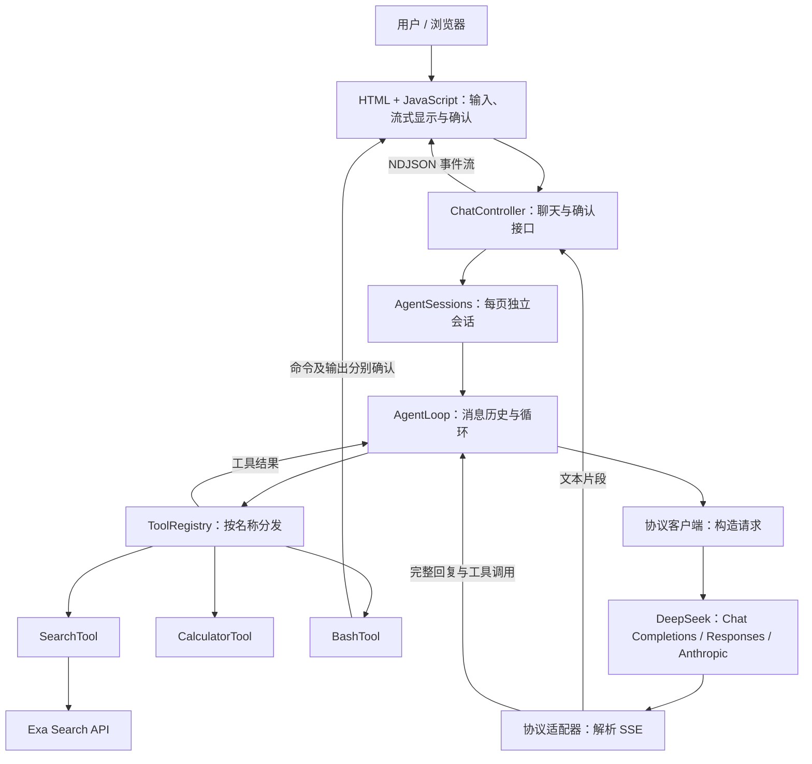
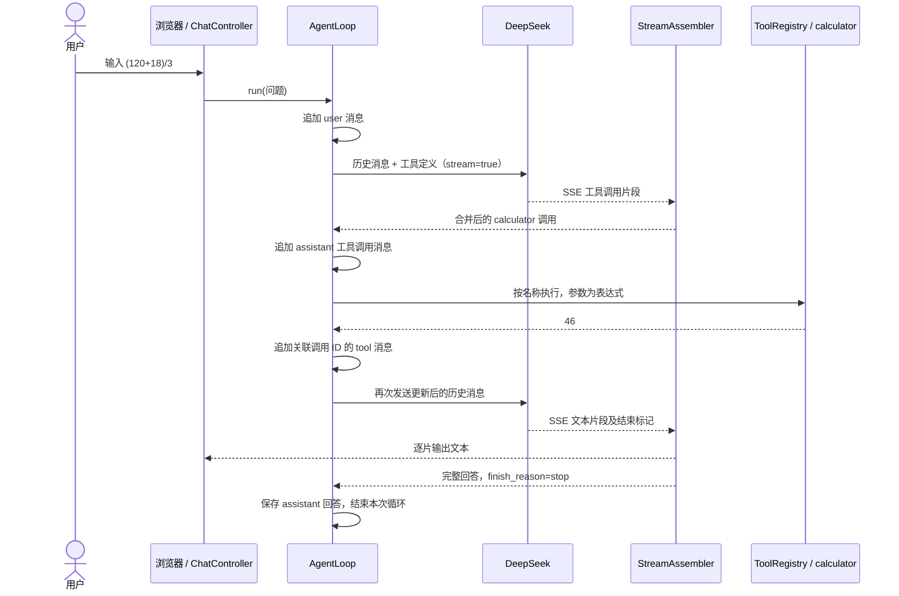

# Java Agent Loop

这是学习 [Phase 14：The Agent Loop](../../phases/14-agent-engineering/01-the-agent-loop/docs/en.md) 后的 Java Maven 练习。它通过 DeepSeek 接收问题、选择工具、读取工具结果并继续生成回答，帮助理解 Agent 循环的基本组成。

程序以 Spring Boot 提供本地浏览器聊天界面。回答会实时显示，工具包括四则运算、Bash 和 Exa 搜索。默认使用 `deepseek-flash`，思考模式关闭；可在输入框中切换模型和推理等级。每个浏览器页面拥有独立的内存会话；刷新页面会开始新会话。

想通过代码理解项目，可以从 [docs/Agent Loop 学习指南](docs/README.md) 开始，按顺序了解项目结构、一次对话的执行过程、协议适配和调试方法。

[三种协议图解](docs/06-three-protocols-by-example.md) 用同一次真实计算对话，逐项标注规则、用户、助手、工具结果和宿主程序，展示完整请求与响应，并解释 developer 与思考内容的归属。

[工具调用实验](docs/05-tool-calls-and-transcripts.md) 对比少回一个结果、执行上限和倒序返回三个场景，并梳理 Chat Completions、Responses、Anthropic Messages 与 Bedrock Converse 的对话记录。实验无需 API key，在本目录运行 `mvn -Dtest=ToolTranscriptExperimentTest,AgentLoopTest test`，可在 `target/tool-transcript-experiment/` 查看生成的请求 JSON。

同一文档也记录了 2026-11-01 的 DeepSeek 真实 API 对照实验：三个兼容接口在缺少第三个结果时均返回 HTTP 400，补上未执行错误后均返回 HTTP 200。已设置 `DEEPSEEK_API_KEY` 时，可用 `python3 experiments/deepseek_tool_limit.py --protocol chat` 复现真实请求。

## 快速运行

需要 Java 17 或更高版本、Maven，以及可用的 DeepSeek API key。在本项目目录运行：

```bash
source ~/.bashrc
mvn test
mvn spring-boot:run
```

打开 `http://127.0.0.1:8080`，输入问题并在页面中查看流式回答。Bash 命令执行前以及命令输出发送给 DeepSeek 前，页面会分别要求确认。按 `Ctrl+C` 停止服务。服务只监听本机；端口可由 `AGENT_PORT` 调整。浏览器关闭后，等待中的 Bash 确认最多 5 分钟后会自动拒绝。

输入框下方可选 `DeepSeek V4.1 Flash` 或 `DeepSeek V4 Pro`，推理等级可选 `Off`、`Low`、`High`、`Max`。默认 `Off`；选择其他等级会开启 Think，并将该等级用于这一轮用户请求的所有模型调用。下一轮可重新选择。模型 ID 和等级按 2026-10-31 的 [DeepSeek 模型列表](https://api-docs.deepseek.com/api/list-models/) 与 [思考模式文档](https://api-docs.deepseek.com/guides/thinking_mode/) 配置。

页面左下角的 **设置** 可选择 DeepSeek 的 Chat Completions、Responses 或 Anthropic Messages 协议。默认使用 Chat Completions。保存后手动重启应用，新的协议才会生效；页面同时显示当前协议和待生效的设置。重启会清空进程内的会话。设置保存在本项目的 `config/settings.json`，该文件被 Git 忽略，API key 仍只从环境变量读取。

三种协议使用同一组模型、工具和推理等级。Responses 的 `Off` 对应 `reasoning.effort=none`；Anthropic 的 `Off` 关闭 thinking，其他等级会开启 thinking 并设置 `output_config.effort`。Responses 接口无服务端会话状态，每次发送完整历史。工具执行后的结果和思考内容按各自协议回传。

页面顶部可切换 **对话 / 轨迹**。轨迹页按用户轮次列出模型设置、模型请求、实际返回的思考内容、助手消息和工具调用；上方时间线显示输入、模型与工具阶段的耗时。点击时间线或列表行可查看模型结束原因、工具参数和返回结果，搜索框可筛选轨迹。推理等级为 `Off` 时没有思考内容；选择其他等级后，模型返回的 `reasoning_content` 会在轨迹中显示。轨迹和对话一样仅保存在当前页面，刷新后清空。

| 环境变量 | 用途 |
| --- | --- |
| `DEEPSEEK_API_KEY` | 必填，用于调用 DeepSeek。 |
| `EXA_AI_KEY` | 搜索工具使用的 Exa key；也兼容 `EXA_API_KEY`，优先使用前者。未配置时，搜索会返回错误观察，其他工具仍可使用。 |
| `DEEPSEEK_BASE_URL` | 可选，默认 `https://api.deepseek.com`，必须使用 HTTPS。 |
| `AGENT_PORT` | 可选，浏览器服务端口，默认 `8080`。 |

请从环境变量提供 key，不要把 key 写入代码或提交到 Git。

## 系统架构



代码按职责组织，建议按下表顺序阅读。路径均相对于本项目。

| 位置 | 职责 |
| --- | --- |
| [`app/WebMain.java`](src/main/java/dev/learning/agent/app/WebMain.java) | 启动 Spring Boot 本地服务。 |
| [`app/chat/`](src/main/java/dev/learning/agent/app/chat/) | 创建页面会话、流式发送事件和处理 Bash 确认。 |
| [`app/settings/`](src/main/java/dev/learning/agent/app/settings/) | 读取和保存协议设置；保存后重启生效。 |
| [`app/LocalRequest.java`](src/main/java/dev/learning/agent/app/LocalRequest.java) | 检查本地请求的主机和来源。 |
| [`core/TraceEvent.java`](src/main/java/dev/learning/agent/core/TraceEvent.java) | 定义模型、工具和助手步骤的轨迹事件。 |
| [`static/`](src/main/resources/static/) | 浏览器页面、样式和交互脚本。 |
| [`core/AgentLoop.java`](src/main/java/dev/learning/agent/core/AgentLoop.java) | 维护消息历史，决定继续调用工具、结束或报错。 |
| [`deepseek/ChatCompletionsClient.java`](src/main/java/dev/learning/agent/deepseek/ChatCompletionsClient.java) | 处理 Chat Completions 请求和流式响应。 |
| [`deepseek/ResponsesClient.java`](src/main/java/dev/learning/agent/deepseek/ResponsesClient.java) | 处理 Responses 请求、历史消息和流式事件。 |
| [`deepseek/AnthropicClient.java`](src/main/java/dev/learning/agent/deepseek/AnthropicClient.java) | 处理 Anthropic 内容块、工具结果和流式事件。 |
| [`deepseek/StreamAssembler.java`](src/main/java/dev/learning/agent/deepseek/StreamAssembler.java) | 读取 SSE 事件，输出文本片段，按索引合并工具调用及参数片段。 |
| [`deepseek/model/`](src/main/java/dev/learning/agent/deepseek/model/) | 请求、消息、工具定义和响应实体；`ChatRequest` 注释了请求字段。 |
| [`tool/`](src/main/java/dev/learning/agent/tool/) | 工具接口、注册表和三个工具实现。 |
| [`logback.xml`](src/main/resources/logback.xml) | 文件日志配置。 |

上述 Java 路径的共同前缀是 `src/main/java/dev/learning/agent/`。JSON 通过 Jackson 转换为明确的 Java 类型；业务代码通过 SLF4J 记录日志，由 Logback 输出。

## 设计思路

Agent 循环可以理解为：**把当前消息交给模型 → 按模型请求执行工具 → 把结果作为新消息交还模型 → 重复，直到得到最终回答**。

阅读 `AgentLoop` 时，从 `run` 看整体流程：请求模型、校验结束原因、保存回复，再决定结束或执行工具。`startRequest` 初始化本次请求，`requestModel` 负责模型调用及其开始、完成和失败轨迹，`traceAnswer` 记录思考和回答，`validateFinishReason` 校验结束原因，`executeTool` 执行单个工具并记录轨迹与结果。

1. **模型决定，程序执行。** 模型返回工具名称和 JSON 参数；`ToolRegistry` 按名称查找 `AgentTool`，由 Java 实际执行。工具定义包含名称、描述和参数 Schema，随请求一起发送给模型。
2. **消息历史连接各轮。** `system` 提供行为指引，`user` 保存问题，`assistant` 保存模型回复或工具调用，`tool` 保存执行结果。工具结果通过 `tool_call_id` 对应具体调用。Think 开启且请求携带工具时，模型返回的 `reasoning_content` 也保存在对应的 assistant 消息中，并随下次请求发回 DeepSeek。
3. **循环有结束条件。** 一次用户输入最多允许 8 次模型请求。没有工具调用且结束原因为 `stop` 时结束；工具调用需要以 `tool_calls` 结束。流不完整、结束原因异常或达到上限时报告错误。
4. **工具失败也能成为观察。** 参数错误、未知工具和部分工具执行异常会被转换为错误文本并写回历史，让模型可以根据结果继续处理。HTTP 或流解析等模型请求错误会显示在页面上。
5. **流式输出与完整结果各有用途。** 文本分片立即显示；工具调用的名称和参数可能分多片到达，需要先合并成完整调用再执行。如果流中途失败，页面可能已显示部分文本，并会标明本轮失败。每次模型请求和工具调用都发送开始与完成轨迹事件，页面按相同 ID 更新耗时和结果。

工具结果和搜索内容被当作数据；系统提示要求模型不要把它们当作指令。Bash 工具另外要求用户确认命令和输出的分享。

## 一次请求如何执行

以下以模型选择调用 `calculator` 为例；实际模型也可能直接回答，或选择其他工具。



消息历史的变化可以概括为：

| 顺序 | 消息角色 | 示例内容 |
| --- | --- | --- |
| 1 | `system` | 指导助手使用工具并遵守 Bash 确认。 |
| 2 | `user` | 请求计算 `(120+18)/3`。 |
| 3 | `assistant` | 发出 `calculator` 调用，参数为 `{"expression":"(120+18)/3"}`，带有调用 ID。 |
| 4 | `tool` | 返回 `46`，通过 `tool_call_id` 关联第 3 条调用。 |
| 5 | `assistant` | 基于结果生成最终回答。 |

如果模型一次返回多个工具调用，当前实现按调用索引顺序逐个执行，并分别写入结果。同一页面内后续问题继续使用这份内存中的历史；刷新页面或退出进程后历史消失，目前没有持久化或自动裁剪。

## 工具与运行边界

| 工具 | 参数与行为 | 主要边界 |
| --- | --- | --- |
| `calculator` | `expression`：支持 `+`、`-`、`*`、`/` 和括号。 | 限制表达式长度、嵌套深度和运算次数；非法表达式返回错误。 |
| `search` | `query`：通过 Exa 搜索，返回标题、URL 和摘要，最多请求 5 条。 | 查询最长 500 字符，HTTP 请求超时为 30 秒；缺少 key 时返回错误。 |
| `bash` | `command`：在项目目录运行 Bash 命令。 | 执行前确认一次，输出发送给 DeepSeek 前再确认一次；最长 15 秒，捕获输出约 12 KB。子进程不继承 DeepSeek 和 Exa 的 API key。 |

Bash 仍能访问当前用户有权限访问的本地文件，请在两次确认时检查命令和输出。工具执行顺序、循环次数和超时都可以从相应类中查看或修改。

## 日志与排查

使用 SLF4J + Logback。运行日志写入 `logs/agent.log`，记录模型轮次、工具名称、HTTP 状态、耗时和 SSE 分片大小等信息；正常运行日志不主动记录 API key、完整提示词或完整 Bash 输出。日志文件已被 Git 忽略。聊天内容和确认操作在浏览器页面显示。

```bash
tail -f logs/agent.log
```

文件保存 `DEBUG` 及以上级别。文件按日期和大小轮转：单个文件达到约 1 MB 时归档，保留最近 5 天，归档总量上限约 5 MB，当前活动文件另计。配置见 [`logback.xml`](src/main/resources/logback.xml)。这些日志用于查看执行过程，当前项目没有接入独立的链路追踪系统。

## 在 IntelliJ IDEA 中

打开本目录的 `pom.xml`，选择 **Open as Project**，使用 WSL JDK 作为 Project SDK。若已打开整个仓库，可在 Maven 工具窗口选择 **Link Maven Projects** 并选中这个 `pom.xml`。同步后，运行 [`WebMain.java`](src/main/java/dev/learning/agent/app/WebMain.java) 的 `main` 方法，即可启动浏览器服务。

程序使用 `System.getenv` 读取启动 Java 进程时已有的环境变量。WSL 交互式 Bash 会读取 `~/.bashrc`，IDEA 的运行进程可能由其他环境启动，因此终端里有 key 并不代表运行配置也有。不要在终端打印 key 来排查；可用下面的命令只检查是否存在：

```bash
if [ -n "$DEEPSEEK_API_KEY" ]; then echo "DeepSeek key 已设置"; else echo "DeepSeek key 未设置"; fi
```

你的 `.bashrc` 中，key 和 Java、Maven 环境配置已放在非交互 Shell 的提前返回判断之前。登录 Shell 或显式加载 `.bashrc` 的非交互 Shell 可以读取这些设置；普通非交互 Shell 不一定会自动加载 `.bashrc`，IDEA 是否继承变量仍取决于它的启动方式和运行配置。

有两种运行方式：

1. **使用 IDEA 的 WSL 终端：**在本项目目录执行 `mvn spring-boot:run`。交互式 Bash 已加载 `.bashrc`，可以继承已有的 key。
2. **使用 Java 的运行按钮：**为 `WebMain` 配置环境变量。本地 `Agent Loop (WSL)` 运行配置已指向 `WebMain`，并从被 Git 忽略的 `.idea/agent-loop.env` 读取密钥；更新 key 后也需更新此文件。也可以在 **Run → Edit Configurations → Environment variables** 中直接配置。请勿将包含 key 的配置共享或提交。

IDEA 从 `WebMain` 旁的运行按钮自动生成的新配置不会自动继承另一份配置的环境变量文件。如果启动时出现 `DEEPSEEK_API_KEY is required`，在当前选中的配置中添加 `.idea/agent-loop.env`，或改选已配置该文件的 `Agent Loop (WSL)`。本机当前选中的 `WebMain` 配置也已补上该环境文件。

终端方式已在当前 WSL 环境验证；IDEA 运行按钮的环境需要在 IDE 中配置并验证。IDEA 还提供 WSL 环境变量加载相关的高级选项，但不同安装环境中选项可能不可见，以上两种方式不依赖该选项。

## 参考资料

- [本仓库 Phase 14 第一课](../../phases/14-agent-engineering/01-the-agent-loop/docs/en.md)：Agent 循环的概念、练习和术语。
- [ReAct 论文](https://arxiv.org/abs/2210.03629)：理解推理、行动和观察如何交替。
- [DeepSeek Chat Completions](https://api-docs.deepseek.com/api/create-chat-completion/) 与 [Tool Calls](https://api-docs.deepseek.com/guides/tool_calls/)：请求字段、消息格式和工具调用流程。
- [DeepSeek Responses API](https://api-docs.deepseek.com/guides/responses_api/) 与 [Anthropic API](https://api-docs.deepseek.com/guides/anthropic_api/)：接口差异与工具历史格式。
- [Spring Boot Web 文档](https://docs.spring.io/spring-boot/3.5/reference/web/servlet.html)：Spring MVC 和静态页面。
- [Server-Sent Events 标准](https://html.spec.whatwg.org/multipage/server-sent-events.html)：理解流式事件格式。
- [Exa Search API](https://exa.ai/docs/reference/search)：搜索请求和结果字段。
- [SLF4J 手册](https://www.slf4j.org/manual.html) 与 [Logback 滚动文件配置](https://logback.qos.ch/manual/appenders-rolling.html)：日志接口和文件轮转。
