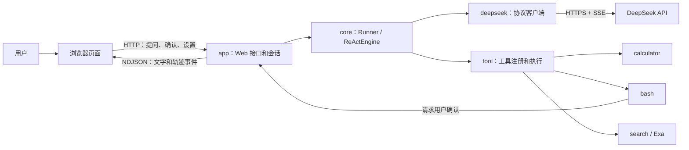

# 1. 项目全貌

[返回目录](README.md) · 下一篇：[一次对话如何运行](02-agent-loop.md)

## 项目解决什么问题

这是一个用 Java 17 和 Spring Boot 编写的本地 Agent 练习。浏览器接收用户消息，后端把消息和可用工具交给 DeepSeek；模型需要工具时，后端执行工具并把结果交还模型，直到生成回答。

页面提供对话和轨迹两个视图。对话视图显示回答、工具提示和 Bash 确认；轨迹视图显示模型请求、工具调用、耗时以及模型实际返回的思考内容。服务只监听本机。

## 一张图看组件

图中的箭头表示调用或数据方向。模型返回工具名称和参数；真正执行工具的是本项目中的 Java 代码。

## 从目录找到代码

以下链接相对于 `learning-artifacts/agent-loop`。

| 位置 | 主要职责 | 首先看哪里 |
| --- | --- | --- |
| [app](../src/main/java/dev/learning/agent/app/) | 启动服务、接收页面请求、管理会话和设置。 | [WebMain](../src/main/java/dev/learning/agent/app/WebMain.java) |
| [app/chat](../src/main/java/dev/learning/agent/app/chat/) | 聊天接口、每个页面的会话以及 Bash 确认。 | [ChatController](../src/main/java/dev/learning/agent/app/chat/ChatController.java)、[AgentSessions](../src/main/java/dev/learning/agent/app/chat/AgentSessions.java) |
| [app/settings](../src/main/java/dev/learning/agent/app/settings/) | 读取、保存 API 协议设置。 | [SettingsStore](../src/main/java/dev/learning/agent/app/settings/SettingsStore.java) |
| [core](../src/main/java/dev/learning/agent/core/) | 维护历史、调用模型、分发工具、产生轨迹。 | [ReActRunner](../src/main/java/dev/learning/agent/core/ReActRunner.java) |
| [deepseek](../src/main/java/dev/learning/agent/deepseek/) | 将历史和工具转换为具体协议，读取模型流式响应。 | [ChatModel](../src/main/java/dev/learning/agent/core/ChatModel.java) 和三个客户端 |
| [tool](../src/main/java/dev/learning/agent/tool/) | 工具定义、注册和实际执行。 | [ToolRegistry](../src/main/java/dev/learning/agent/tool/ToolRegistry.java) |
| [static](../src/main/resources/static/) | HTML、样式、聊天交互和轨迹渲染。 | [app.js](../src/main/resources/static/app.js)、[trace.js](../src/main/resources/static/trace.js) |
| [tests](../src/test/java/dev/learning/agent/) | 验证循环、协议、接口、工具和确认逻辑。 | [ReActRunnerTraceTest](../src/test/java/dev/learning/agent/core/ReActRunnerTraceTest.java) |

## 进程中保存了什么

启动时，[SettingsStore](../src/main/java/dev/learning/agent/app/settings/SettingsStore.java) 读取协议设置，[AgentSessions](../src/main/java/dev/learning/agent/app/chat/AgentSessions.java) 根据这个设置创建协议客户端。每次页面请求 `/api/session`，服务端创建一个新会话；首条请求接受时为会话创建一个固定模式的 Runner，持有独立历史。每个已接受请求拥有自己的 RunLease、事件通道、确认和 RunContext，Session 在它清理完成前拒绝其他请求。

消息历史在服务端内存中。页面刷新会请求新会话，重启进程后会话消失；目前没有会话持久化；ReAct 历史不自动裁剪，ReWOO/P&E 仅保留有限的已完成问答。模型和推理等级每次发送消息时由页面提交，API 协议在进程启动时确定。

下一步沿着实际调用顺序看：[一次对话如何运行](02-agent-loop.md)。
