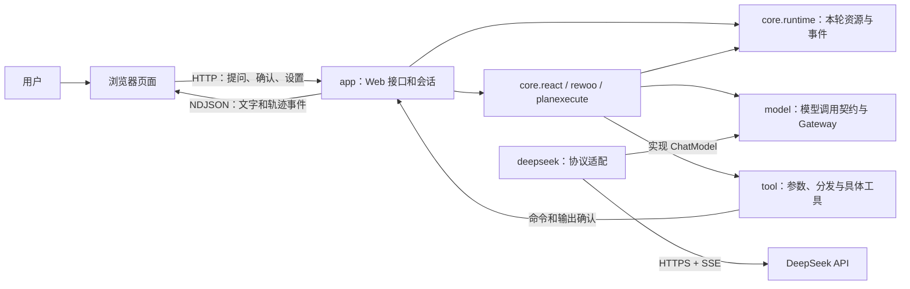

# 1. 项目全貌

[返回目录](README.md) · 下一篇：[一次对话如何运行](02-agent-loop.md)

## 项目解决什么问题

这是一个用 Java 17 和 Spring Boot 编写的本地 Agent 练习。浏览器接收用户消息，后端把消息和可用工具交给 DeepSeek；模型需要工具时，后端执行工具并把结果交还模型，直到生成回答。

页面提供对话和轨迹两个视图。对话视图显示回答、工具提示和 Bash 确认；轨迹视图显示模型请求、工具调用、耗时以及模型实际返回的思考内容。服务只监听本机。

## 一张图看组件

图中的箭头表示调用或数据方向。模型返回工具名称和参数；真正执行工具的是本项目中的 Java 代码。

## 从目录找到代码

以下链接相对于 `learning-artifacts/agent-loop`。

| 位置 | 主要职责 | 首先看哪里 |
| --- | --- | --- |
| [app/chat](../src/main/java/dev/learning/agent/app/chat/) | HTTP、会话模式、RunLease 和浏览器确认。 | [AgentSessions](../src/main/java/dev/learning/agent/app/chat/AgentSessions.java) |
| [app/settings](../src/main/java/dev/learning/agent/app/settings/) | 设置保存与重启生效。 | [SettingsStore](../src/main/java/dev/learning/agent/app/settings/SettingsStore.java) |
| [core](../src/main/java/dev/learning/agent/core/) | 三种执行策略的公共入口和结果。 | [AgentRunner](../src/main/java/dev/learning/agent/core/AgentRunner.java) |
| [core/runtime](../src/main/java/dev/learning/agent/core/runtime/) | 本轮预算、取消、证据、确认接口和事件。 | [RunContext](../src/main/java/dev/learning/agent/core/runtime/RunContext.java) |
| [core/react](../src/main/java/dev/learning/agent/core/react/) | 对话历史和通用反馈循环。 | [ReActRunner](../src/main/java/dev/learning/agent/core/react/ReActRunner.java) |
| [core/rewoo](../src/main/java/dev/learning/agent/core/rewoo/) | 静态工具计划与串行依赖执行。 | [RewooRunner](../src/main/java/dev/learning/agent/core/rewoo/RewooRunner.java) |
| [core/planexecute](../src/main/java/dev/learning/agent/core/planexecute/) | 高层计划、局部 ReAct 和重规划。 | [PlanExecuteRunner](../src/main/java/dev/learning/agent/core/planexecute/PlanExecuteRunner.java) |
| [core/planning](../src/main/java/dev/learning/agent/core/planning/) | 任务快照、记忆、结构化请求、引用检查。 | [ModelJson](../src/main/java/dev/learning/agent/core/planning/ModelJson.java) |
| [model](../src/main/java/dev/learning/agent/model/) | 共用模型契约与带预算、轨迹的调用 Gateway。 | [ChatModel](../src/main/java/dev/learning/agent/model/ChatModel.java) |
| [deepseek](../src/main/java/dev/learning/agent/deepseek/) | HTTP 报文与 SSE 适配，协议 DTO 留在其 model 子包。 | [ChatCompletionsClient](../src/main/java/dev/learning/agent/deepseek/ChatCompletionsClient.java) |
| [tool](../src/main/java/dev/learning/agent/tool/) | 工具类型、参数解码、分发、执行和结果记录。 | [DefaultToolExecutionService](../src/main/java/dev/learning/agent/tool/DefaultToolExecutionService.java) |
| [support/json](../src/main/java/dev/learning/agent/support/json/) | 通用严格 JSON 操作。 | [StrictJson](../src/main/java/dev/learning/agent/support/json/StrictJson.java) |
| [static](../src/main/resources/static/) | 页面、交互、模式状态与轨迹。 | [app.js](../src/main/resources/static/app.js) |

测试目录跟随生产包：ReAct 测试位于 `core/react`，ReWOO 位于 `core/rewoo`，P&E 位于 `core/planexecute`，预算和取消位于 `core/runtime`。另有 [PackageStructureTest](../src/test/java/dev/learning/agent/architecture/PackageStructureTest.java) 防止算法交叉依赖、共享模型引用协议实现、通用 JSON 引用业务类型。

## 为什么这样分

执行策略通过共用 model、tool、runtime 能力协作。P&E 依赖 `core.react.ReActEngine` 来执行单个目标，但不依赖 ReWOO；两个规划模式读取 JSON 数组都调用 `StrictJson.strings`。`StrictJson` 只校验通用 JSON，工具名、参数类型和长度限制由 `tool.ToolInputDecoder` 负责。

`model` 提供三个协议共用的内部契约，`deepseek.model` 保存外部报文类型。ProviderUsage 到 TokenUsage 的映射在协议包中完成，共享用量类型不反向导入 ProviderUsage。现有 ChatMessage、ToolSpec 仍保留 Jackson 注解和兼容字段，ModelSettings 仍限制当前 Demo 的 DeepSeek 模型；分包没有把这些类型改造成全新的多厂商抽象。

`RunContext` 汇集本轮使用的服务，model/tool 的执行方法也接收它来消费预算、保存证据和发送事件，因此 runtime 与这些服务包会互相引用。这是同一个 Java 模块里的职责划分；没有把它们定义成只能单向依赖的独立模块。

`RunLease` 留在 `app.chat`，因为它直接协调 HTTP 异步执行、EventSink 与 BrowserApproval。核心仍通过 ApprovalGateway 获取确认结果，无需了解浏览器交互。

## 进程中保存了什么

启动时，[SettingsStore](../src/main/java/dev/learning/agent/app/settings/SettingsStore.java) 读取协议设置，[AgentSessions](../src/main/java/dev/learning/agent/app/chat/AgentSessions.java) 根据这个设置创建协议客户端。每次页面请求 `/api/session`，服务端创建一个新会话；首条请求接受时为会话创建一个固定模式的 Runner，持有独立历史。每个已接受请求拥有自己的 RunLease、事件通道、确认和 RunContext，Session 在它清理完成前拒绝其他请求。

消息历史在服务端内存中。页面刷新会请求新会话，重启进程后会话消失；目前没有会话持久化；ReAct 历史不自动裁剪，ReWOO/P&E 仅保留有限的已完成问答。模型和推理等级每次发送消息时由页面提交，API 协议在进程启动时确定。

下一步沿着实际调用顺序看：[一次对话如何运行](02-agent-loop.md)。
