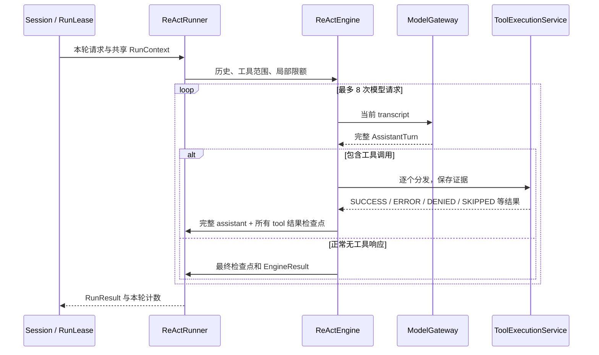

# 一次 ReAct 对话如何执行

[返回学习指南](README.md) · [三模式方案](design/agent-execution-technical-design.md)

ReAct 的关键是：模型根据当前历史选择工具，程序执行工具，再把观察交还模型。同一次用户请求可以经历多轮反馈。现在代码把“保存对话历史”和“执行一段反馈循环”分开，便于 P&E 的每个步骤复用循环。

## 浏览器到 Session

页面先通过 `GET /api/session` 创建对话。新对话模式为空，在对话框上方选择模式；首条 `POST /api/chat` 通过输入校验后，`Session.accept` 原子绑定模式和 Runner，创建 RunLease。当前 Session 已有运行时返回 409；已有模式与请求不同也返回 409。输入错误不会绑定模式。

RunLease 持有本轮 requestId、请求快照、RunContext、事件通道和工具确认。异步流真正开始后进入 RUNNING，发出 run_started，再调用 Runner。结束时清理资源并释放所属 Session。若连接在异步任务启动前就结束，ACCEPTED 状态也能直接取消，不依赖尚未进入的执行方法的 finally。

## Runner 保存历史，Engine 执行循环

从 [ReActRunner.run](../src/main/java/dev/learning/agent/core/react/ReActRunner.java) 开始阅读：它复制会话历史，追加本轮用户问题，把这些消息和局部限额交给 [DefaultReActEngine.execute](../src/main/java/dev/learning/agent/core/react/DefaultReActEngine.java)。Engine 本身不保存会话历史。



模型调用经过 ModelGateway，统一计数、取消、结束原因校验和轨迹。工具经过 ToolExecutionService，先消费尝试额度，再校验和分发，记录实际是否执行与可分享证据。模型每次返回的工具定义受 allowedTools 限制，服务端分发时再次核对。

## 完整检查点为什么重要

模型声明三个原生工具调用后，必须收到三个对应结果。即使只允许执行两个，也为第三个补 SKIPPED；原调用 ID 用于协议配对，宿主证据另有 E1、E2 等 ID。assistant 与全部结果作为一个批次保存，不能只保存半段往返。

```json
{"evidenceId":"E1","status":"SUCCESS","content":"138","executed":true,"hasValue":true,"truncated":false}
```

这是原生 tool 消息里的字符串内容。`executed` 与 `status` 是不同问题：Bash 已执行但输出未获分享时，状态为 DENIED、executed 为 true，内容只保留拒绝说明；成功缓存复用则 executed 为 false。

ReAct 保留完整历史，三个协议客户端负责转换，思考内容与 Anthropic blocks 也保留在完整 AssistantTurn 中。P&E 的局部步骤历史不进入会话历史；ReWOO/P&E 的跨轮记忆只保留有限的已完成问答对。

## 和其他两种模式的关系

ReWOO 不走 ReActEngine。Planner 产出静态工具计划，校验依赖后直接逐个执行，最后交给 Solver。中间工具失败不会触发模型重规划。

P&E 每个高层目标通过 StepExecutor 调用同一个 ReActEngine，但每次传入新 transcript、目标和工具范围，最多 3 次模型调用、2 次工具尝试，且不向页面发布内部步骤回答。各步骤共享外层 RunContext 的总预算和证据。外层 Replanner 决定继续、修订或结束，Finalizer 才生成用户回答。

可运行 `mvn -Dtest=ReActRunnerTest,EngineBoundaryTest,RewooRunnerTest,PlanExecuteRunnerTest test`，用可控模型返回逐步观察执行差异；真实三协议结果见[实施验证](design/agent-execution-research.md#实施后验证2026-11-01)。
