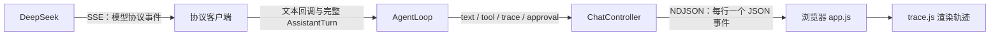

# 3. 协议、流式输出和轨迹

[返回目录](README.md) · 上一篇：[一次对话如何运行](02-agent-loop.md) · 下一篇：[动手运行和调试](04-run-and-debug.md)

## 为什么有三个客户端

[ChatModel](../src/main/java/dev/learning/agent/core/ChatModel.java) 是 Agent 循环使用的接口：传入历史消息、工具定义、文本回调和模型设置，返回一次完整的 `AssistantTurn`。三个客户端都实现这个接口：

| 页面中的选项 | 客户端 | DeepSeek 路径 | 适配重点 |
| --- | --- | --- | --- |
| Chat Completions | [ChatCompletionsClient](../src/main/java/dev/learning/agent/deepseek/ChatCompletionsClient.java) | `/chat/completions` | `messages`、工具调用片段和 `reasoning_content`。 |
| Responses | [ResponsesClient](../src/main/java/dev/learning/agent/deepseek/ResponsesClient.java) | `/responses` | `input` 中的消息、`function_call`、`function_call_output` 和语义化流事件。 |
| Anthropic Messages | [AnthropicClient](../src/main/java/dev/learning/agent/deepseek/AnthropicClient.java) | `/anthropic/v1/messages` | 有顺序的内容块，`tool_use`、`tool_result` 和 thinking 内容。 |

[AgentLoop](../src/main/java/dev/learning/agent/core/AgentLoop.java) 处理统一后的回答、工具调用和结束原因；具体请求和响应的差别由客户端处理。DeepSeek 的 Responses 接口是无状态的，每次请求都需要携带完整历史。

## 模型和推理等级怎么传

输入框选择的模型和等级由 [ModelSettings](../src/main/java/dev/learning/agent/deepseek/model/ModelSettings.java) 校验。等级统一为 `off`、`low`、`high`、`max`，每次发送消息时生效。三个协议对应的请求字段不同：

| 等级 | Chat Completions | Responses | Anthropic Messages |
| --- | --- | --- | --- |
| Off | `thinking.type=disabled` | `reasoning.effort=none` | `thinking.type=disabled` |
| Low / High / Max | 开启 thinking，设置 `reasoning_effort` | 设置 `reasoning.effort` | 开启 thinking，设置 `output_config.effort` |

API 协议由设置页面选择。[SettingsStore](../src/main/java/dev/learning/agent/app/settings/SettingsStore.java) 保存到 `config/settings.json`；运行中的客户端继续使用启动时的协议，重启后才读取新设置。文件未创建时默认是 Chat Completions。key 从环境变量读取。

## 两段不同的流

从模型到浏览器的路上，有两段独立的流：

1. **DeepSeek 到 Java：SSE。** Chat Completions 的 [StreamAssembler](../src/main/java/dev/learning/agent/deepseek/StreamAssembler.java) 合并文本、思考内容和按索引分片的工具调用。Responses 和 Anthropic 使用 [StreamingHttp](../src/main/java/dev/learning/agent/deepseek/StreamingHttp.java) 读取 SSE 帧，再由各客户端解析具体事件。
2. **Java 到浏览器：NDJSON。** [ChatController](../src/main/java/dev/learning/agent/app/chat/ChatController.java) 每次写入一个 JSON 对象并加换行。浏览器的 `readEvents` 按行解析。

浏览器可能在模型请求完成前就看到文本；工具参数需要组装完整后才能执行。如果流中断，页面可能已经显示部分文字，并提示本轮失败。

## 工具调用和思考内容怎样回传

`AgentLoop` 将模型的工具调用与对应的结果保存到历史。各客户端发送下一次请求时再做转换：

- Chat Completions 使用 assistant 的 `tool_calls` 和 tool 消息的 `tool_call_id` 关联结果。
- Responses 将调用和结果转换为 `function_call`、`function_call_output`，通过 `call_id` 关联。
- Anthropic 将调用放在 assistant 的 `tool_use` 内容块中，把连续工具结果放进下一条 user 消息的 `tool_result` 块中，并保留 assistant 返回的有序内容块，包括 thinking 和签名。

思考内容只有在模型实际返回时才会显示在轨迹中。`Off` 表示请求关闭 thinking，并不是一条独立的开关设置。

## 轨迹从哪里来

[TraceEvent](../src/main/java/dev/learning/agent/core/TraceEvent.java) 描述用户输入、模型设置、模型请求、思考、工具和助手消息等事件。`AgentLoop` 在模型请求和工具执行开始、结束或失败时发出事件；开始和结束事件使用相同 ID，页面据此更新对应项的状态和耗时。

[trace.js](../src/main/resources/static/trace.js) 保存当前页面的事件，绘制时间线和可展开的列表。它展示应用实际收到和记录的内容；是否出现工具调用或思考内容，取决于本次模型响应。

协议格式与功能边界可进一步参考 [DeepSeek Responses 文档](https://api-docs.deepseek.com/guides/responses_api/)、[Anthropic 格式文档](https://api-docs.deepseek.com/guides/anthropic_api/) 和 [思考模式文档](https://api-docs.deepseek.com/guides/thinking_mode/)。
