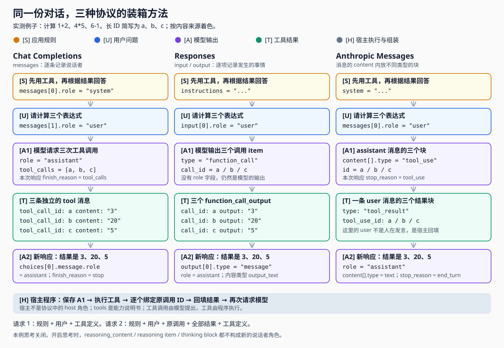
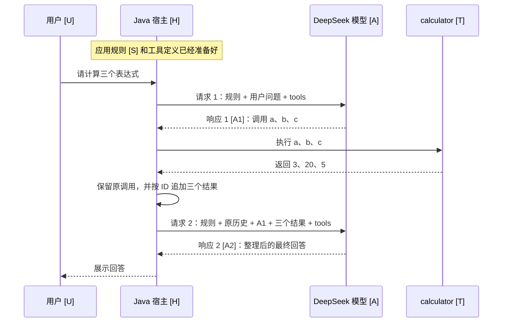

# 6. 用同一段对话理解三种协议

[返回目录](README.md) · 上一篇：[工具调用上限、终止条件和对话记录](05-tool-calls-and-transcripts.md)

三种协议都能表达“用户提出问题，模型请求工具，程序执行工具，模型根据结果回答”。它们的区别首先在于：规则、消息、工具调用和工具结果分别装在哪些字段里。

本文以 2026-11-01 的 DeepSeek 真实 API 实验为基础。例子是同时计算 `1+2`、`4*5`、`6-1`；三个接口均真实返回了三个工具调用，收到全部结果后正常回答。为方便对照，下面将提示词和回复翻译、精简成长相一致的中文，将各自的长调用 ID 简写为 `a`、`b`、`c`，省略 usage 等元数据。它们是根据实测整理的教学视图，不是未经修改的原始报文。

完整原始报文仍在本地 `target/deepseek-tool-limit-live/20261031T171123075834Z/`；复现方式见[上一节的真实 API 实测](05-tool-calls-and-transcripts.md#deepseek-真实-api-实测)。本节复用已有记录，不再次调用模型。



## 先认识内容从哪里来

可以把这次对话理解为一间带计算器的教室：应用制定规则，学生提问，老师决定何时使用计算器，助教实际操作并递回结果。老师拿到结果后，才给学生解释。

| 标记 | 内容来源 | 例子 | 对应概念 |
| --- | --- | --- | --- |
| [S] 金色 | 应用编写者提供规则 | “必须先用计算器，再依据结果回答。” | system / instructions |
| [U] 蓝色 | 用户提出问题 | “请计算 1+2、4*5、6-1。” | user |
| [A1] 紫色 | 模型提出动作 | “请调用三次 calculator。” | assistant 生成的工具调用 |
| [H] 灰色 | 宿主程序执行和组装 | 按工具名找 Java 实现，执行并保存结果 | 应用程序，不是新的 API role |
| [T] 绿色 | 工具产生结果 | `a → 3`、`b → 20`、`c → 5` | tool result / function output |
| [A2] 紫色 | 模型整理最终回答 | “三个结果分别是 3、20、5。” | assistant 生成的文本 |

颜色表示内容来源，不保证等于 JSON 的 `role`。最典型的例子是 Anthropic：绿色的工具结果装在 `role: "user"` 的消息里，但它不是用户亲手输入的。

`tools` 则相当于计算器的说明书：名称、用途、参数格式。它不会自己执行计算，也不是一个新的说话者。模型输出一个工具调用后，宿主才查找并执行相应实现。

## 角色和内容类型分别回答什么问题

`role` 说明一条消息处于什么对话位置；`type` 说明某个对象或内容块表示什么。两者不是同一维度。在本例里，完整对应关系如下：

| 内容或角色 | Chat Completions | Responses | Anthropic Messages（本项目基础格式） |
| --- | --- | --- | --- |
| [S] 初始规则 | `messages[]` 中 `role: system` | 顶层 `instructions`，也可用兼容的 system message item | 顶层 `system` |
| developer 指令 | OpenAI 相关模型有 developer 消息；本项目 DeepSeek 格式使用 system | OpenAI 支持 developer；DeepSeek 将该角色当作 user，规则用 instructions / system | 本项目基础格式没有独立 developer 角色 |
| [U] 用户消息 | `role: user` | message item 的 `role: user` | `role: user`，内容为字符串或 text 块 |
| [A] 助手文本 | `role: assistant` 的 `content` | `type: message`、`role: assistant`，内含 `output_text` | `role: assistant`，内含 text 块 |
| [A1] 工具调用 | assistant 消息的 `tool_calls[]` | 独立的 `type: function_call` item | assistant 消息中的 `type: tool_use` 块 |
| [T] 工具结果 | `role: tool` 消息 | 独立的 `type: function_call_output` item | user 消息中的 `type: tool_result` 块 |
| 工具定义 | `tools[].function` | `tools[]`，函数字段直接展开 | `tools[]`，参数定义放在 `input_schema` |
| 模型思考 | DeepSeek 的 `reasoning_content` 字段 | reasoning item | assistant 消息中的 thinking 块 |
| [H] 宿主程序 | 没有 `role: host` | 没有 `role: host` | 没有 `role: host` |

Responses 中只有 message 这一类 item 使用消息角色；function call 和结果通过 `type` 区分。因此，不能要求每个 item 都带 `role`。[OpenAI 的 Messages → Items 对照](https://developers.openai.com/api/docs/guides/migrate-to-responses#2-map-messages-to-items)

### developer 角色放哪里

`developer` 表达应用开发者的指令。OpenAI 原生接口的相关模型可以使用 developer 消息，其指令优先于普通 user 消息；不能只按“谁写了这段文字”判断角色。[OpenAI 消息角色与指令](https://developers.openai.com/api/docs/guides/text#message-roles-and-instruction-following) 下面是 OpenAI Responses 中的角色结构示意：

```json
{
  "instructions": "你是负责回答问题的助手。",
  "input": [
    {"role":"developer","content":"回答使用中文，计算结果必须来自工具。"},
    {"role":"user","content":"请计算 1+2。"}
  ]
}
```

这个片段用于说明 OpenAI 的 developer 位置，不是本次 DeepSeek 实测请求。DeepSeek Responses 虽接受 `role: developer`，当前文档明确将其当作 user 处理；需要作为规则的内容应放在 `instructions` 或该接口支持的 system 消息位置。DeepSeek Chat Completions 的文档消息类型为 system、user、assistant、tool；不要直接套用 OpenAI 的 developer 语义。[DeepSeek Responses 兼容表](https://api-docs.deepseek.com/guides/responses_api/)、[DeepSeek Chat Completions 消息定义](https://api-docs.deepseek.com/api/create-chat-completion/)

本项目 Anthropic 客户端使用顶层 `system` 和 user / assistant 消息，没有单独的 developer 角色。Anthropic 原生服务的部分新模型还支持满足位置规则的会话中途 system 消息；不能据此推断所有兼容服务都支持，或把初始规则直接塞到消息数组第一项。[Anthropic system 消息说明](https://platform.claude.com/docs/en/build-with-claude/working-with-messages#system-role-in-messages)

## 同一次用户提问，实际经过几次请求

本次工具全部由客户端执行，因此完整回答需要两次模型 HTTP 请求：



用户没有再发一次问题；发起第二次模型请求的是宿主。宿主保存上一条 assistant 调用消息并回放，也不代表它冒充模型重新生成调用，而是在重放模型实际返回的历史。

下面三份 JSON 都展示**请求 2 的完整请求体教学视图**：所有工具结果已经产生，最终回答尚未产生。请求 1 则只保留初始规则、用户问题和工具定义，不携带下面的历史调用与结果。本次实测请求 1 使用强制工具选择配置，后续请求改为 auto；完整配置见原始记录。

## Chat Completions：用消息角色逐条记账

DeepSeek 路径是 `POST https://api.deepseek.com/chat/completions`。按顺序看 `messages`：规则、用户、助手调用、工具结果、工具结果、工具结果。

```json
{
  "model": "deepseek-flash",
  "stream": false,
  "thinking": {"type":"disabled"},
  "max_tokens": 512,
  "tool_choice": "auto",
  "tools": [
    {"type":"function","function":{
      "name":"calculator",
      "description":"每次计算一个表达式。",
      "parameters":{
        "type":"object",
        "properties":{"expression":{"type":"string","enum":["1+2","4*5","6-1"]}},
        "required":["expression"],
        "additionalProperties":false
      }
    }}
  ],
  "messages": [
    {"role":"system","content":"先调用计算器，再根据工具结果回答。"},
    {"role":"user","content":"请计算 1+2、4*5、6-1。"},
    {"role":"assistant","content":"","tool_calls":[
      {"id":"a","type":"function","function":{"name":"calculator","arguments":"{\"expression\":\"1+2\"}"}},
      {"id":"b","type":"function","function":{"name":"calculator","arguments":"{\"expression\":\"4*5\"}"}},
      {"id":"c","type":"function","function":{"name":"calculator","arguments":"{\"expression\":\"6-1\"}"}}
    ]},
    {"role":"tool","tool_call_id":"a","content":"3"},
    {"role":"tool","tool_call_id":"b","content":"20"},
    {"role":"tool","tool_call_id":"c","content":"5"}
  ]
}
```

对应到图：`messages[0]` 是 [S]，`messages[1]` 是 [U]，`messages[2]` 是 [A1]，最后三条是 [T]。这里 `calculator` 是工具名称，`a` 是某一次调用的身份；同名工具可以有多个调用。

响应 1 中，上面的 [A1] 位于 `choices[0].message`，结束原因为 `tool_calls`。请求 2 发出后，响应 2 的关键字段是：

```json
{
  "choices": [{
    "message":{"role":"assistant","content":"三个结果分别是 3、20、5。"},
    "finish_reason":"stop"
  }]
}
```

这条新 assistant 消息是 [A2]；它不在已经发出的请求 2 里。宿主收到后才将它保存到历史，供下一次用户输入使用。[DeepSeek Chat Completions 请求与响应](https://api-docs.deepseek.com/api/create-chat-completion/)

## Responses：把消息、调用、结果拆成不同 item

DeepSeek 路径是 `POST https://api.deepseek.com/responses`。把 `input` 想成一份按顺序排列的事项清单：里面既有用户消息，也有模型生成的调用和宿主回填的结果。

```json
{
  "model": "deepseek-flash",
  "stream": false,
  "reasoning": {"effort":"none"},
  "max_output_tokens": 512,
  "instructions": "先调用计算器，再根据工具结果回答。",
  "tool_choice": "auto",
  "tools": [
    {"type":"function",
      "name":"calculator",
      "description":"每次计算一个表达式。",
      "parameters":{
        "type":"object",
        "properties":{"expression":{"type":"string","enum":["1+2","4*5","6-1"]}},
        "required":["expression"],
        "additionalProperties":false
      }
    }
  ],
  "input": [
    {"role":"user","content":"请计算 1+2、4*5、6-1。"},
    {"type":"function_call","id":"fc_a","call_id":"a","name":"calculator","arguments":"{\"expression\":\"1+2\"}"},
    {"type":"function_call","id":"fc_b","call_id":"b","name":"calculator","arguments":"{\"expression\":\"4*5\"}"},
    {"type":"function_call","id":"fc_c","call_id":"c","name":"calculator","arguments":"{\"expression\":\"6-1\"}"},
    {"type":"function_call_output","call_id":"a","output":"3"},
    {"type":"function_call_output","call_id":"b","output":"20"},
    {"type":"function_call_output","call_id":"c","output":"5"}
  ]
}
```

[S] 现在位于顶层 `instructions`，[U] 是 `input[0]`。三个 function_call item 是 [A1]：它们来自响应 1 的 `output`，没有 `role: assistant` 字段，仍然是模型产生的调用。三个 function_call_output item 是 [T]。

`id: fc_a` 标识这个 item，`call_id: a` 用于关联工具结果，两者用途不同。不要把 item 的 `id` 填到结果的 `call_id` 中。模型响应的顶层 response ID 又是第三种身份，也不是工具调用 ID。

请求 2 发出后，响应 2 的关键字段是：

```json
{
  "status":"completed",
  "output":[{
    "type":"message",
    "role":"assistant",
    "content":[{"type":"output_text","text":"三个结果分别是 3、20、5。"}]
  }]
}
```

现在 [A2] 才是一个带 `role: assistant` 的 message item。`status: completed` 只说明这次响应正常完成：响应 1 返回三个 function_call 时也是 completed，所以还必须检查 `output` 中有没有待执行的调用。

本次实测把规则放在 `instructions`。项目中的 `ResponsesClient.request` 则把内部 system 消息转换为 `input` 中的 system message item，这是兼容接口支持的另一种位置。项目用完整历史回放；DeepSeek 不支持 `previous_response_id`。OpenAI 原生服务支持的状态管理能力不能直接套到 DeepSeek。[DeepSeek Responses 兼容性](https://api-docs.deepseek.com/guides/responses_api/)

## Anthropic Messages：一条消息里可以装多种内容块

DeepSeek 路径是 `POST https://api.deepseek.com/anthropic/v1/messages`。初始规则放在顶层 `system`；本例的消息数组使用 user 和 assistant。重点看第二条和第三条消息内部的 `content`。

```json
{
  "model": "deepseek-flash",
  "stream": false,
  "thinking": {"type":"disabled"},
  "max_tokens": 512,
  "system": "先调用计算器，再根据工具结果回答。",
  "tool_choice": {"type":"auto"},
  "tools": [
    {
      "name":"calculator",
      "description":"每次计算一个表达式。",
      "input_schema":{
        "type":"object",
        "properties":{"expression":{"type":"string","enum":["1+2","4*5","6-1"]}},
        "required":["expression"],
        "additionalProperties":false
      }
    }
  ],
  "messages": [
    {"role":"user","content":[{"type":"text","text":"请计算 1+2、4*5、6-1。"}]},
    {"role":"assistant","content":[
      {"type":"tool_use","id":"a","name":"calculator","input":{"expression":"1+2"}},
      {"type":"tool_use","id":"b","name":"calculator","input":{"expression":"4*5"}},
      {"type":"tool_use","id":"c","name":"calculator","input":{"expression":"6-1"}}
    ]},
    {"role":"user","content":[
      {"type":"tool_result","tool_use_id":"a","content":"3"},
      {"type":"tool_result","tool_use_id":"b","content":"20"},
      {"type":"tool_result","tool_use_id":"c","content":"5"}
    ]}
  ]
}
```

[S] 位于顶层；`messages[0]` 是 [U]，`messages[1]` 是 [A1]，`messages[2]` 的内容是 [T]。后者虽然也是 user 消息，里面却全是工具结果。看 `role` 还不够，需要继续看 `content[].type`。

本例有三个工具结果，但只用一条 user 消息承载。每个 tool_result 块通过 `tool_use_id` 指向前面相应的 tool_use。这里工具参数 `input` 是 JSON 对象；前两种格式的 `arguments` 则是包含 JSON 的字符串。

响应 1 本身是一条 assistant 消息，content 包含三个 tool_use，`stop_reason` 为 `tool_use`。请求 2 发出后，响应 2 的关键字段是：

```json
{
  "role":"assistant",
  "content":[{"type":"text","text":"三个结果分别是 3、20、5。"}],
  "stop_reason":"end_turn"
}
```

这就是 [A2]。工具结果必须跟在原 assistant 工具调用消息后，且每个调用都要有结果；宿主不能把工具输出改写成普通用户 text 来代替。[DeepSeek Messages 请求与响应](https://api-docs.deepseek.com/api/create-message/)

## 开启思考后，多出来的是内容，不是说话者

刚才的真实 API 实验关闭了思考，所以报文里没有思考文本。下面只说明结构，不声称这些占位内容来自本次实测，也不将任何厂商的可见思考字段等同于完整内部推理。

| 协议 | 思考放哪里 | 工具往返时如何保存 |
| --- | --- | --- |
| DeepSeek Chat Completions | assistant 消息的 `reasoning_content` | 按 DeepSeek 工具思考模式要求，完整回传实际收到的字段 |
| DeepSeek Responses | 独立 `type: reasoning` item，内容使用 `reasoning_text` | 与相关调用 item 一起回放 |
| Anthropic Messages | assistant 消息内的 `type: thinking` 块 | 完整保留原 content 块、原顺序及服务端给出的 signature |

Chat Completions 的字段结构示意：

```json
{"role":"assistant","reasoning_content":"<实际返回的思考内容>","content":"<面向用户的文本>"}
```

DeepSeek Responses 的 item 结构示意：

```json
{"type":"reasoning","content":[{"type":"reasoning_text","text":"<实际返回的思考内容>"}]}
```

Anthropic 的内容块结构示意：

```json
{"role":"assistant","content":[
  {"type":"thinking","thinking":"<实际返回的内容>","signature":"<原样保留服务端值>"},
  {"type":"text","text":"<面向用户的文本>"}
]}
```

这些片段中的尖括号文本是说明用占位符，不应作为伪造的历史发给服务端。尤其不要自行编造签名。DeepSeek Chat 的带 tools 思考模式、DeepSeek Responses 的纯文本 reasoning，与 OpenAI 原生 Responses 的 reasoning items / summaries / encrypted_content 并不完全相同。[DeepSeek 思考模式](https://api-docs.deepseek.com/guides/thinking_mode/)、[DeepSeek Responses 兼容表](https://api-docs.deepseek.com/guides/responses_api/)、[Anthropic 思考与工具往返](https://platform.claude.com/docs/en/build-with-claude/thinking#thinking-with-tool-use)

## 消息、API 请求和用户轮次不要混在一起

| 计数对象 | 本次例子 |
| --- | --- |
| 用户提问次数 | 1 次 |
| 模型 HTTP 请求次数 | 2 次 |
| 工具调用次数 | 3 次 |
| Chat 请求 2 中的消息数 | 6 条：S、U、A1、T、T、T |
| Responses 请求 2 中的 input items | 7 项：U、调用、调用、调用、结果、结果、结果；规则在 instructions |
| Anthropic 请求 2 中的消息数 | 3 条：U、A1、承载工具结果的 user；规则在 system |

上面的六条、七项、三条并不表示模型处理了不同任务，只是相同内容被组织进了不同结构。原始 Responses 报文还带有 status 等元数据，这里未计入额外 item。

如果用户接着问“第二个为什么是 20？”，宿主先保留 [A2]，再追加新的 user 消息。三种接口里新的问题都具有 user 身份，但 Anthropic 历史中那条承载 tool_result 的 user 消息仍是工具结果，不能当作另一轮人类提问来计数。

## 与本项目代码怎样对应

宿主内部统一保存 `ChatMessage`，不要求 ReActRunner 自己维护三种外部 JSON：

| 内部记录 | Chat Completions 适配 | Responses 适配 | Anthropic 适配 |
| --- | --- | --- | --- |
| `ChatMessage.system(...)` | system 消息 | 当前实现是 input 的 system message item | 顶层 system |
| `ChatMessage.user(...)` | user 消息 | user message item | user / text |
| `ChatMessage.assistant(turn)` 中的文本 | assistant.content | assistant / output_text | assistant / text |
| assistant 中的 `toolCalls` | assistant.tool_calls | 多个 function_call items | 多个 tool_use 块 |
| `ChatMessage.tool(id, result)` | tool 消息 | function_call_output item | 连续结果合并到一条 user 消息的 tool_result 块 |
| assistant 中的 `reasoningContent` / `blocks` | reasoning_content | 当前 DeepSeek 的 reasoning_text | 保留 Anthropic 原始内容块及 signature |

代码入口分别是 [ChatCompletionsClient](../src/main/java/dev/learning/agent/deepseek/ChatCompletionsClient.java)、[ResponsesClient](../src/main/java/dev/learning/agent/deepseek/ResponsesClient.java)、[AnthropicClient](../src/main/java/dev/learning/agent/deepseek/AnthropicClient.java)。本项目内部没有单独的 developer、host 或 reasoning 角色。

注意兼容服务仍有能力差异：DeepSeek Anthropic 的 `is_error` 当前被忽略，错误详情要写进 content；DeepSeek Responses 的 developer 被当作 user。原生 Anthropic / OpenAI 的字段语义不能仅因为路径或对象长得相似，就直接认为在 DeepSeek 上完全相同。[DeepSeek Anthropic 兼容表](https://api-docs.deepseek.com/guides/anthropic_api/)

读一份新报文时，依次确认：它是请求还是响应；规则在哪里；哪些对象是消息、哪些是调用或结果；调用 ID 怎样配对；是否还有待处理的工具调用。这样就能沿着同一次用户提问，追踪整个工具往返。
