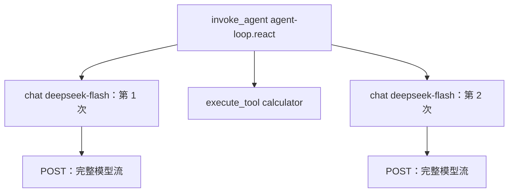
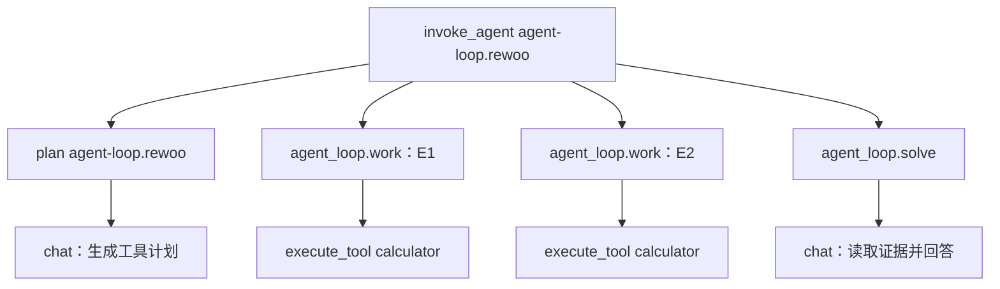
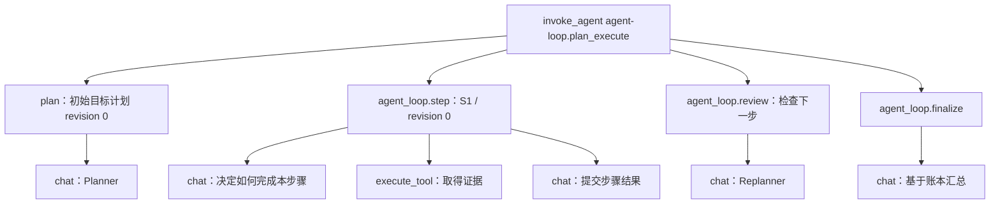
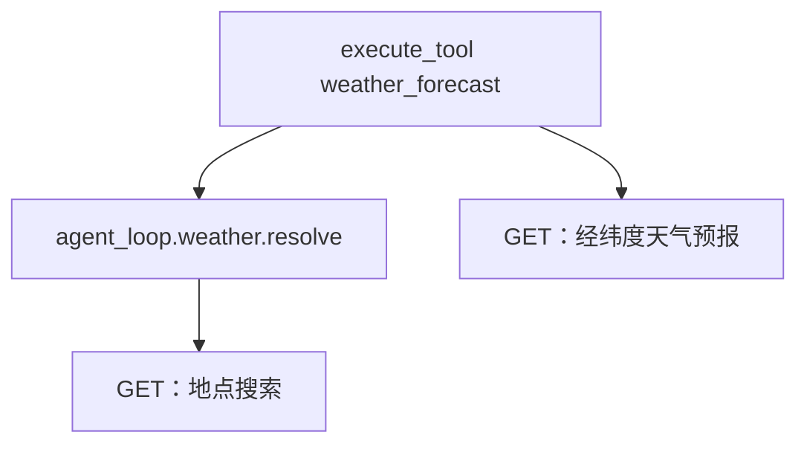
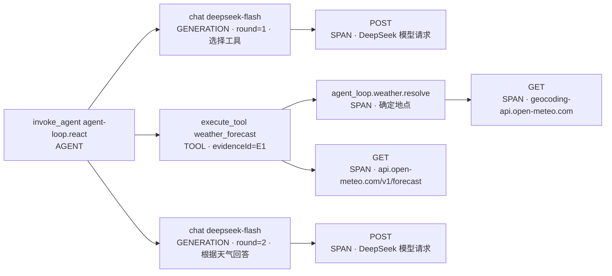
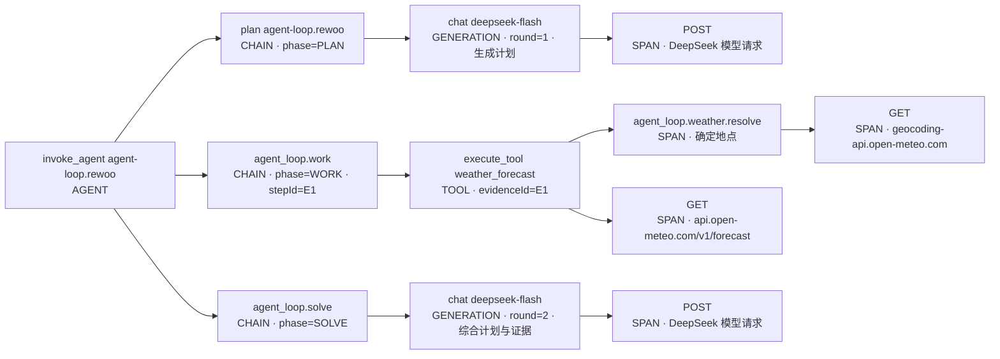
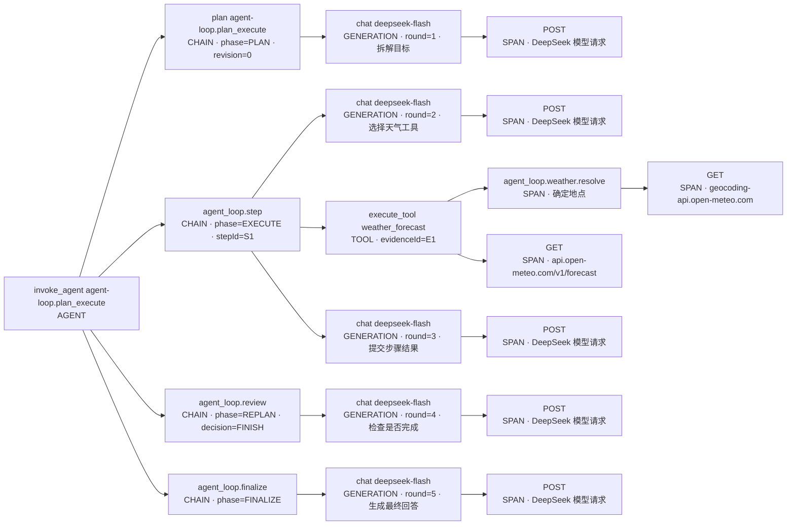
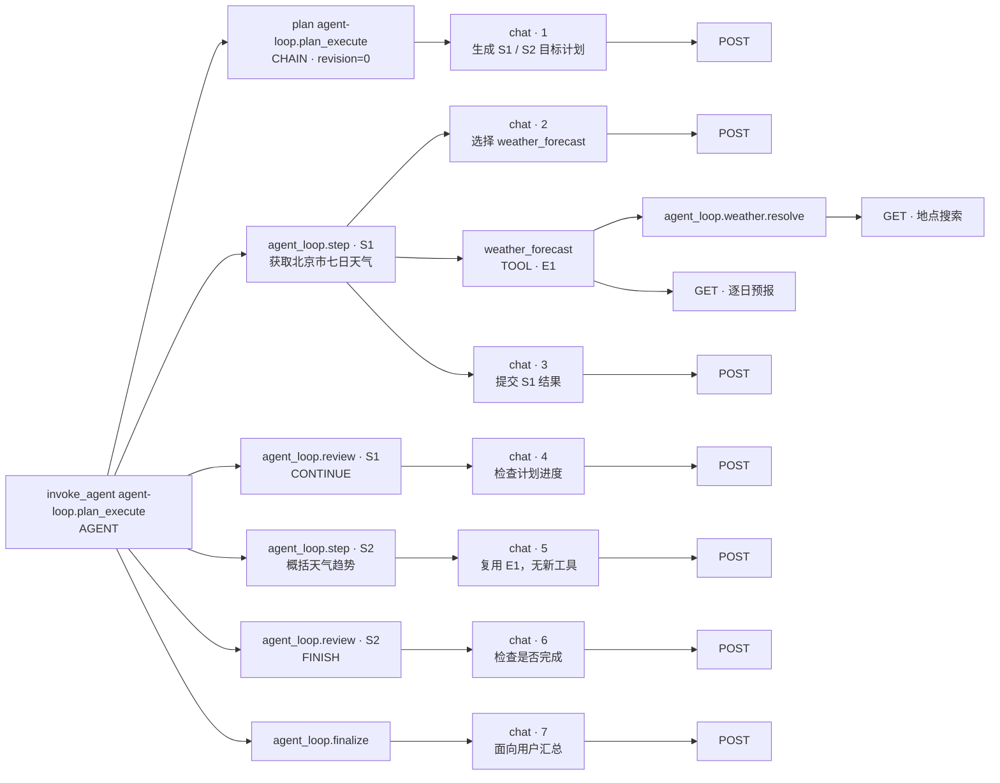

# 通过 Trace 理解 Agent 项目

> 先看一轮的执行树，再看模型和工具如何改变下一步。

**状态：已接入并通过真实回读。** 第 3–9 节用示意树解释代码，第 10 节提供本机 Langfuse 中可打开的真实 Trace，二者的模型调用数可能不同。字段、改造清单与验收见[接入技术方案](design/observability-trace-implementation-plan.md)。

想先看完整展开效果，可直接阅读[三模式 Span 树对照](#9-接入后的完整-span-树)；想沿着已发生的请求复盘，从[真实 Trace](#10-用真实-trace-复盘)开始。

## 1. 先把四个概念分开

| 概念 | 项目中的对象 | 怎样阅读 |
| --- | --- | --- |
| Session | 一个浏览器对话 | 把用户多次发送消息产生的 trace 串起来；不是一个无限长 span。 |
| Trace | 一条被接受的用户消息及其处理 | 从接受、执行到清理的一整轮。 |
| Span / Observation | 一个有起止时间的操作 | 一次模型请求、一个目标步骤或一次工具尝试。Langfuse 将 span 呈现为 observation。 |
| Event | 操作中某个瞬间的事实 | 计划被接受、证据保存、预算耗尽、请求取消。 |

用户问“北京未来七天天气”，Agent 可能问模型、调用工具，再问模型。它们属于同一条 trace。用户接着问“改查上海”，就产生另一条 trace，两条共享观测 Session ID。同一个 Session 的下一条消息也可以选择其他模式；新建对话的作用是开始新的上下文。

下面所有实线箭头表示**父子包含关系**，不是时间顺序。兄弟节点的先后顺序在时间线上看。

## 2. 从最外层看：RunLease 管的是哪一轮

从根 `invoke_agent agent-loop.<mode>` 先看 mode、requestId、run.status、completion_check 与最终计数。它对应一次 RunLease，而不是整个 Session。

[AgentSessions](../src/main/java/dev/learning/agent/app/chat/AgentSessions.java)检查会话当前能否接受消息；[RunLease](../src/main/java/dev/learning/agent/app/chat/RunLease.java)持有这次请求、取消信号和执行资源。页面断连可能发生在后台线程启动前，所以根 span 必须覆盖 ACCEPTED 状态；运行中收到取消时，根 span 等工作线程退出和资源释放后再结束。

因此，看到一个 cancelled、started=false、没有 generation 的 trace，不应解释为“模型没被正确埋点”。它可能代表请求被接受后，还没开始执行就取消了。相反，同一 Session 的并发请求如果被拒绝，就没有第二个已接受的 Agent run。

## 3. ReAct：工具结果为什么要再交给模型

示例问题：`用 calculator 计算 (120+18)/3，并说明结果。`



一种可能的时间顺序是：第 1 次模型输出调用参数；程序执行 calculator 得到 46；第 2 次模型读到工具结果，生成回答。

模型 span 与工具 span 是同级，因为生成调用参数的模型请求已经结束，随后是 Java 在执行工具。工具不是模型服务器内部执行的一段工作。它们的联系通过原生 tool call ID、轮次和证据 ID 表达，不把时间上的“随后发生”强行画成父子关系。

对应源码：

| 观察内容 | 从哪里理解 |
| --- | --- |
| 会话历史保存在哪 | [ReActRunner](../src/main/java/dev/learning/agent/core/react/ReActRunner.java) |
| 谁决定继续循环 | [DefaultReActEngine](../src/main/java/dev/learning/agent/core/react/DefaultReActEngine.java)：没有工具调用时结束，否则先配齐工具结果。 |
| 哪些是真模型调用 | [DefaultModelGateway](../src/main/java/dev/learning/agent/model/DefaultModelGateway.java)：每次实际请求单独计数。 |
| 工具错误如何进入下一轮 | [DefaultToolExecutionService](../src/main/java/dev/learning/agent/tool/DefaultToolExecutionService.java)：保存带状态的 Evidence，再转成协议结果。 |

实际模型也可能直接回答、拆成两个工具调用或遇到失败。不能拿图中的“两次模型调用”当作每轮 ReAct 的固定规则。

## 4. ReWOO：先生成计划，Worker 为什么没有模型



例如 Planner 生成 E1=`120+18`、E2=`#E1/3`。E1 得到 138 后，Java 的 EvidenceBinder 将引用替换为实际值，再执行 E2；这一过程不需要模型重新判断下一步。最后 Solver 读取计划和证据回答。

在 [RewooRunner](../src/main/java/dev/learning/agent/core/rewoo/RewooRunner.java) 的 trace 中，最值得核对的是 **PLAN 与 SOLVE 下有 generation，WORK 下没有**。这正是 ReWOO 与 ReAct 的结构差异，不能只通过“调用次数看起来更少”来判断。

如果 E1 失败导致 E2 无法绑定，E2 应显示 dependency skipped 事件，不应出现一条假的 calculator 执行。如果计划 JSON 不合法且仍有修复预算，PLAN 下会出现 `agent_loop.json.repair` 及额外 generation；这是格式修复，不是根据新证据重新制定计划。

## 5. Plan and Execute：一个步骤里为什么还有 ReAct



Planner 决定高层目标，StepExecutor 负责完成一个目标。目标可能还需要“问模型 → 执行工具 → 再问模型”，所以它复用与 ReActRunner 相同的 ReActEngine。区别是这个局部循环有更小的上限和独立的临时历史，最终必须提交可校验的步骤结果。

看 [StepExecutor](../src/main/java/dev/learning/agent/core/planexecute/StepExecutor.java) 内嵌的模型 / 工具跨度，就能理解“共用 Engine”：共用的是反馈循环实现，不是把整个会话交给另一个 ReActRunner。

[PlanExecuteRunner](../src/main/java/dev/learning/agent/core/planexecute/PlanExecuteRunner.java)在步骤结束后检查计划。看到 REVISE 才表示计划版本变化；一次 review 也可能只是 CONTINUE，不能把 review 数当成修订次数。新版本不会抹掉旧结果，[ExecutionLedger](../src/main/java/dev/learning/agent/core/planexecute/ExecutionLedger.java)保留尝试和证据，后续步骤继续引用它们。

如果工具要求用户澄清，当前实现会跳出执行，不再调用 Replanner 猜地点，而是进入最终澄清回答。trace 应保留这个分支。

## 6. 天气：一个工具为什么会有两个 HTTP 请求



模型只选择 `weather_forecast` 并给出 city / country_code / admin1 / days。天气服务先把城市解析成确定地点，再把经纬度发给预报 API。因此，一次工具尝试通常包含两次真实网络请求。

在 [CityResolver](../src/main/java/dev/learning/agent/tool/weather/CityResolver.java) 看地点为什么被选中，在 [OpenMeteoClient](../src/main/java/dev/learning/agent/tool/weather/OpenMeteoClient.java)看请求和数据校验。接口耗时、HTTP 状态码及 resolution 比整段天气 JSON 更适合用来定位失败。

| 观察到的结构 | 对应行为 |
| --- | --- |
| 地点 HTTP + 预报 HTTP | 找到唯一可信地点，然后查询天气。 |
| 两次地点 HTTP + 预报 HTTP | 中国城市首查无结果，满足“市”后缀回退条件后查到地点。不是网络错误自动重试。 |
| 只有地点 HTTP，tool.status=NEEDS_INPUT | 有同名候选，程序没有猜测；等待用户补充国家或行政区。 |
| HTTP 结束后 tool 仍失败 | 可能是 JSON / 日期 / 必填天气数据校验失败；HTTP 成功不保证工具成功。 |
| 天气工具再次出现 | 可能是 ReAct 在观察失败后决定另发一次工具调用；与客户端内部请求次数分开计数。 |

用户回答澄清问题后会产生新 trace。通过相同 Session ID 连接两轮，就能看到“询问候选 → 用户补充 → 成功查询”的完整过程，而不是把澄清当作必须重试的系统故障。

## 7. 读时间、Token 和错误时的顺序

先找根状态，再按 phase / step 展开，最后检查慢或失败的模型、工具和 HTTP。

| 想回答的问题 | 看哪些信息 | 容易误读的地方 |
| --- | --- | --- |
| 这一轮为什么慢 | 时间线；generation、HTTP、approval.wait | 父 span 已经包含子 span 耗时，不能全部相加；用户等确认也不是模型慢。 |
| 为什么还没显示正文 | first_chunk、first_text、工具调用与 reasoning 是否存在 | SSE 建连不代表模型已经生成正文；工具参数也可能先于正文。 |
| 模型调用了多少次 | GENERATION 数与 budget.model_calls | PLAN / step / 根都不是额外的模型调用。 |
| 工具实际执行了几次 | toolAttempts、toolsExecuted、tool.executed、cached | TOOL observation 数是逻辑尝试数，不等于实际执行数。 |
| 为什么 Token 很多 | 每次 generation 的输入量及 history / evidence 摘要 | 多次请求会反复携带历史；缓存与 reasoning 是子集，不能再次加进总量。 |
| 为什么费用为空 | 模型 ID、usage、价格匹配情况 | 本机 DeepSeek 样例未匹配价格，费用为空；未知费用不表示免费。 |
| 是否得到正确答案 | run.status 与 completion_check | COMPLETE + UNVERIFIED 表示流程完成，语义正确性未独立验证。 |
| 是谁失败 | 最早的失败操作与根最终结果 | 工具失败后 Agent 可以恢复；子 span ERROR 不必使整轮 FAILED。 |

## 8. 接入后的复习练习

以下是可自行重做的练习；已完成的实际样例见第 10 节。每个模式新建一个对话，保持模型、推理等级和协议相同，再比较相同题目；不要为获得固定树形而篡改模型结果。

1. **计算两步。** 要求先算 `120+18`，再将结果除以 3。标出三个模式中负责决定下一步的 span，并核对模型调用、工具尝试和实际执行数。
2. **北京七日预报。** 找到地点搜索和预报 HTTP，说明一次工具调用与两次网络调用的区别，并从证据查看来源。
3. **同名城市。** 使用确定性的同名地点 fixture 先验证 NEEDS_INPUT，再进行真实 API 练习；给出补充地点后确认新 trace 与旧 trace 共享 Session。
4. **受控失败。** 用测试模型 / HTTP server 制造一次失败，指出失败发生在哪层，以及是否触发修复、跳过、后续模型决策或部分完成。

每轮留下六项复盘记录即可：问题、mode / protocol、traceId、关键父子关系、调用与 Token 计数、结束原因。没有完整内容采集时结合浏览器的本地轨迹阅读；若开启 learning 预览，则先确认样本适合保存。

第 10 节的 ID 均已通过本项目的独立 Langfuse key 回读；它们来自这个 Demo，不是 Codex 的 trace。你也可以通过方案中的 CLI 命令，重新查询对应 UTC 窗口和 traceId。

## 9. 接入后的完整 Span 树

这一节是**单目标、单天气工具调用的结构示意**。实际模型可能将任务分成多个目标；第 10 节展示的 P&E 就有两个目标。

统一用“查询北京市未来七天天气并概括”举例。为便于比较，假设地点唯一、只调用一次 weather_forecast，模型正常结束，不发生格式修复、重规划或重试。以下展示完整展开后的预期层级，**每个节点都是一个 span**；实际模型可能选择不同步骤，不能把示例的调用次数当作算法固定值。

节点第二行是 Langfuse observation type；phase / step / round 放在属性中。HTTP 节点的域名与路径是阅读注释，实际 span 名仍为 GET / POST，不将动态 URL 放入名称。

### 9.1 ReAct：模型、工具、模型



根有三个直接子操作，时间顺序为 round 1 → weather_forecast → round 2。模型只提出工具调用，Java 执行天气工具，所以 TOOL 与 GENERATION 同级；每次模型调用自己的网络请求才放在 GENERATION 下面。

### 9.2 ReWOO：规划、静态执行、汇总



根仍有三个直接子操作，但它们是 PLAN、WORK、SOLVE。WORK 下只有程序与工具执行，没有 GENERATION；Planner 生成计划后已经结束，后续工具不应挂在那次 Planner 的模型 span 下。

### 9.3 Plan and Execute：步骤内部包含局部 ReAct



根的直接子操作是 PLAN → S1 → REVIEW → FINALIZE。S1 内部再展开“模型 → 工具 → 模型”，正是共用 ReActEngine 的局部循环。round 3 输出供宿主校验的步骤结果，round 5 才输出用户最终回答。这个例子的 review 决定 FINISH，所以 revision 仍为 0，没有发生计划修订。

### 9.4 对照计数与阅读边界

| 这一个天气示例 | ReAct | ReWOO | Plan and Execute |
| --- | --- | --- | --- |
| 根的直接子操作数 | 3 | 3 | 4 |
| 模型调用 / GENERATION 数 | 2 | 2 | 5 |
| 工具尝试 / TOOL 数 | 1 | 1 | 1 |
| 天气 HTTP 请求数 | 2 | 2 | 2 |
| 模型 HTTP 请求数 | 2 | 2 | 5 |
| 展开后的 span 总数 | 9 | 12 | 19 |

总数包含根、阶段、地点解析、模型、工具与 HTTP。父 span 时长包含其子操作时间，不能将所有 span 时长相加。这个简单例子里，ReWOO 与 ReAct 的模型调用次数相同；ReWOO 的特点是静态计划与执行方式，不保证任何问题都能减少模型调用。P&E 则显式展示了规划、步骤检查和终结带来的额外调用。

同一个 Session 可以先后产生上述三个不同模式的 trace，Session 只是它们共同的分组标识，不额外创建一个横跨整个对话的 Session span。每条 trace 都有独立 traceId / requestId，mode 保存在本轮根及子 span 的关联属性上。

plan.accepted、evidence.saved、plan.decision 等瞬时事实放在相应 span 的 event 列表中，不再画成额外的 span 节点。Token 只记在 GENERATION；span 总数不是模型调用数，也不是工具执行数。

如果地点有歧义，树上保留地点 GET 与 NEEDS_INPUT 结果，不会出现天气预报 GET；用户补充地点后另开一条 trace。若有 JSON 修复，会在相应阶段下多一个 repair CHAIN 和真实 GENERATION；若有多个目标步骤，则增加独立的 step / review 子树。树必须反映实际执行路径，不预先补齐所有可能分支。

## 10. 用真实 Trace 复盘

### 10.1 先打开三条相同天气任务

本机 Langfuse 地址 `http://127.0.0.1:3035`，独立项目 `agent-loop-learning`。下列都是 2026-11-02 由本 Demo 产生、经 CLI 回读的 Chat Completions 样例，模型 deepseek-flash、reasoning off。输入明确给出北京、中国、北京市与 7 天，避免比较时被地点歧义分支干扰。

| 模式 | 真实 Trace | GENERATION | TOOL | HTTP | 总 span |
| --- | --- | --- | --- | --- | --- |
| ReAct | [打开执行树](http://127.0.0.1:3035/project/cmvytzpya0003oe078lhvii2k/traces/4e5d7b0253659c05944a38532d211b0e) | 2 | 1 | 4 | 9 |
| ReWOO | [打开执行树](http://127.0.0.1:3035/project/cmvytzpya0003oe078lhvii2k/traces/3b6be82502c8f12dc371bd4a45c1ac11) | 2 | 1 | 4 | 12 |
| Plan and Execute | [打开执行树](http://127.0.0.1:3035/project/cmvytzpya0003oe078lhvii2k/traces/92a95c86bb094c1cb6e3905fefea374d) | 7 | 1 | 9 | 25 |

先在根查看 status=COMPLETE、mode、completion_check=UNVERIFIED 和预算计数；再展开 PLAN / WORK / step / review；最后看 generation 和工具下的 HTTP。Langfuse 将原始 `execute_tool weather_forecast` 映射显示为 `weather_forecast`，它仍是同一个 TOOL observation。

ReAct 与 ReWOO 的天气结构和第 9 节相同。ReWOO 的额外 span 来自 PLAN / WORK / SOLVE，模型次数仍为 2。P&E 实际规划出两个高层目标：S1 获取天气，S2 概括趋势。展开如下，箭头仍表示包含，不表示先后；每个 generation 下面都有一个实际 POST。



这里有 1 次 Planner、3 次步骤内模型调用、2 次 review、1 次 Finalizer，共 7 次模型调用。7 次模型 POST 加 2 次天气 GET，共 9 次 HTTP；连同根、六个阶段、地点解析、模型和工具，共 25 个 span。两次 review 都没有修订计划，revision 仍为 0。S2 不再查询天气，说明“一个目标步骤”不等于“一次工具执行”。

### 10.2 用一条真实用量检查缓存口径

上述 ReAct 样例的一次 generation 返回 input=1325、cache read=896、output=89。因此输入总量仍为 1325，未缓存输入为 429，总量为 1414。Langfuse 的不重叠明细是 `input=429`、`cache_read_input_tokens=896`、`output=89`，而不是将 1325 与 896 再次相加。

三协议矩阵还覆盖了 DeepSeek Anthropic 输入不含缓存的口径；该协议先把未缓存输入与 cache read / write 合成标准 input。最终 message_delta 替换累计值，不与起始 usage 相加。流中途失败时保留已收到的 usage，并标记 `agent_loop.model.usage_complete=false`；没收到的分项不填零。

最初矩阵里的 cache write / reasoning 未知项曾显示 0，已修正为省略，并用三个协议的新 Trace 回读验证。上述旧 Trace 保留当时的真实数据，不能靠修改展示掩盖实现历史。本机价格未匹配，costDetails 为空、totalCost 为 null，不能用来估算货币费用。

要核对修正后的数据，可看 [Chat 最终复查样例](http://127.0.0.1:3035/project/cmvytzpya0003oe078lhvii2k/traces/4c9d3e526a51571135cd609572630a1a)：每个 generation 的 usage_complete=true，未知分项省略。其他协议的最终样例见[实施记录](design/observability-trace-implementation-plan.md#113-后端转换与真实案例)。

### 10.3 同一会话澄清并切换模式

先打开 [ReAct：北京地点有歧义](http://127.0.0.1:3035/project/cmvytzpya0003oe078lhvii2k/traces/eb819512adddf433746ffe3eee794fc8)，再打开 [ReWOO：补充北京市后成功](http://127.0.0.1:3035/project/cmvytzpya0003oe078lhvii2k/traces/9bb0ca645cef4af544aaf3d5e4280e6e)。

第一轮根为 NEEDS_INPUT，只有地点 GET，没有天气 GET，工具不是 ERROR。第二轮换为 ReWOO，明确 admin1=北京市后查询成功，有地点与预报两次 GET。两轮 traceId 不同、观测 Session ID 相同；证明 Session 保存对话上下文，执行模式属于本轮请求。这两条使用默认 metadata 模式，预览为空，需结合浏览器轨迹查看文字。

也可以查看探索时的 [ReWOO：巴黎补充信息后仍失败](http://127.0.0.1:3035/project/cmvytzpya0003oe078lhvii2k/traces/2c5eb5ed8f6a976ed6c9365039fed136)。仅补充国家仍有多个候选，Worker 返回 NEEDS_INPUT，但 Solver 引用了不可用于作答的待补证据，宿主校验拒绝，根为 FAILED。先看 WORK 的地点结果，再看 SOLVE 的 ERROR，就能区分“天气服务网络失败”与“模型引用不合法”。Trace 帮助定位失败，不能保证模型正确处理每一种地点补充。

### 10.4 自己运行与查找代码

在项目目录运行：

```bash
./run-with-tracing.sh
# 明确需要保存受控问题 / 回答预览时：
AGENT_TRACE_CONTENT=learning ./run-with-tracing.sh
```

页面对话和轨迹中点击“在 Langfuse 查看本轮 Trace”。根的 IO 是整轮入口，generation 的 IO 是消息数量、结束原因等摘要，learning 模式额外附脱敏限长预览。完整历史、系统提示词、reasoning、Bash 和搜索正文不导出。模型实际返回的 reasoning 仍可在网页本地轨迹查看。

| 阅读问题 | 代码入口 |
| --- | --- |
| 根为何在接受时开始、清理后结束 | [RunLease](../src/main/java/dev/learning/agent/app/chat/RunLease.java) |
| 名称、类型、固定上下文和阶段如何映射 | [OtelRunTelemetry](../src/main/java/dev/learning/agent/observability/OtelRunTelemetry.java) |
| 为什么缓存不重复统计 | [TokenUsage](../src/main/java/dev/learning/agent/model/TokenUsage.java)、[UsageMapping](../src/main/java/dev/learning/agent/observability/UsageMapping.java) |
| 默认哪些内容不采集 | [TraceContentPolicy](../src/main/java/dev/learning/agent/observability/TraceContentPolicy.java) |
| 天气为何不依赖 Session / Langfuse | [ExternalObserver](../src/main/java/dev/learning/agent/core/runtime/ExternalObserver.java) 与 [CityResolver](../src/main/java/dev/learning/agent/tool/weather/CityResolver.java) |

CLI 回读使用 `--expand-metadata attributes` 时，本实例的原始属性是平铺键，例如 `metadata["attributes.agent_loop.mode"]`；显式映射的 mode / phase / stepId / revision 也可直接查看。对照计数时仅对 GENERATION 累计 Token，不把根和阶段重复计入。
