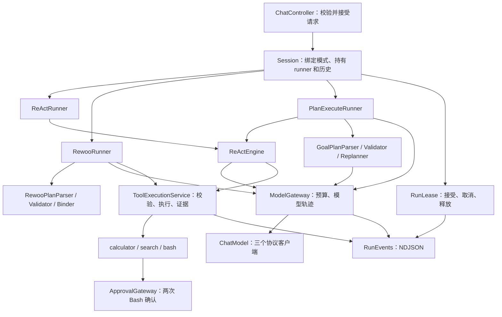
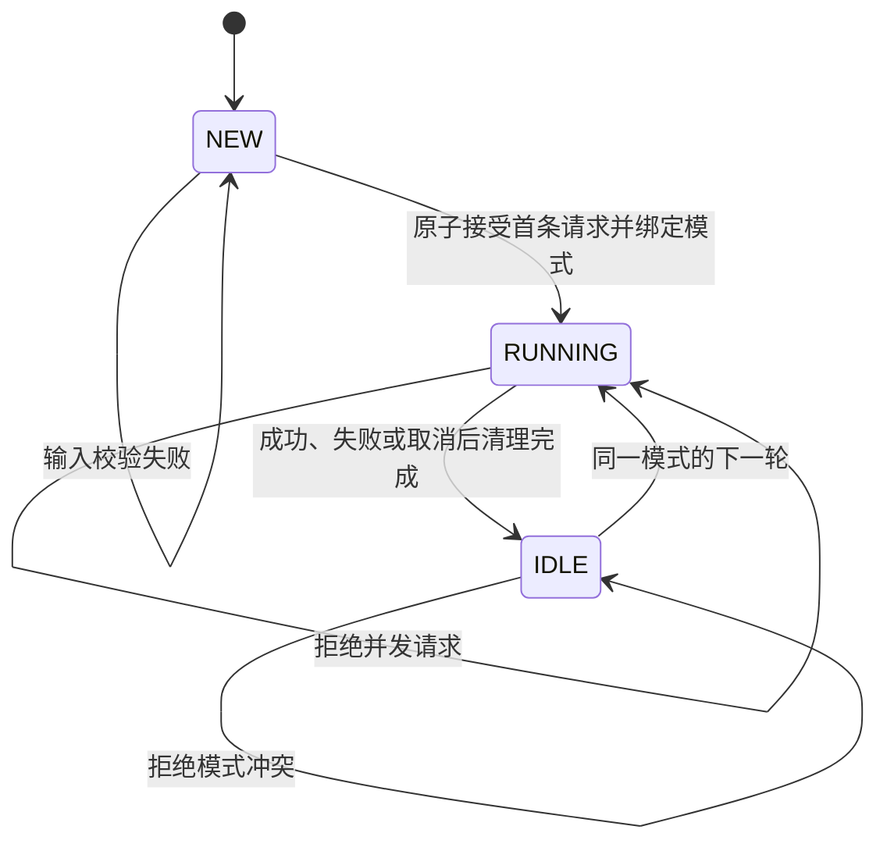
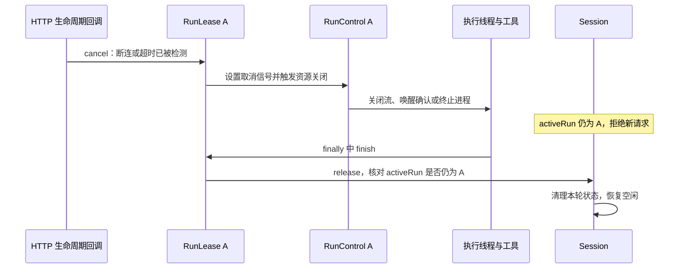
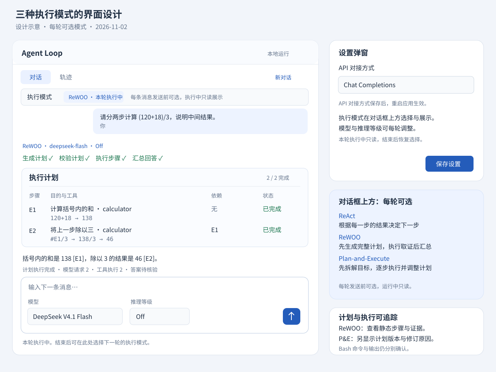

# Agent 三模式技术方案 v1

日期：2026-11-01（Asia/Shanghai） · 状态：T1–T5 已实现；18 组真实接口固定算术验收通过

[项目](../../README.md) · [研究证据](agent-execution-research.md) · [界面示意](figures/execution-modes-ui.svg)

天气能力新增的自主参数解码、通用字符串绑定、来源信息和 NEEDS_INPUT 状态详见[天气实现方案](weather-capability-implementation-plan.md)。

本文是 ReAct、ReWOO、Plan-and-Execute 的统一开发依据，确定类边界、接口、状态转移、执行算法、改造顺序与验收用例。代码块说明接口与算法；当前实现已覆盖三模式，验收结果与仍需扩展的样例见第 14–15 节及研究记录。

阅读时先沿第 3 节理解一次请求怎样流动，再看第 5 节的对话与运行管理，以及第 7–9 节的三种执行流程。第 4 节完整类型签名用于实现时查阅；理解主线后再展开，不需要先记住所有类名。

## 1. 文档保留与合并

| 文档 | 用途与处理 |
| --- | --- |
| 本文 | 唯一的三模式技术方案，合并原总设计稿与 P&E 设计稿 |
| [研究记录](agent-execution-research.md) | 保留来源、当前代码观察、离线探针与既有测试基线；不重复规定接口 |
| [界面示意](figures/execution-modes-ui.svg) | 本文的视觉附件，不单独维护另一套交互规则 |
| [现有学习指南](../README.md)中的 01–06 | 解释当前已实现的 Java demo；实施时随代码更新对应章节 |
| [复习笔记](../../../review-notes/README.md) | 学习者复习、自测和实践 TODO，继续保留；不作为开发接口规范 |

## 2. 实施范围与固定决策

1. 在当前 Java 17 / Spring Boot 3.5.16 项目扩展，使用现有依赖。
2. 在对话框上方的独立模式栏选择 REACT、REWOO 或 PLAN_EXECUTE；新对话首次请求被服务端接受后，原位改为只读标识，模式固定。
3. 同一对话一个 runner、一份历史；一次只执行一个用户轮次。模式冲突与运行冲突都在后端拒绝。
4. 模型和推理等级可逐轮选择，在本轮所有模型调用中保持一致；协议仍启动时确定，保存后重启生效。
5. ReWOO 使用静态工具计划与串行拓扑执行；P&E 使用高层计划、步骤内 ReAct、执行后检查与有界修订。
6. 三模式复用模型调用、工具执行、预算、取消和事件；ReWOO 工具计划与 P&E 高层计划使用不同类型。
7. v1 不实现并行 Worker、跨轮恢复或持久化。刷新页面和“新对话”都取得新的 sessionId。

| 模式 | 初始计划 | 执行中的模型决策 | 完成路径 |
| --- | --- | --- | --- |
| ReAct | 无独立计划 | 每次观察后选择工具 | 正常无工具响应结束，完成语义另行检查 |
| ReWOO | 工具、参数、证据引用 | Worker 不调用模型 | Solver 汇总证据 |
| P&E | 高层目标、条件与工具范围 | 步骤内选工具；步骤后决定继续、修订或结束 | Finalizer 汇总证据 |

P&E 的内部计划可以变，所属对话的模式不变。Plan-and-Execute 的高层步骤执行与重规划变体依据见[研究记录](agent-execution-research.md)；不把“ReWOO 加一次失败重试”作为第三种模式的实现。

## 3. 改造动机与当前调用链

改造前链路为 `ChatController → Session.run → AgentLoop.run → ChatModel / ToolRegistry`。用户发来一条消息，Session 找到自己的 AgentLoop；循环请求模型，执行模型提出的工具调用，再把结果送回模型，直到本轮结束。这已经是一套可运行的 ReAct 实现。

增加另外两种模式后，变化主要在“谁决定下一步、何时再次请求模型”。例如同样要求先算 `120+18`，再除以三：

| 模式 | 这个任务怎样执行 | 需要复用什么 |
| --- | --- | --- |
| ReAct | 模型先选加法工具，看到 138 后再决定除法调用 | 现有的模型—工具反馈循环 |
| ReWOO | Planner 先写出加法节点与引用它的除法节点，程序按依赖直接调用工具，最后求解 | 模型客户端和工具能力；Worker 不进入反馈循环 |
| P&E | Planner 先给出“求和”“求商”两个高层目标，每个目标由局部反馈循环完成，之后检查剩余计划 | 可反复用于不同步骤的反馈循环，并取得明确的步骤结果 |

因此把当前 AgentLoop 的职责分开：Runner 管整个任务的执行策略与历史，ReActEngine 管一段可复用的反馈循环。现有 run 返回 void、直接向页面输出、内部持有历史；P&E 若直接拿它执行每个步骤，就很难收集步骤结果，也容易混入整段对话的历史与输出。提取内核是为了解决这个具体复用问题。

目标调用关系：



图中的共享入口负责统一的执行规则。ModelGateway 先检查预算、记录轨迹，再交给 ChatModel 把请求转换成具体协议；ToolExecutionService 校验调用、执行工具、保存证据，再把状态交还调用者。这样三种 Runner 都使用同样的计数与失败规则。

ChatModel 的三个实现继续负责 HTTP 报文与 SSE；新增 Gateway 将预算和轨迹留在协议之外。切换协议时，任务策略和总预算的含义保持一致。

## 4. 共享 Java 契约

先区分几个名字对应的时间范围。以同一对话中先发“搜索资料”、再发“总结结果”为例，Session 会一直存在，每条用户消息各有一次 RunLease 和 RunContext；其中又可能发起多次 ModelRequest。

| 对象 | 管什么 | 存在多久 |
| --- | --- | --- |
| Session | 对话模式、Runner、历史，以及当前由谁占用执行 | 一段对话 |
| RunLease | 某次请求是否已启动、如何取消、何时释放占用 | 一次用户请求的接受到清理完成 |
| RunContext | 本轮共享的预算、证据、取消信号与执行服务 | 一次用户请求；P&E 各步骤共用 |
| ModelRequest | 某一次发给模型的历史、工具和输出配置 | 一次模型请求 |
| ToolResult / Evidence | 工具执行结果，以及该结果的编号和来源 | 当前 run；用于绑定、检查与轨迹 |

以下签名按阅读顺序集中展示，不属于同一个 Java 文件；每个 public 类型独立落盘，实际包归属见第 13 节。集合参数在构造时复制；返回快照不暴露内部可变集合。

<details>
<summary>展开共享 Java 接口与数据类型的完整签名</summary>

<!-- contract: shared -->
```java
// 跨包契约摘要；core、core.runtime、core.react、model、tool 的归属见第 13 节。

import dev.learning.agent.model.AssistantTurn;
import dev.learning.agent.model.ChatMessage;
import dev.learning.agent.model.ModelSettings;
import dev.learning.agent.model.ToolCall;
import dev.learning.agent.model.ToolSpec;
import java.io.IOException;
import java.time.Duration;
import java.util.List;
import java.util.Set;
import java.util.UUID;
import java.util.function.Consumer;

public enum AgentMode { REACT, REWOO, PLAN_EXECUTE }
public enum ExecutionStatus { NEEDS_INPUT, COMPLETE, PARTIAL, FAILED, CANCELLED }
public enum CompletionCheck { UNVERIFIED, PASSED, FAILED }
public enum EngineStop { NEEDS_INPUT, FINAL_RESPONSE, LOCAL_BUDGET, CANCELLED, INVALID_RESPONSE }
public enum OutputMode { TEXT, JSON_OBJECT }
public enum ModelUse { CONTROL, EXECUTOR, FINALIZER }
public enum ToolStatus { NEEDS_INPUT, SUCCESS, ERROR, DENIED, TIMEOUT, CANCELLED, SKIPPED }

public record ExecutionRequest(UUID requestId, String prompt, ModelSettings settings) {}
public record RunScope(String phase, String stepId, int revision) {}
public record RunCounters(int modelCalls, int toolAttempts, int toolsExecuted,
                          int stepAttempts, int planRevisions) {}
public record RunResult(ExecutionStatus status, CompletionCheck completionCheck,
                        String answer, String errorCode, RunCounters counters) {}

public record ModelRequest(List<ChatMessage> messages, ModelSettings settings,
                           List<ToolSpec> tools, OutputMode outputMode,
                           int maxOutputTokens, ModelUse use) {}

public interface ToolInput {
    String toolName();
    List<String> templateStrings();
    ToolInput mapStrings(java.util.function.UnaryOperator<String> mapper);
}
public record ToolSource(String label, String url) {}
public record ToolResult(ToolStatus status, String content, String errorCode,
                         boolean executed, boolean hasValue, boolean truncated,
                         List<ToolSource> sources) {}
public record Evidence(String id, String stepId, String tool,
                       String boundArgumentsJson, ToolResult result, long durationMs) {}

public record EngineRequest(List<ChatMessage> transcript, ModelSettings settings,
                            Set<String> allowedTools, int maxModelCalls,
                            int maxToolAttempts, boolean publishText, RunScope scope) {}
public record EngineResult(List<ChatMessage> transcript, AssistantTurn finalTurn,
                           EngineStop stop) {}

public interface AgentRunner {
    RunResult run(ExecutionRequest request, RunContext context)
            throws IOException, InterruptedException;
}
public interface ReActEngine {
    EngineResult execute(EngineRequest request, RunContext context)
            throws IOException, InterruptedException;
}
public interface ChatModel {
    String protocol();
    AssistantTurn stream(ModelRequest request, Consumer<String> onText, RunControl control)
            throws IOException, InterruptedException;
}
public interface ModelGateway {
    AssistantTurn call(ModelRequest request, RunScope scope,
                       Consumer<String> onText, RunContext context)
            throws IOException, InterruptedException;
}
public interface ToolExecutionService {
    Set<String> availableTools();
    Evidence invoke(ToolInput input, String evidenceId, Set<String> allowedTools,
                    RunScope scope, RunContext context);
    Evidence invokeNative(ToolCall call, String evidenceId, Set<String> allowedTools,
                          RunScope scope, RunContext context);
}
public interface EvidenceStore {
    String nextId();
    void put(Evidence evidence);
    Evidence requireUsable(String id);
    List<Evidence> snapshot();
}
public interface RunBudget {
    void claimModel(ModelUse use);
    void claimToolAttempt();
    void recordToolResult(ToolResult result);
    void claimStep();
    void claimRevision();
    boolean claimFormatRepair();
    boolean canStartStep();
    RunCounters snapshot();
}
public interface RunControl extends AutoCloseable {
    void check() throws InterruptedException;
    Duration remaining();
    AutoCloseable onCancel(Runnable action);
    void cancel(String reason);
    void close();
}
public interface AgentEvent {}
public interface RunEvents { void emit(AgentEvent event); }
public interface ApprovalGateway {
    boolean approve(String kind, String content, RunScope scope, RunControl control);
}
public interface RunContext {
    UUID requestId();
    AgentMode mode();
    RunBudget budget();
    RunControl control();
    RunEvents events();
    EvidenceStore evidence();
    ModelGateway model();
    ToolExecutionService tools();
    ApprovalGateway approvals();
}
```

</details>

实现类为 `DefaultReActEngine`、`DefaultModelGateway`、`DefaultToolExecutionService`、`DefaultRunBudget`、`DefaultRunControl`、`DefaultRunContext` 和 `InMemoryEvidenceStore`。状态只存在于当前对话或当前 run；模型客户端可共用，不保存对话状态。

`ModelGateway.call` 先消费预算、发开始事件，再调用客户端，最后记录成功或失败。进入客户端的一次尝试计入 modelCalls，即使随后失败；它不是服务端计费次数。`OutputMode.JSON_OBJECT` 表示应用要求解析 JSON；三协议的实际格式参数见第 11 节。

`ToolResult.content` 永远只包含允许进入后续模型的数据。hasValue 区分“成功取得值”和“成功调用但没有结果”；例如空搜索为 false，合法数值 0 为 true。`requireUsable` 要求 SUCCESS、hasValue=true、truncated=false。`boundArgumentsJson` 是用于轨迹的序列化文本，不参与业务调度；真正的参数由 ToolInput 保存并校验。不要把 JsonNode 或 Map of Object 当作运行状态。

## 5. 对话生命周期与 HTTP 接口

### 5.1 状态与锁定时机



NEW 的 mode 为 null。IDLE 和 RUNNING 的 mode 永不改变；新建对话创建另一个 Session，而不是把原 Session 重置为 NEW。

同一个 Session 串行执行，是因为同一 Runner 持有一份需要按顺序更新的对话历史与运行策略。改造前还共享 currentSink 和等待确认的操作；两个请求同时运行时，既会交叉追加历史，也会覆盖输出通道、争用工具确认。当前 RunLease 已把事件和确认分给各次请求，但同一会话历史仍需要串行推进。即使把历史列表换成线程安全集合，也没有定义两条执行分支应怎样合并。改造前的 Session.begin 已用 running 防止这种并发；现在 accept 与 RunLease 延续并补齐这条规则。

不同 Session 可以分别执行；如果将来要让同一对话并发，需要另外设计分支历史、独立输出与确认、结果合并规则。P&E 在一个请求内部执行多个步骤，仍占用同一个 Session，不等于接收了多个并发用户请求。

Session 替换 `begin()` / `run(String, ModelSettings, EventSink)`，对外提供：

| 方法 | 契约 |
| --- | --- |
| `synchronized RunLease accept(String prompt, ModelSettings settings, AgentMode requested)` | 校验状态、选择或核对模式、创建唯一 runner、建立 activeRun，原子完成 |
| `RunResult execute(RunLease lease, EventSink events)` | 校验 lease 所属关系，执行 runner；finally 清理确认、事件通道和 activeRun |
| `synchronized SessionStatus status()` | 返回 mode、modeLocked、running、activeRequestId |
| `boolean decide(String approvalId, boolean approved)` | 沿用当前确认入口；仅针对当前 activeRun 的有效确认 |

接受伪代码：

```text
accept(validatedPrompt):
    synchronized session:
        if activeRun exists: reject RUN_IN_PROGRESS
        requested = supplied mode, or bound mode, or REACT
        if bound mode exists and requested differs: reject MODE_LOCKED
        candidateRunner = existing runner or factory.create(requested)
        lease = new RunLease(requestId, immutable request, fresh run context)
        bind mode and candidateRunner; assign activeRun = lease
        return lease
```

基础输入校验和模型设置校验在 accept 前完成；纯内存 runner 构造失败时不提交绑定。接受完成之后即使模型失败，模式也保持锁定。

### 5.2 请求和响应

保留 `/api/chat`、`/api/session`、`/api/approve` 的当前用途，以及本地/同源检查和 X-Agent-Session 校验。

```json
{
  "prompt": "请分两步计算 (120+18)/3。",
  "mode": "REWOO",
  "model": "deepseek-flash",
  "reasoningLevel": "off"
}
```

`Prompt` 增加可空 AgentMode mode。新对话缺省为 REACT；已锁定对话省略 mode 时沿用绑定值。GET `/api/session` 新建响应为：

```json
{
  "sessionId": "example-session",
  "supportedModes": ["REACT", "REWOO", "PLAN_EXECUTE"],
  "defaultMode": "REACT",
  "mode": null,
  "modeLocked": false,
  "running": false
}
```

新增 GET `/api/session/status`，请求头必须携带已有 X-Agent-Session，响应包含 sessionId、mode、modeLocked、running、activeRequestId；它只查询，不创建会话。

| 场景 | HTTP / 错误码 | 是否绑定模式 |
| --- | --- | --- |
| 空或超长 prompt、未知模型/等级/mode | 400 / INVALID_REQUEST | 否 |
| 没有有效 sessionId | 401 / SESSION_NOT_FOUND | 否 |
| 非法来源 | 403 / FORBIDDEN_ORIGIN | 否 |
| 对话运行中 | 409 / RUN_IN_PROGRESS | 保持原状态 |
| 已绑定模式与请求不同 | 409 / MODE_LOCKED | 保持原模式 |
| 已接受，之后计划/模型/工具失败 | HTTP 200 内的失败事件 | 是 |

错误体统一为 `ApiError(code, message)`；未知枚举等 Spring 反序列化异常也通过本地 ControllerAdvice 转换，不能返回默认 HTML。

### 5.3 RunLease：一次请求的执行占用与清理

ReAct 原本就需要管理运行占用：Session.begin 把 running 设为 true，Session.run 的 finally 取消确认、清空 currentSink，再恢复空闲。已有实现覆盖了正常进入执行后的基本清理。

RunLease 是本方案新增的普通 Java 对象，用来集中管理这次占用的身份和生命周期。它把“当前很忙”细化为“请求 A 占用、执行是否开始、是否已结束”，让执行线程、HTTP 连接回调与超时任务都操作属于 A 的同一个对象。ReAct、ReWOO 和 P&E 都使用它。

| 对象或状态 | 职责 |
| --- | --- |
| Session.accept 的同步检查 | 保证同一对话只接受一个执行者，建立 activeRun |
| RunLease 的 requestId 和状态 | 标识占用者，协调启动、取消与结束 |
| RunContext 中的 RunControl | 保存取消信号，触发已注册的流关闭、进程终止和等待唤醒 |
| Session.release(expectedLease) | 核对当前占用者，只释放这次运行所属的状态 |

RunLease 负责协调这些动作，具体关闭 SSE 或终止 Bash 进程仍由相应资源的取消处理完成。它也不能单独提供互斥；接受请求时的 Session 同步检查仍然必需。

其状态为 ACCEPTED、RUNNING、CLOSED。ACCEPTED 表示服务端已接受、占用了执行位置，但异步回调可能还没启动；RUNNING 表示执行回调已实际开始；CLOSED 表示这次运行已结束。这里 Session 的 RUNNING 表示存在 activeRun，因此也包含 lease 仍为 ACCEPTED 的短暂阶段。

这些区别在三个场景中有用：

| 场景 | 具体经过 | RunLease 的处理 |
| --- | --- | --- |
| 接受后、启动前取消 | A 已通过 accept，但 StreamingResponseBody 的执行回调还没开始，容器已通知连接结束 | 关闭 ACCEPTED 状态的 A 并释放占用；迟到的执行回调无法再次启动它。不能依赖尚未进入的执行代码里的 finally |
| 执行中取消 | A 的 Bash 命令仍在运行，HTTP 层请求取消 | 先通知进程和等待停止，继续占用 Session；执行线程退出并清理后才释放，期间新请求仍被拒绝 |
| 旧回调迟到 | A 已结束，B 开始运行，此时 A 的延迟超时回调才到达 | A 已关闭，重复取消不再产生效果；即使调用 release，也不能释放当前属于 B 的占用 |

因此取消要区分“已提出停止”与“已完成清理”。下面展示执行中取消的路径：



实现时，启动、取消和释放必须满足以下条件：

- tryStart 只允许一次从 ACCEPTED 原子转为 RUNNING；已取消或已关闭的 lease 不能启动。
- cancel 发生在 ACCEPTED 时可以直接关闭并释放；发生在 RUNNING 时只发取消信号，等待执行线程的 finally 完成释放。
- finish 只由已启动的执行线程在清理路径中调用；重复 finish、cancel 不重复清理。已经 CLOSED 的 lease 不再触发旧资源的取消动作。
- release(expectedLease) 只有在 Session.activeRun 就是 expectedLease 时才能取消所属确认、清空输出通道并移除 activeRun；旧回调不得直接写 running=false。
- 每个确认和资源取消动作都关联当前 requestId，结束后注销本轮回调，避免旧动作影响新请求。

Controller 注册 `AgentRunInterceptor implements CallableProcessingInterceptor`；handleTimeout、handleError 和 afterCompletion 都调用幂等的 lease.cancel。通过 WebAsyncManager.registerCallableInterceptor 绑定当前 requestId；finally 仍是运行中 lease 的唯一释放位置。这些是 Spring MVC 提供的异步生命周期钩子。[Spring 6.2 API](https://docs.spring.io/spring-framework/docs/6.2.x/javadoc-api/org/springframework/web/context/request/async/CallableProcessingInterceptor.html)

测试覆盖上述三种时序，并分别检查执行是否启动、资源是否停止、占用是否被正确释放。关闭一次 RunLease 不会删除 Session 的历史或解除模式锁定；下一条消息建立新的 RunLease，继续使用同一 Runner。

## 6. 工具结果、证据与原生调用配对

### 6.1 工具接口改造

当前 ToolRegistry 用字符串同时表达结果和错误。模型能阅读这些文字，但程序要决定是否执行下游节点，就需要明确状态。例如 search 请求正常完成却没有匹配项：工具实际运行了，后续仍没有可用值。ToolResult 将这些事实拆开，Evidence 再加上 ID、所属步骤和耗时，供依赖绑定与复盘使用。

`AgentTool.execute(String)` 改成下面的目标方法；工具注册表负责目录、查找并委托具体工具解码，执行状态和事件集中在 ToolExecutionService。

```java
ToolResult execute(ToolInput input, RunScope scope, RunContext context)
        throws IOException, InterruptedException;
```

具体工具通过 instanceof 检查参数类型，保持实现直接可读。`invokeNative` 对模型的 tool name / arguments 做边界解码后调用 `invoke`；未知工具、非法 JSON 或错误参数返回 ERROR，不抛出整个任务。

兼容原来的 `ToolRegistry.dispatch(call)` 可暂留一层文本转换用于迁移测试；正式 runner 全部经过 ToolExecutionService，不能重复执行一次工具来获取两种结果。

### 6.2 状态规则

| 情况 | status / executed | content 与证据处理 |
| --- | --- | --- |
| calculator 成功 | SUCCESS / true | 数值字符串，可绑定后续参数 |
| 参数错误或未注册工具 | ERROR / false | 简要错误，无成功值 |
| search 无匹配 | SUCCESS / true | hasValue=false，明确无结果；不满足高层步骤的证据数量门槛 |
| search 缺 key | ERROR / false | 说明工具不可用，不包含 key |
| HTTP 或执行异常 | ERROR / 按实际开始情况 | 保留错误码，不记录认证头 |
| Bash 执行前拒绝 | DENIED / false | 只有拒绝原因 |
| Bash 已运行但输出拒绝分享 | DENIED / true | 只有拒绝原因，不包含原始输出 |
| Bash 非零退出或超时 | ERROR 或 TIMEOUT / true | 只有输出分享获准后才可附输出 |
| 限额阻止调用 | SKIPPED / false | 明确未执行，仍回传原生调用结果 |

Bash 原始输出只保存在工具局部变量和现有确认卡交互中。拒绝后不得写入 Evidence、Replanner、Finalizer、历史或普通日志；日志记录状态、耗时和长度即可。

每个工具尝试在分发前消费 toolAttempts；拒绝、参数错误也计入尝试。服务入口返回时恰好调用一次 recordToolResult，根据 executed 统计 toolsExecuted；额度耗尽而未分发的 SKIPPED 不再消费尝试。缓存复用的 calculator 也不计为新执行。这样用户反复拒绝时仍有预算边界，统计也不混淆“尝试调用”与“实际执行”。

### 6.3 证据和工具结果消息

ReWOO 的证据 ID 等于计划节点 ID。ReAct/P&E 使用本 run 内递增的 E1、E2；P&E 的高层步骤另用 S1、S2。协议调用 ID 来自模型，不能由这些宿主 ID 替代。

原生工具结果 content 统一序列化为明确对象，令步骤执行器知道宿主证据 ID：

```json
{"evidenceId":"E1","status":"SUCCESS","content":"138","executed":true,"hasValue":true,"truncated":false}
```

该对象是 tool 结果的字符串内容，外层仍由三个适配器按原调用 ID 配对。更新原有测试中对纯文本 `138` 的精确断言；最终算术行为保持一致。

一次 assistant 声明多个调用时，每个调用都获得成功、失败、拒绝或跳过结果。校验调用 ID 非空且在本批唯一；畸形批次不执行工具。达到额度时为未执行调用补 SKIPPED，不能留悬空结果。

## 7. ReActEngine 与历史检查点

ReActRunner 保留整段 ReAct 对话的历史，ReActEngine 负责一次被调用的反馈循环。对话式 ReAct 通常每条用户消息调用它一次；P&E 的 StepExecutor 可以按高层步骤多次调用它，每次提供不同的目标、局部历史和工具范围，再取得 EngineResult。

例如 P&E 的“求和”步骤结束后，外层需要读到结果 138，判断是否完成，再开始“除以三”。这要求内核能返回数据与结束原因，而不是只把文字推给浏览器后返回 void。局部步骤使用同一个 RunContext，因此不会为每一步重新获得全套预算。
### 7.1 内核算法

```text
execute(engineRequest, context):
    transcript = mutable copy of engineRequest.transcript
    repeat within local model limit:
        check cancellation and local/global budgets
        turn = ModelGateway.call(current transcript, allowed tool definitions)
        validate complete response, normalized finish reason and call IDs
        if no calls:
            append assistant final response
            return EngineResult(transcript, turn, FINAL_RESPONSE)
        results = []
        for every declared call:
            assign host evidence ID
            if local/global tool limit reached: record SKIPPED result
            else: invokeNative through ToolExecutionService
            build result message paired with original call ID
        append assistant + all results as one complete checkpoint
    return EngineResult(checkpoint transcript, no final response, LOCAL_BUDGET)
```

所有模型请求都经过 Gateway；局部额度与 RunBudget 同时生效。发布文本由 publishText 决定：对话式 ReAct 为 true，P&E 子步骤为 false。完整的 AssistantTurn 保留协议 blocks/reasoning 信息，不能只存可见文本。

### 7.2 对话历史提交

这里的“检查点”指一段已经完整、可以继续回放给模型的历史。例如 assistant 声明三个工具调用，应连同三个对应结果一起保存；只保存两个结果，就还不是完整的往返。

`ReActRunner` 为每轮复制已保存 transcript，追加 user 后交给内核。每次只提交完整 assistant/tool 批次或完整最终响应；异常响应与半个流不进入持久的内存历史。

取消发生在一批工具执行中时，已执行结果进入账本，剩余调用补 CANCELLED / SKIPPED，形成完整本地检查点；之后不再请求模型。下一轮保留合法检查点，并附一条宿主生成的失败状态数据，明确上一轮未完成。不能丢失已执行副作用，再假定它从未发生。

`StepExecutor` 的局部 transcript 不进入对话历史；仅保留步骤结果和证据。ReWOO/P&E 的对话历史保存最近最多 4 个已完成问答对、合计最多 24,000 字符，按完整问答对淘汰；模型不读取上一轮原始证据。

## 8. ReWOO 的具体实现

### 8.1 格式与类型

```json
{
  "version": 1,
  "steps": [
    {"id":"E1","purpose":"计算括号内的和","tool":"calculator","arguments":{"expression":"120+18"}},
    {"id":"E2","purpose":"除以三","tool":"calculator","arguments":{"expression":"#E1/3"}}
  ],
  "answerEvidence": ["E2"]
}
```

`RewooPlan(version, steps, answerEvidence)` 包含 `RewooStep(id, purpose, ToolInput arguments)`。JSON 中的 tool 只用于边界解码选择具体 ToolInput，运行状态不再保存第二份可能不一致的工具名。

| 组件方法 | 输入与输出 |
| --- | --- |
| `RewooPlanner.plan(TaskInput, RunContext)` | 纯文本模型请求 → RewooPlan |
| `RewooValidator.validate(RewooPlan, Set<String>)` | → ValidatedRewooPlan，含节点索引、依赖、稳定拓扑顺序 |
| `EvidenceBinder.bind(ToolInput, EvidenceStore)` | 模板参数 → 已绑定参数；失败抛出带节点原因的验证异常 |
| `RewooSolver.solve(TaskInput, ValidatedRewooPlan, List<Evidence>, RunContext)` | → 完整最终 AssistantTurn，文本可流式显示 |

TaskInput 包含本轮原问题和固定的历史快照。所有方法的模型 I/O 统一抛 IOException / InterruptedException，解析与计划验证使用 IOException / PlanValidationException 描述失败原因；HTTP 错误码由 Controller 统一包装。

### 8.2 解析、校验和绑定

JSON 解析拒绝空白、Markdown 包裹、尾随内容、重复 key、未知字段、缺失字段和标量类型强制转换。最多 8 个节点；ID 符合 `E[1-9][0-9]*`，唯一且无自引用/环，所有引用存在，answerEvidence 均存在。空计划必须使用空 answerEvidence。

参数由注册工具的 decode 方法校验。拓扑排序采用入度和就绪队列；多个节点同时就绪时保持原列表优先级。复杂度 O(V+E)，不通过 `toString()` 搜索依赖。

Binder 只扫描原参数字符串里的引用，以完整 ID 匹配，避免 E1 与 E10 混淆；替换后的证据内容不再作为模板递归解析。非 SUCCESS、未获分享或已截断的证据不能绑定为精确参数。绑定后重新执行工具长度、格式与表达式检查。

### 8.3 Runner 算法

```text
snapshot = task input and completed conversation pairs
plan = Planner(snapshot)
validated = validate(plan), with at most one pre-execution format repair
emit validated plan
for step in stable topological order:
    if dependency unusable: record SKIPPED evidence and continue
    bind typed arguments; failure becomes this node's ERROR evidence
    invoke planned tool directly, saving evidence under step.id
answer = Solver(snapshot, validated plan, safe evidence)
validate final response and evidence citations
derive COMPLETE / PARTIAL / FAILED and save complete answer if eligible
```

Worker 不调用 ReActEngine，也不创建假的原生 tool_calls。计划与证据通过普通 user 数据上下文交给 Solver，三个协议共用这一表示。Planner/Solver 的 tools 均为空，若返回原生工具调用则失败。

一次格式修复只允许在执行前发生；传入原问题、模型输出和结构校验错误，不包含工具观察。模型 HTTP 失败和流异常不自动重发。

Solver 的 `[E1]` 引用必须指向成功可分享的证据；检查引用存在不证明整段结论正确。返回 completionCheck=UNVERIFIED。

## 9. Plan-and-Execute 的具体实现

### 9.1 初始计划与运行类型

```json
{
  "version": 1,
  "revision": 0,
  "steps": [
    {"id":"S1","goal":"查找模拟服务 A 的默认端口","successCriteria":"取得明确端口的官方来源证据","minEvidence":1,"allowedTools":["search"],"dependsOn":[]},
    {"id":"S2","goal":"查找模拟服务 B 的默认端口","successCriteria":"取得明确端口的官方来源证据","minEvidence":1,"allowedTools":["search"],"dependsOn":[]}
  ]
}
```

`GoalPlan(version, revision, steps)` 与 `GoalStep(id, goal, successCriteria, minEvidence, allowedTools, dependsOn)` 是独立类型。minEvidence 是 0–8 的整数，作为宿主可执行的证据数量门槛。v1 当前有效计划的全部步骤都是必需步骤。S ID 在整个 run 中唯一，任何历史版本使用过的 ID 不得复用。依赖必须存在且无环；未完成计划最多 8 个步骤。

| 方法 | 契约 |
| --- | --- |
| `GoalPlanner.plan(TaskInput, RunContext)` | 返回初始 GoalPlan，原始任务不可改写 |
| `GoalPlanValidator.validate(GoalPlan, ExecutionLedger)` | 校验 ID、依赖、工具范围、版本与保留事实 |
| `StepExecutor.execute(TaskInput, GoalStep, ExecutionLedger, RunContext)` | 使用局部 ReActEngine，返回 StepResult |
| `Replanner.review(TaskInput, GoalPlan, StepResult, ExecutionLedger, RunContext)` | 返回 CONTINUE / REVISE / FINISH / STOP 决策 |
| `PlanFinalizer.finish(TaskInput, ExecutionLedger, Termination, RunContext)` | 最多一次最终汇总，不能再执行工具 |

ExecutionLedger 保存所有计划版本、步骤尝试、证据和已发生工具行为。步骤的模型可见状态为 COMPLETE、INCOMPLETE、FAILED、DENIED、CANCELLED；被新计划移除且未执行的步骤为 SUPERSEDED。失败尝试不会被修订覆盖成 SUPERSEDED。

### 9.2 步骤执行与完成声明

局部输入为原任务、当前目标、验收条件、相关已完成步骤与可分享证据。允许工具集合必须是会话目录的子集；宿主实际发送的工具定义和分发检查都使用该集合。

每次步骤使用新的 transcript，模型最多请求 3 次、工具尝试最多 2 次，并同时消费全局预算。模型正常无工具响应时，content 必须能解析为下面的 StepAnswer：

```json
{"status":"COMPLETE","summary":"已取得模拟服务 A 的端口证据。","evidenceIds":["E1"]}
```

宿主验证所引用证据通过 requireUsable，去重后数量达到 minEvidence；不从自由文本猜测数量门槛。格式错误、无值或无效引用、局部预算耗尽产生 INCOMPLETE，而不是直接升级为成功。自由文本 successCriteria 的语义需由 Replanner 与验收样例判断，最终仍保留 UNVERIFIED 标记。

### 9.3 重规划与版本提交

```json
{
  "decision": "REVISE",
  "reason": "S2 没有找到有效来源，改用明确的模拟官方域名检索。",
  "remainingSteps": [
    {"id":"S3","goal":"按指定模拟官方域名核对服务 B 的端口","successCriteria":"取得明确端口与来源","minEvidence":1,"allowedTools":["search"],"dependsOn":[]}
  ]
}
```

ReplanDecision 为带 decision 标签的四种 Java record，不使用一个装满可空字段的通用对象：ContinueDecision、ReviseDecision、FinishDecision、StopDecision。REVISE 携带 remainingSteps；FINISH 携带 answerEvidence 和 COMPLETE/PARTIAL 意图；其余只携带 reason。

| 决策 | 执行条件 |
| --- | --- |
| CONTINUE | 当前版本存在可执行步骤；不增 revision，必须推进步骤 |
| REVISE | 未超修订预算；新剩余计划合法；已成功事实不改写；接受后 revision+1 |
| FINISH | 提交可用答案证据；完整结束还要求当前有效必需步骤满足完成检查 |
| STOP | 保留现有证据和原因，进入部分完成或失败终结 |

REVISE 的校验拒绝重复/历史 ID、无效依赖、工具越界，以及仅更换 ID 的无变化计划。相同目标与工具范围的规范化指纹用于检测明显无进展；不声称能证明自然语言目标语义等价。无效决策可消费一次共享格式修复，否则按失败终结。

### 9.4 外层算法

```text
plan = validate(initial Planner(task))
ledger = new ExecutionLedger(original task, revision 0)
while not terminated:
    if no executable step or global budget insufficient: terminate incomplete
    claim one global step attempt
    result = StepExecutor(first ready step, current plan, ledger)
    append immutable step result and evidence to ledger
    decision = Replanner.review(task, current plan, result, safe ledger)
    switch decision:
        CONTINUE: continue only if another ready step exists
        REVISE: validate; claim revision; atomically commit next plan version
        FINISH: check evidence and required steps; set termination
        STOP: set incomplete termination
answer = Finalizer(task, safe ledger, termination), using reserved model slot
derive RunResult; commit complete user/assistant pair if eligible
```

执行后每个步骤最多检查一次；检查不改变计划时不增加版本。不允许模型在没有新步骤结果时反复 review。基础设施故障或硬取消直接结束，不再请求 Finalizer；只有仍有预算、连接和可用模型时才汇总业务不足。

### 9.5 保留证据与重复执行

S1 成功、S2 不足、新增 S3 时保留 S1/E1，保留 S2 尝试记录，不重跑成功分支。重规划不能改写原任务、已执行操作或拒绝记录。

成功的确定性只读调用可通过工具名与规范化参数缓存复用；v1 只缓存 calculator。search 不自动缓存，后续查询作为新尝试计数。Bash 不自动重放，保持每次命令和输出确认；参数指纹只能拦截精确重复，不能提供通用幂等保证。

## 10. 预算、取消、异常与完成状态

### 10.1 固定预算

RunContext 贯穿一次用户请求，RunBudget 记录它已经消费的资源。P&E 即使包含多个步骤，也只是同一次运行的内部执行：若每个步骤都新建一份独立总预算，外层的模型请求上限就失去约束。因此步骤局部限额与共享全局限额同时检查。

| 限制 | ReAct | ReWOO | P&E |
| --- | --- | --- | --- |
| 全局模型请求 | 8 | 3：规划、可选修复、求解 | 35：1+24+8+1+1 |
| 全局工具尝试 | 16 | 8 | 12 |
| 计划 / 步骤 | 不适用 | 最多 8 节点 | 每版最多 8，跨版最多 8 次步骤尝试 |
| 步骤内模型 / 工具尝试 | 不适用 | Worker 不调用模型 | 3 / 2 |
| 计划修订 | 不适用 | 0 | 2 |
| JSON 格式修复 | 不适用 | 规划阶段最多 1 次 | 初始规划与 review 合计最多 1 次 |

P&E 的 35=初始规划 1+最多 8×3 次步骤模型+最多 8 次 review+Finalizer 1+共享修复 1。StepAnswer 错误不自动发修复请求。已发送的失败请求也计数，子步骤绝不重置外层额度。

预算预留按模式执行：ReAct 不预留独立汇总额度；ReWOO 的 CONTROL 为 Solver 保留 1 次；P&E 的 EXECUTOR 为下一次 review 与 Finalizer 保留 2 次，CONTROL 保留 Finalizer 的 1 次。FINALIZER 最多执行一次。P&E 的 canStartStep 要求还剩步骤额度及至少一次执行、一次检查、一次最终汇总的模型额度。

共享约束：本轮 15 分钟；单次完整模型流 120 秒；单次输出最多请求 4,096 tokens，应用对组装中的文本、reasoning 和工具参数合计限制 16,000 字符，单个 SSE 帧上限 128 KB，超过即中止为失败；单证据最多 8,000 字符，全轮 32,000。模型 usage 未返回时记 unknown，不以 0 或字符数代替。

超出证据上限时显式标记 truncated；截断证据不能做精确参数绑定或支撑 COMPLETE，可作为部分结果供最终说明。API token 参数与应用文本/时间上限同时存在。

### 10.2 取消的实际落点

HTTP 断连或超时先交给第 5.3 节的 RunLease，它通知本轮 RunControl。RunControl 再让具体客户端和工具停止阻塞；执行线程完成清理后，RunLease 才释放 Session。下面列的是实际停止资源的位置，不能只修改一个取消标记就认为操作已经结束。

DefaultRunControl 使用 System.nanoTime 截止时间和取消原因；onCancel 注册资源关闭动作，返回值 close 只注销该动作。进程内单个守护线程调度超时，每个 run 结束取消自己的定时任务；调度线程随 JVM 退出。

预算计数器以同步方法或原子更新保护。transcript、证据与计划版本只由当前执行线程写入；计时线程只设置取消信号和关闭资源，不直接改写业务状态。NDJSON 的序列化与写出保持单一顺序，失败只触发幂等取消。

| 阻塞资源 | 取消动作 |
| --- | --- |
| 尚未收到头的模型请求 | 使用 sendAsync，取消关联 future |
| 已开始读取的 SSE | 注册并关闭 InputStream；取消时不再发新请求 |
| search 请求 | 取消 future，单次最多现有 30 秒并受本轮剩余时间限制 |
| Bash 子进程 | 终止当前 process 与可见 descendants，关闭流并停止后续节点 |
| Bash 确认等待 | 完成或取消 pending future；等待上限为 min(5 分钟, 本轮剩余时间) |
| 浏览器写出失败 / MVC 超时 | 取消 RunLease，执行清理后才释放运行锁 |

HttpClient 的响应对象可在响应体尚未读完时返回，因此现有取得 InputStream 后继续 readLine 的路径需要独立关闭机制，不能只配置请求 timeout。[JDK 17 HttpClient](https://docs.oracle.com/en/java/javase/17/docs/api/java.net.http/java/net/http/HttpClient.html)

显式停止按钮不在 v1；页面断开由写出错误或容器通知发现，硬截止兜底。不能承诺浏览器关闭瞬间就结束远端生成，也不能把中止已开始的命令当作回滚。

### 10.3 错误归属

| 错误 | 处理位置 | 行为 |
| --- | --- | --- |
| 模型 HTTP/流不完整/异常结束 | Gateway / 客户端 | MODEL_REQUEST_FAILED；当前轮 FAILED，无自动网络重试 |
| JSON / 计划不合法 | Parser / Validator | 消费允许的共享修复；再次失败为 PLAN_INVALID |
| 工具参数或 I/O 异常 | ToolExecutionService | 错误证据；ReAct 可继续，ReWOO 阻断依赖，P&E review |
| 必需证据缺失 / 引用不合法 | Binder / 完成检查 | 跳过依赖或拒绝完成，不能宣称证据已取得 |
| 本地步骤预算耗尽 | ReActEngine / StepExecutor | INCOMPLETE，外层仍可 review；全局预算不重置 |
| 全局额度不足 | Runner / Budget | BUDGET_EXHAUSTED，以部分结果或失败终结 |
| 用户拒绝 | 工具 / ApprovalGateway | 拒绝作为持续约束，不自动更换路径绕过分享拒绝 |
| 取消或硬截止 | RunControl | CANCELLED，不再执行模型或工具 |

### 10.4 执行结束与任务正确性

NEEDS_INPUT 表示工具仍需要用户补充，本轮正常结束并保留澄清问答，后续消息重新查询；具体停止与配对规则见[天气方案](weather-capability-implementation-plan.md#8-三模式中的行为与澄清)。COMPLETE 表示当前模式的流程、必需步骤和证据检查通过；PARTIAL 表示有可用结果但存在缺口；FAILED 表示流程失败或无所需证据；CANCELLED 表示取消。P&E 按当前有效计划判定，不要求历史上被替换的步骤全部成功。

三模式初始 completionCheck 均为 UNVERIFIED。只有预先定义的确定性任务检查器才能置 PASSED/FAILED；模型自称完成或 FINISH 不改变该字段。正常问候/澄清允许无工具完成，不把它解释成已经完成原本未澄清的业务目标。

## 11. 三种模型协议的具体改造

直接把 ChatModel 的旧签名迁移为第 4 节的新签名，同时修改三个实现和测试替身；本项目没有对外 Java SDK 使用者，不保留两套长期入口。`ModelSettings` 只表达用户选择，不增加 mode 或阶段参数。

| ModelRequest 字段 | Chat Completions | Responses | Anthropic 兼容接口 |
| --- | --- | --- | --- |
| messages | 现有 messages 转换 | 现有 input item 转换 | system 独立，保留有序 blocks |
| maxOutputTokens | max_tokens | max_output_tokens | max_tokens |
| tools 非空 | 工具定义与 auto | function 工具与 auto | 现有 client tool 定义 |
| tools 为空 | 省略 tools / tool_choice | 省略 tools / tool_choice | 省略 tools |
| JSON_OBJECT | response_format=json_object，提示含 JSON 示例 | v1 使用文本提示与本地严格解析 | v1 使用文本提示与本地严格解析 |

JSON_OBJECT 的共同保障在应用解析层；Responses 的原生 text.format 支持作为后续优化，不作为三协议 v1 的必要条件。Anthropic 兼容接口不假定支持原生结构化输出。JSON 输出仍需检查空白与完整结束。[DeepSeek JSON](https://api-docs.deepseek.com/guides/json_mode/)、[Responses](https://api-docs.deepseek.com/guides/responses_api/)、[Anthropic](https://api-docs.deepseek.com/guides/anthropic_api/)

ChatRequest 增加 `forModel(ModelRequest)`，现有 forAgent 的参数填充合并到该方法；ResponsesClient.request 和 AnthropicClient.request 改接 ModelRequest。模型结束原因仍归一为 stop / tool_calls，保留已有流完整性判断及 reasoning/blocks 回放。

增加 TokenUsage 可空字段：分别解析各协议的实际 usage；不可用时仍为 null。统计实际输入、输出、缓存与 reasoning 时保持各字段原始口径，不把 reasoning 重复加到已包含它的 output 中。

## 12. 前端、事件与显示状态

### 12.1 前端状态

新增纯状态模块 `static/conversation-state.js`，只管理 mode、modeLocked、running 和 activeRequestId；sessionId 由 app.js 持有，便于 Node 标准测试器验证。app.js 继续负责 DOM 与 fetch，trace.js 继续显示轨迹。

布局顺序为：页面标题 → 对话/轨迹导航 → 独立执行模式栏 → 对话内容或轨迹 → 消息输入区。模式选择和只读展示使用同一位置，放在对话框上方；切换对话/轨迹视图时仍然可见。消息输入区只保留文本输入、模型、推理等级与发送按钮。

index.html 在导航后、conversation 与 trace-view 之前新增 `section.mode-bar`，内部包含带可见标签的 `select#mode-select` 和只读 `strong#current-mode`。NEW 时只显示 select，锁定后只显示 strong；app.js 更新同一栏，不把模式控件移入 composer 或设置弹窗。窄屏下允许该栏换行，完整显示 Plan-and-Execute。

| 时点 | 模式控件 | 模型/推理等级 |
| --- | --- | --- |
| 新对话 | 对话框上方的模式栏显示三个选项；本地偏好只设置初值 | 可选 |
| 首次请求等待接受 | 暂时禁用 | 禁用 |
| 收到 run_started | 在模式栏原位替换为只读文本徽标 | 运行中禁用 |
| 本轮完成或失败 | 保持只读 | 恢复可选 |
| 接受前 400/401/403/409 | 以已有会话状态恢复；不自行改写模式 | 根据 running 状态恢复 |
| 首条请求网络异常 | 查询 session/status；查询失败保持待确认状态 | 等状态明确后恢复 |
| 新对话 | 调用创建接口，替换 sessionId、清空当前视图 | 恢复选择 |

本地偏好键 `agent-mode` 仅在服务端确认后写入；未知值退回 REACT。设置弹窗只保留协议和作用域说明，不出现第二个模式选择入口。

### 12.2 事件契约

外层为 NDJSON `ChatEvent(UUID requestId, String type, Object data)`，在现有包装上增加顶层 requestId；业务 data 使用具体 record，RuntimeEvent 实现 AgentEvent；Object 只存在于最终事件序列化包装层。RunEvents 绑定当前 requestId，前端按顶层 ID 忽略迟到事件。text 仍使用字符串 data，done 仍使用空字符串，以减少现有显示逻辑的改动。

| type | data 的固定关键字段 |
| --- | --- |
| run_started | requestId、mode、modeLocked=true |
| phase | phase、status、stepId、revision |
| plan | mode、revision、plan（模式专属类型） |
| evidence | Evidence 本身 |
| step_result | StepResult 本身；stepId 关联所在计划 |
| decision | 四种 ReplanDecision 之一，含 reason；新版本再发 plan |
| trace | 现有 TraceEvent 字段，加 requestId、mode、phase、stepId、revision |
| text | 最外层用户回答分片；ReAct 沿用现有显示，另外两种仅最终汇总 |
| approval | 现有确认信息，加 stepId；内容只用于本地确认 |
| run_result | RunResult 本身；mode 来自 run_started |
| done / error | 保留现有传输终态；error 加 code 和 message |

正常、待补充信息或业务不足的顺序为 run_started → 阶段事件 → run_result → done。运行时异常为 run_started → 可选 run_result → error；之后不再发送 done。连接已断时仅做后端清理。done 只表示事件流正常终止。

传输示例；UUID 与内容为固定夹具：

```json
{"requestId":"00000000-0000-4000-8000-000000000001","type":"run_started","data":{"mode":"REWOO","modeLocked":true}}
{"requestId":"00000000-0000-4000-8000-000000000001","type":"text","data":"结果是 46。"}
{"requestId":"00000000-0000-4000-8000-000000000001","type":"done","data":""}
```

示例省略中间轨迹和 run_result；每个实际终态按上述顺序发送，error data 使用 ApiError。

TraceEvent 的 round 表示全局模型请求序号，不随步骤或 revision 重置。工具开始/结束共用 trace ID，不能拿 trace ID 配协议结果；统计工具次数从 RunCounters 读取，不再简单统计所有 kind=tool 的计划行。

ReWOO 计划卡显示工具与依赖；P&E 显示高层目标、验收条件、当前 revision 和步骤内轨迹。修订保留旧版本，只读展示原因与差异。界面示意如下，具体行为以本文为准。



## 13. 文件级改造清单

Java 路径前缀为 `src/main/java/dev/learning/agent/`，测试对应 `src/test/java/dev/learning/agent/`。

| 文件或目录 | 操作 | 实施内容 |
| --- | --- | --- |
| core/AgentLoop.java | 拆分后删除旧单体 | 循环迁入 DefaultReActEngine，历史所有权迁入 ReActRunner；迁移引用后一次删除 |
| model/ChatModel.java | 修改 | 统一 ModelRequest、RunControl、输出回调签名 |
| core/ 与 core/runtime/ | 按职责分包 | 根包保留执行入口与结果；runtime 管 RunContext、预算、取消、证据和事件 |
| core/react/ReActRunner.java | 新增 | 对话历史、内核调用、合法检查点、RunResult |
| core/rewoo/ | 新增 | RewooRunner、Plan/Step/ValidatedPlan、Planner、Parser、Validator、Binder、Solver |
| core/planexecute/ | 新增 | PlanExecuteRunner、GoalPlan/Step、StepResult、Ledger、Planner、Validator、StepExecutor、Replanner、四种 Decision、Finalizer |
| app/chat/AgentSessions.java | 修改 | 单 runner、模式原子绑定、accept/execute/status、RunLease |
| app/chat/ChatController.java | 修改 | 新请求 DTO、状态接口、run_started、终态与异步清理 |
| app/chat/RunLease.java / AgentRunInterceptor.java | 新增 | 接受/运行/关闭生命周期与取消 |
| app/chat/BrowserApproval.java | 修改 | 实现 ApprovalGateway；绑定 requestId、超时受剩余时间限制 |
| app/chat/ChatErrors.java / ApiFailure.java | 新增 | 稳定的 JSON 错误码与 body |
| app/settings/ | 保留既有职责 | 不写入模式或本轮预算 |
| tool/ | 按职责归集 | ToolInput/ToolResult、ToolInputDecoder、ToolRegistry 和 ToolExecutionService，与具体工具放在一起 |
| support/json/StrictJson.java | 提取通用操作 | 严格对象/字段/字符串数组解析；不引用工具或算法类型 |
| tool/ 三个具体工具 | 修改 | 状态、执行标记、取消；Bash 拒绝分享不外泄输出 |
| deepseek/ 三客户端与 StreamingHttp | 修改 | 新 ModelRequest、取消 future/流、输出上限 |
| deepseek/model/ChatRequest.java | 修改 | forModel、无工具字段省略、输出参数 |
| model/ 与 deepseek/model/ | 分离共享契约和协议 DTO | AssistantTurn、ChatMessage、TokenUsage 等由各模式共用；ChatRequest、ChatChunk、ProviderUsage 保留在协议包 |
| core/runtime/TraceEvent.java | 修改 | 作用域、实际错误状态和模型计数 |
| static/index.html / app.css / app.js | 修改 | 对话框上方独立模式栏、新对话三选一与原位只读展示、计划卡、状态恢复 |
| static/conversation-state.js | 新增 | 纯状态转换与事件归属检查 |
| static/trace.js | 修改 | revision、步骤关联、按实际状态/计数展示 |
| prompts/ 下 7 个文本文件 | 新增 | rewoo-planner、rewoo-solver、json-repair；goal-planner、step-executor、replanner、plan-finalizer，均以 .txt 结尾 |
| README 与 docs/01–06 | 随实现更新 | 只描述已经实现并验收的行为 |

当前包结构与依赖规则见[项目架构](../01-architecture.md#为什么这样分)。测试包跟随生产包；PackageStructureTest 保护算法、共享模型与 JSON 支持的边界。RunContext.trace 统一发送带作用域轨迹，工具服务不再借用 DefaultModelGateway 的静态事件方法。

提示词资源位于 `src/main/resources/prompts/`，代码填充带标签的任务、工具和证据数据；明确角色、输出契约与规则，外部内容不获得执行授权。修复提示只处理格式，不假冒工具执行记录。

## 14. 分步实施、测试与验收

T1–T5 的代码与本地测试已完成；T6 已完成三模式 × 三协议 × Off/Low 的 18 组真实算术样例，并完成 Chromium 页面验证。计数、耗时、usage 和范围限制见[实施验证](agent-execution-research.md#实施后验证2026-11-01)。下表保留原实施拆分，便于按提交阅读。

具体实现用 `ModelJson` 共用纯 JSON 请求与一次格式修复，`GoalPlans` 合并 P&E 的解析、图校验及决策解码；Planner/Replanner/Finalizer 的单次请求由 Runner 调用这些函数，不另建只有转发方法的包装类。逻辑职责仍按第 8–9 节划分。

| 提交阶段 | 代码范围 | 必须通过的测试与退出条件 |
| --- | --- | --- |
| T1：新增共享基础类型 | ModelRequest、ToolResult、预算/取消与证据实现；暂不切换现有调用入口 | 新的 Budget/Control/Evidence 测试通过，旧 48 项行为仍可执行 |
| T2：原子迁移 ReAct 主链 | 新 ChatModel 与工具接口、三个客户端、ReActEngine/Runner、现有 Session 的最小 ReAct 适配 | AgentLoopTest 迁为 ReActRunnerTest，并增加 EngineBoundaryTest；协议/工具测试同步迁移，覆盖两次拒绝、非零退出、超时与历史检查点；整个项目编译通过 |
| T3：ReWOO | 计划、校验、绑定、串行 Worker、Solver | RewooRunnerTest：乱序、环、缺引用、E1/E10、失败分支与独立分支、格式修复上限 |
| T4：P&E | 高层计划、步骤、review、修订、最终汇总 | PlanExecuteRunnerTest：正常继续、有界修订、保留成功证据、拒绝提前完成、跨版本预算不重置 |
| T5：对话与前端 | mode 绑定、RunLease、状态接口、计划显示 | ChatControllerTest、RunLeaseTest、BrowserApprovalTest；Node 状态测试；三模式新对话选择与锁定的浏览器验收 |
| T6：真实矩阵 | 三模式 × 三协议，Off/非 Off | 相同任务与完成标准记录质量、调用、工具执行、耗时与实际 usage；未覆盖组合明确列出 |

新增关键断言：

- 首条请求校验失败不锁；接受后模型失败仍锁；缺省 mode 复用绑定；冲突 mode 409。
- 模式栏位于导航下方、对话框上方；选择与锁定后展示不换位置；对话/轨迹切换时保持可见，消息输入区没有重复模式控件。
- 并发首条请求至多一个成功；异步任务未启动就取消也能释放；执行未退出前不得释放锁。
- A 已结束、B 已开始后再触发 A 的延迟取消/释放回调，B 的输出通道、确认状态和执行占用仍保持有效；重复回调不会重复清理。
- 模型返回三个调用而局部只允许两个，第三个得到明确 SKIPPED，下一次请求没有未配对调用。
- 拒绝 Bash 输出分享后，用唯一占位串检查所有后续模型请求、证据、对话历史与普通日志均无原输出。
- P&E 的 S1 成功、S2 无结果、S3 替代成功：S1 不重跑，旧记录不覆盖，revision 和全局计数正确。
- JSON 计划仅更换步骤 ID、不改变目标与范围时不能绕过进展与预算检查。
- 用可控阻塞流、fake clock 和 stub 工具测试取消与超时，避免依赖真实网络和严格毫秒断言。

从项目根目录执行 Java 验证：

```bash
mvn test
```

从项目根目录执行纯前端状态测试：

```bash
node --test src/test/js/*.test.js
```

至少保留当前已有 48 项测试的行为覆盖；可以迁移、重命名和重构断言，不将新测试数与旧测试数机械相加。该 48 项是研究阶段的既有基线；当前测试数量与本轮真实 API 结果见[实施验证](agent-execution-research.md#实施后验证2026-11-01)。

每个提交阶段结束都要求项目可编译、测试可运行。T1 的新类型是增量添加；T2 一次迁完生产调用者和测试替身，避免将“接口已经改了但旧循环尚未迁移”的中间状态作为独立提交。

## 15. 交付边界与待实测项

接口、模式锁定、串行调度、局部/全局预算、取消资源和测试映射由本文确定。真实模型能否稳定输出合法计划、步骤完成判断的质量、token 与端到端成本必须通过 T6 验证。

三模式在固定模型下各有代价，P&E 可以因步骤内与执行后调用更多而更慢、更贵；验收只在相同完成标准下比较。本轮 18 组只使用相同的两步算术任务。搜索质量、Bash 真实交互、开放式复杂任务与稳定性统计仍需扩展，不能据此推断普遍质量或成本优势。
