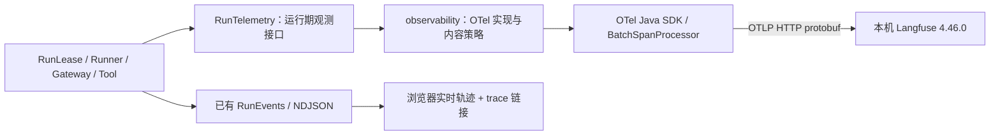

# OpenTelemetry Trace 接入技术方案

> 用一轮请求的执行树，解释 Agent 做了什么、为什么结束，以及时间和 Token 花在哪里。

核对日期：2026-11-02。**状态：已实现并通过 Langfuse 实际写入、CLI 回读和浏览器验证。** 本文保留设计依据，并按最终代码更新；实施证据与边界见第 11 节。配套的 [Trace 阅读指南](../07-reading-agent-traces.md) 区分结构示意与真实 Trace。

完整展开后的预期效果见[三模式 Span 树对照](../07-reading-agent-traces.md#9-接入后的完整-span-树)：用同一个七日天气问题展示阶段、模型、工具和 HTTP 的父子关系，并区分 span 总数与实际调用次数。

## 1. 接入后的结果

用户每发送一条被接受的消息，创建一个 trace；同一对话的多条 trace 用 Session ID 关联。展开后可以看到执行阶段、每次模型请求、每次工具尝试和真正发出的外部 HTTP 请求。沿着这棵树，能够回答：

- ReAct 为什么需要再问一次模型？ReWOO 的 Worker 为什么没有模型调用？
- Plan and Execute 的步骤为什么包含一个小型 ReAct 循环？哪次检查导致了计划修订？
- 天气工具耗时来自地点解析还是天气查询？一次工具尝试实际请求了几次 API？
- 没有得到答案，是需要用户澄清、预算不足、等待确认、模型失败，还是工具失败？

页面已有的 NDJSON 轨迹继续承担实时展示；OTel span 由服务端创建，经 OTLP/HTTP 发送到 Langfuse，负责持久化、分组、查询与对比。两者共享 requestId，不把每条页面消息机械转换成一个 span。

## 2. 实际研究与版本基线

### 2.1 本机检查

下表是实施前的检查基线，没有读取已有 Codex 对话的输入输出。实施时使用本机登录态另建独立项目，实际写入与回读结果见第 11 节。

| 检查项 | 实际结果 | 对接入的影响 |
| --- | --- | --- |
| Langfuse 服务 | `http://127.0.0.1:3035/api/public/health` 返回 HTTP 200，`status=OK`，版本 `4.46.0` | 可以使用现有实例，无需重装。 |
| CLI | 已安装 `@langfuse/cli`，命令 `langfuse`，版本 `1.2.4` | 实施后用 CLI 回读新写入的 observations。 |
| 已有项目凭据 | `native.env` 的项目查询成功，对应 `Codex Native OTel` | 属于 Codex 数据，项目接入应另配凭据。 |
| 创建项目能力 | CLI 有 `projects create` / `create-api-key`，帮助明确要求组织级 API key | 已有项目级 key 不能视为组织管理权限；项目创建改用本机已登录管理界面完成。 |
| 项目依赖 | Java 17、Spring Boot `3.5.16`，只有 Web / Test starter | 基线无 OTel；实施后新增原生 SDK `1.67.0`，不引入 Langfuse SDK。 |
| 页面轨迹 | `TraceEvent` 带 requestId、mode、phase、stepId、revision、usage | 业务关联信息已有，仍缺真正的 span 父子关系和 exporter。 |

OTLP 写入、字段转换、真实模型 Trace 与页面链接现均已验证；健康检查仅是前置条件。

### 2.2 官方规范核对

OTel 原 [GenAI 入口](https://opentelemetry.io/docs/specs/semconv/gen-ai/)已提示迁移到独立的官方仓库。此次使用 `open-telemetry/semantic-conventions-genai` 的提交 **`244465e94b9d7167fa5ed5c31a4b2b49ab6ddee5`**，提交日期为 2026-10-31。该快照的 GenAI 约定仍为 **Development**，不能将其称为稳定规范，也不编造尚未发布的 GenAI schema URL。

| 来源 | 核对结论 | 本项目决策 |
| --- | --- | --- |
| [Agent spans：固定快照](https://github.com/open-telemetry/semantic-conventions-genai/blob/244465e94b9d7167fa5ed5c31a4b2b49ab6ddee5/docs/gen-ai/gen-ai-agent-spans.md) | 已定义同进程 `invoke_agent`、明确规划阶段 `plan`；规划产生的模型调用位于 plan 下。 | 整轮使用 INTERNAL agent span；明确的计划生成使用 plan span。 |
| [Client inference：固定快照](https://github.com/open-telemetry/semantic-conventions-genai/blob/244465e94b9d7167fa5ed5c31a4b2b49ab6ddee5/docs/gen-ai/client-inference.md) | 推理是独立 CLIENT span，覆盖完整响应；有模型、用量及 reasoning level 字段。 | 每次 Gateway 实际发起的模型请求一个 generation，流结束后再结束。 |
| [工具与内容采集：固定快照](https://github.com/open-telemetry/semantic-conventions-genai/blob/244465e94b9d7167fa5ed5c31a4b2b49ab6ddee5/docs/gen-ai/gen-ai-spans.md) | 已定义 `execute_tool`；消息与工具内容属于显式开启的采集项。 | 使用标准工具语义；默认只采集结构和安全摘要。 |
| [属性注册表：固定快照](https://github.com/open-telemetry/semantic-conventions-genai/blob/244465e94b9d7167fa5ed5c31a4b2b49ab6ddee5/docs/registry/attributes/gen-ai.md) | provider 有 `deepseek`；输入总量含缓存，reasoning 属于输出总量。 | 服务提供方和协议分开；用量先统一口径，再映射。 |
| [Java SDK](https://opentelemetry.io/docs/languages/java/sdk/)与[Maven 元数据](https://repo.maven.apache.org/maven2/io/opentelemetry/opentelemetry-bom/maven-metadata.xml) | 核对时 Java BOM release 为 `1.67.0`。 | 首版固定 SDK/BOM `1.67.0`；不随每次构建漂移。 |

Langfuse 的[原生 OTel 文档](https://langfuse.com/integrations/native/opentelemetry)和[v4 迁移说明](https://langfuse.com/integrations/native/opentelemetry/migration-to-v4)确认：Java 可以直接用原生 OTel SDK；传输使用 HTTP/protobuf 或 HTTP/JSON，不能把 gRPC exporter 指向 Langfuse HTTP 地址。v4 的筛选上下文需复制到各个 observation；整轮输入输出放在根 observation 上，避免使用旧 trace create/update API。

## 3. 接入架构与配置



首版应用直接导出到 Langfuse，省去 Collector 的部署和路由。以后需要同时接多个后端，再将 exporter 地址改到 Collector。首版不叠加 Java Agent、Spring AI 或另一套 Langfuse SDK，避免自动与手动埋点重复。

`pom.xml` 引入固定版本的 `io.opentelemetry:opentelemetry-bom:1.67.0`，管理 `opentelemetry-api`、`opentelemetry-sdk`、`opentelemetry-exporter-otlp`；测试使用同版 `opentelemetry-sdk-testing`。只建立 TracerProvider，不额外启动 Metrics / Logs exporter。GenAI 字段集中在 observability 映射实现，记录上述规范提交，不为少量 Development 属性引入另一套实验依赖。

Trace 配置集中在 `src/main/resources/application.yml`，由 `TracingProperties` 绑定并交给 `TelemetryConfiguration` 初始化。YAML 支持下列环境变量占位符，也支持 Spring 标准的属性覆盖。

| YAML 配置 | 默认值 / 用途 | 环境变量覆盖 |
| --- | --- | --- |
| `agent.tracing.enabled` | `true`；关闭时使用 Noop 实现。 | `AGENT_TRACING_ENABLED` |
| `agent.tracing.langfuse.base-url` | `http://127.0.0.1:3035`；远程实例必须 HTTPS。 | `LANGFUSE_BASE_URL` |
| `agent.tracing.langfuse.project-id` | 可选，仅用于生成页面链接，不承担认证。 | `LANGFUSE_PROJECT_ID` |
| `agent.tracing.sample-ratio` | `1.0`，采用 ParentBased + TraceIdRatioBased。 | `AGENT_TRACE_SAMPLE_RATIO` |
| `agent.tracing.release` | `1.0-SNAPSHOT`；构建版本或 Git commit，不在请求中运行 Git。 | `AGENT_RELEASE` |

`agent.tracing.langfuse.public-key` / `secret-key` 在 YAML 中分别引用 `${LANGFUSE_PUBLIC_KEY:}` / `${LANGFUSE_SECRET_KEY:}`，由 Spring 解析并绑定；开启 Trace 时必须提供，真实值不写入仓库。启用 Trace 后统一采集限长内容预览，没有独立的内容模式开关。

OTel 实现使用 `OtlpHttpSpanExporter`，将完整 traces endpoint 设置为 **`http://127.0.0.1:3035/api/public/otel/v1/traces`**。程序在内存中对项目 public key 与 secret key 做 Basic Auth 编码，并设置 **`x-langfuse-ingestion-version: 4`**。不要将编码后的凭据打印到日志、拼入浏览器响应或保存到仓库。

Resource 设置 `service.name=agent-loop-learning`、`service.version`、`deployment.environment.name=local`。初始化器明确读取本项目配置，不借用 Codex 进程的 OTel exporter 设置；不调用全局 provider 的覆盖注册，不关闭其他组件拥有的 provider。

批量导出初始参数：队列 2048、每批 256、间隔 1 秒、单次导出超时 5 秒。Spring 关闭时有界 flush / shutdown，总等待最多 5 秒。业务路径不逐条同步 flush；导出失败不能改变 RunResult、占用 Agent 调用预算或阻止 RunLease 释放。开启 tracing 却缺少 key / endpoint 不合法时，启动阶段明确报配置错误；运行期间后端不可用由 SDK 报导出失败，聊天照常执行。进程被强杀或队列满仍可能丢 span，首版不承诺可靠投递。

已创建独立项目 `agent-loop-learning`，项目级 key 保存在仓库外 `~/.config/langfuse/agent-loop.env`，权限 `0600`。已有 `native.env` / `session.env` 继续服务 Codex，不混用。`./run-with-tracing.sh` 加载该文件；`AGENT_TRACE_ENV_FILE` 可覆盖路径。脚本只加载私有环境文件并启动应用，配置解析由 Spring 完成。

## 4. 一条 trace 的边界

| 标识 | 来源与用途 |
| --- | --- |
| Session ID | 为当前 Session 单独生成的 telemetrySessionId，同一对话不变；用于 `gen_ai.conversation.id` 和 `langfuse.session.id`。 |
| requestId | 每次接受消息时生成的 UUID；连接 NDJSON、RunLease、日志和 trace。 |
| traceId | OTel SDK 生成的 32 位十六进制 ID；一轮一个，不拿 requestId 字符串直接替代。 |
| spanId | SDK 生成的 16 位十六进制 ID；每个操作不同。 |
| stepId / revision | 当前算法步骤与计划版本；相同步骤在不同版本或尝试中不能合并成一个 span。 |
| native tool call ID / evidenceId | 前者配对模型协议结果，后者引用本轮证据；都不是 spanId。 |

根 span 名称固定为 `invoke_agent agent-loop.react`、`invoke_agent agent-loop.rewoo` 或 `invoke_agent agent-loop.plan_execute`，类型为 Langfuse `agent`、OTel `INTERNAL`。`gen_ai.operation.name=invoke_agent`，agent name 使用同一稳定名称。模式、提示词、轮次编号不拼进动态 span 名。

根 span 从 Session 校验成功、RunLease 被接受时开始；包括异步启动等待、执行、取消和资源清理。Controller 收到无效参数、并发请求而拒绝接受时，不创建一个虚假的“已运行 Agent”。首版不采集入站 HTTP server span，也不采集静态页面、轮询和每条 NDJSON 写入。

Session 的 Header 目前还承担访问会话的凭据作用。**不要把这个原值直接导出。** 代码为 Session 单独生成不可用于访问会话的 telemetrySessionId，以上表格的“Session ID”均指这个观测 ID；浏览器访问凭据继续仅用于已有 API。项目没有登录用户，不构造 `user.id`。

### 4.1 RunLease 为什么也是 trace 的归属点

RunLease 唯一代表“一条已经接受的消息”，正好覆盖两类容易漏记的场景：还没有进入工作线程就被取消，以及工作线程运行中收到取消。若只在 Runner.run 开头埋点，第一类请求就没有 trace；若在取消回调立即结束根 span，第二类请求的清理和子 span 又可能还没结束。

因此 RunLease 保存 `RunTelemetry` 句柄和根 Context，创建时不在 HTTP 线程长期 `makeCurrent()`。工作线程进入 `execute` 时临时激活 Context，退出时恢复。根 span 只由成功关闭 lease 的那条路径结束：

| 生命周期路径 | trace 行为 |
| --- | --- |
| `ACCEPTED → RUNNING → CLOSED` | 激活根 Context；记录 RunResult；子操作先结束；cleanup 后根 span 结束一次。 |
| `ACCEPTED → CLOSED` | 未启动取消；记录 cancelled / started=false；cleanup 后结束，无 generation。 |
| RUNNING 收到 cancel | 记录取消事件，通知 RunControl；等待工作线程退出并清理，回调不提前 end。 |
| Controller 输出最终 NDJSON 失败 | 在本地日志用 requestId / traceId 记录 transport 状态；不修改已经结束的 span，不把业务结果改写为模型失败。 |
| 旧回调晚到 | 按 lease 身份处理，不修改新一轮 trace，不释放新 activeRun。 |

`RunLease.execute` 当前在 `finally` 里 finish，Controller 在它返回后才发 run_result。因此必须在 execute 内保存业务结果或异常结果，不能等 Controller 后补一个已经结束的 span。根结束前记录 `agent_loop.run.delivery=not_confirmed`；它表示没有浏览器确认机制，不承诺回答已被用户收到。

Context 不能只靠 `Span.current()` 猜测：Servlet 接受线程、StreamingResponseBody 工作线程、HTTP 异步回调和确认接口线程不同。每个异步任务显式携带捕获的 Context；同一线程上的 Scope 使用 try-with-resources 及时恢复。`/api/approve` 通过当前 lease 找到等待中的确认操作，完成其结果；不把另一条 HTTP 请求当成新 Agent，也不让它结束模型 span。首版不把 baggage / 会话标识注入 DeepSeek、Exa 或天气 API。

## 5. 需要设计哪些 span 和 event

### 5.1 必需的 span 清单

这里的 `agent_loop.*` 名称和属性都是项目自定义；`gen_ai.*` 只用于规范已定义的含义。

| 操作 | span 名称 / Langfuse 类型 | 父操作与采集位置 | 解决的问题 |
| --- | --- | --- | --- |
| 一轮 Agent | `invoke_agent agent-loop.<mode>` / agent | 根；RunLease | 请求整体状态、耗时、预算、取消和清理。 |
| 初始规划、明确的计划修订 | `plan agent-loop.<mode>` / chain | 根；RewooRunner / PlanExecuteRunner | 计划生成、解析、校验和修复花了多少时间。 |
| P&E 检查下一步 | `agent_loop.review` / chain | 根；Replanner 调用与决策校验 | 检查可能只返回 CONTINUE / FINISH / STOP，不一概假定产生了新计划。 |
| ReWOO 工具步骤 | `agent_loop.work` / chain | 根；Worker 每个 E 步骤 | 参数绑定、依赖与工具结果；此阶段不调用模型。 |
| P&E 目标步骤 | `agent_loop.step` / chain | 根；StepExecutor.execute | 将步骤内的 ReAct 模型和工具调用放在一起。 |
| 汇总 / 澄清 | `agent_loop.solve`、`agent_loop.finalize`、`agent_loop.clarify` / chain | 根；对应 Runner | 区分取证后的回答与单纯解释缺少什么信息。 |
| JSON 修复 | `agent_loop.json.repair` / chain | 所属规划 / 检查 / 步骤；ModelJson | 修复包含额外 generation，与修改业务计划不同。 |
| 每次模型调用 | `chat <model>` / generation，CLIENT | 当前阶段；DefaultModelGateway | 实际请求数、输入输出用量、完整流耗时与结束原因。 |
| 每次工具尝试 | `execute_tool <registered-name>` / tool，INTERNAL | 当前阶段；DefaultToolExecutionService | 参数校验、缓存、确认与返回结果；一次尝试一个 observation。 |
| 天气地点解析 | `agent_loop.weather.resolve` / span | 天气 tool；CityResolver | 首次搜索、受限“市”后缀回退、唯一 / 同名 / 未找到。 |
| 外部 HTTP 请求 | `GET` / `POST`，span，CLIENT | 模型 generation、天气 resolve / tool、search tool | 真实网络次数、状态码、完整响应耗时、超时和取消。 |
| Bash 确认等待 | `agent_loop.approval.wait` / span | Bash tool；BrowserApproval | command / output 两次独立等待及批准、拒绝、过期。 |
| Bash 进程 | `agent_loop.bash.process` / span | Bash tool；BashTool 实际启动后 | 运行耗时、退出码和终止；与用户等待分开。 |

P&E 的 review 若返回 REVISE，仍在同一 review span 上记录 decision=REVISE 与新 revision；首版不为已经完成的那次模型调用倒补一个 plan 父 span。初始计划使用标准 `plan`；review 复合操作使用自定义语义，保持时间和调用关系真实。三个 Runner 都是进程内策略；Planner / Solver / Replanner 的提示词角色不意味着部署了多个独立 agent，不为每个帮助类生成 invoke_agent。

工具 span 表示一次逻辑调用尝试，包含参数无效、未知工具、命中缓存或确认拒绝等提前返回。用 `agent_loop.tool.executed` 区分实际执行，不能从 TOOL observation 数推导执行数。未知工具的 span 名使用固定 `execute_tool unknown_tool`。依赖失败、预算阻止而根本没有进入尝试的步骤，只记录 skipped event，不补造一个已调用工具的 span。为避免重复计数，不额外包一层同名 tool dispatch / tool execution span。

天气工具与业务继续解耦：CityResolver / OpenMeteoClient 使用可注入的窄观测接口，默认 Noop；OTel 适配器位于 observability 包。它们不接收 Session、Langfuse 或整份 RunContext。适配器从已激活的 OTel Context 读取当前父操作及白名单关联信息，不能在共享 WeatherService 上保存可变的“当前请求”；异步回调携带捕获的 Context。HTTP span 覆盖响应 body 读取结束，包括超过大小限制、超时和取消；收到响应头不代表请求完成。Search 和三个模型客户端的 HTTP 同样处理；不向第三方传播内部会话与认证信息。

### 5.2 用 event 表达瞬时事实

| event（项目自定义） | 内容白名单 |
| --- | --- |
| `agent_loop.run.started` / `agent_loop.cancel.requested` | 启动与取消事实；不记录任意异常 message。 |
| `agent_loop.plan.accepted` | revision、步骤数；计划原文不导出。 |
| `agent_loop.plan.decision` | CONTINUE / REVISE / FINISH / STOP；相关 phase / revision 关联当前步骤。 |
| `agent_loop.evidence.saved` | evidenceId、status、executed；hasValue、truncated 和来源数在工具结果中。 |
| `agent_loop.step.skipped` | 跳过事实，结合所属 step 与 evidence 状态阅读。 |
| `agent_loop.budget.exhausted` | model / tool / step / revision 分类及计数。 |
| `agent_loop.validation.failed` | JSON / plan / citation 分类、错误码；不放原始模型输出。 |

这些 event 附在所属的活跃 span，不单独变成一组零耗时 observation。已有 text / reasoning 分片不逐片建 span 或 event，避免把一轮请求放大成数千条记录。

## 6. 字段契约：标准、自定义与 Langfuse 映射

### 6.1 标准字段

| 位置 | OTel 字段 | 数据来源 / 规则 |
| --- | --- | --- |
| agent | `gen_ai.operation.name=invoke_agent`、`gen_ai.agent.name` | 同进程 Runner 的稳定名称，不填伪造的远程 agent.id。 |
| plan | `gen_ai.operation.name=plan`、`gen_ai.agent.name` | 能明确辨认的规划阶段。 |
| 模型 | `gen_ai.operation.name=chat`、`gen_ai.provider.name=deepseek`、`gen_ai.request.model` | 三个协议都在调用 DeepSeek；协议名字不改变 provider。 |
| 模型配置 | `gen_ai.request.max_tokens`、`gen_ai.request.reasoning.level`、`gen_ai.output.type` | 本轮 ModelRequest 的实际值；off 的线协议值与页面设置另行保留。 |
| 模型结果 | `gen_ai.response.finish_reasons`、可得时 `gen_ai.response.id` / `gen_ai.response.model` | AssistantTurn.ResponseMetadata 从实际协议响应提取；缺失时不拿请求值冒充返回值。 |
| 模型用量 | `gen_ai.usage.input_tokens` / `output_tokens`、`cache_read.input_tokens`、`reasoning.output_tokens` | 后两项均为 `gen_ai.usage.*` 子项；未知不写，零只有服务端明确返回时才写。 |
| 工具 | `gen_ai.operation.name=execute_tool`、`gen_ai.tool.name`、`gen_ai.tool.type=function` | 注册工具名称；有模型原生 ID 时填 `gen_ai.tool.call.id`。ReWOO 的 E1 不冒充原生 ID。 |
| 会话 | `gen_ai.conversation.id` | 非认证用途的 telemetrySessionId。 |
| HTTP | `http.request.method`、`http.response.status_code`、`server.address`、`server.port` | 标准 HTTP client 语义；保留安全的 scheme/host/path，查询参数与认证头不采集。 |
| 失败 | `error.type` | 受控类型，例如 MODEL_TIMEOUT、INVALID_ARGUMENTS、WEATHER_PROVIDER_ERROR。 |

首版不导出标准全量 input_messages / output_messages，而使用下文的安全 IO 摘要与预览。不把 ChatMessage JSON 冒充标准消息结构；JSON 属性先限制文本再序列化，保证合法。未部署额外 OTel Logs pipeline。

### 6.2 自定义字段

| 字段组 | 字段（均以 `agent_loop.` 开头） |
| --- | --- |
| 关联 | `request.id`、`mode`、`protocol`、`phase`、`step.id`、`plan.revision`、`model.round`、`evidence.id`、`semconv.revision` |
| 根结果 | `run.status`、`run.completion_check`、`run.error_code`、`run.started`、`run.delivery` |
| 计数 | `budget.model_calls`、`budget.tool_attempts`、`budget.tools_executed`、`budget.step_attempts`、`budget.plan_revisions` |
| 工具结果 | `tool.status`、`tool.error_code`、`tool.executed`、`tool.has_value`、`tool.truncated`、`tool.cached` |
| 计划与依赖 | `plan.step_count`、`plan.decision`、`step.status`、`step.evidence_ids` |
| 模型补充 | `model.use`、`model.message_count`、`model.tool_call_count`、`model.first_chunk_ms`、`model.first_text_ms`、`model.usage_accounting`、`model.raw_usage`、`model.usage_complete` |
| 天气与确认 | `weather.resolution`、`weather.candidate_count`、`weather.fallback_used`、`tool.http_requests`、`approval.kind`、`approval.outcome` |
| 内容控制 | `content.mode`、`content.omitted_reason`；预览超限添加 `[truncated]` 标记 |

版本、轮次和耗时使用数字，executed / cached 等使用布尔值，状态使用固定枚举字符串。requestId、stepId 不进入 span 名；若将来加 Metrics，也不作为高基数指标标签。RunCounters 的五项计数与子操作交叉核对，不以 observation 总数代替它们。

### 6.3 Langfuse 适配

映射集中在 `OtelRunTelemetry` 与 `UsageMapping`，业务层只描述运行事实。

| Langfuse 字段 | 实现约定 |
| --- | --- |
| 类型 | `langfuse.observation.type` 明确写 agent / chain / generation / tool / span；不依赖后端猜测。 |
| Session / 名称 | `langfuse.session.id`、`langfuse.trace.name`，复制到所有 span。 |
| 可筛选上下文 | `langfuse.observation.metadata.mode` / `protocol` / `requestId`，相关 span 加 phase / stepId / revision。根级筛选同时映射 `langfuse.trace.metadata.*`。 |
| 发布与环境 | `langfuse.release`、`langfuse.environment=local`，复制到所有 span。 |
| 输入输出 | `langfuse.observation.input` / `output`，根写本轮安全输入与结果摘要，子 span 写本操作摘要。 |
| 模型与用量 | 标准模型字段及经核对的 usage；需要专用映射时只在 generation 上设置，不把根当 generation。 |
| 严重程度 | DEFAULT / WARNING / ERROR；与下面的结果分类一致。 |

这些副本由 OtelRunTelemetry 的固定上下文添加，不能仅在根 span 上写 session / mode 后假设子 span 会继承。初版在本进程显式复制白名单，比把会话上下文放入对外传播的 baggage 更直接。根 observation 输入输出是 v4 的阅读入口，不用废弃的 `langfuse.trace.input` / `output`。

## 7. 用量、流式时间与结果状态

### 7.1 Token 不能简单相加

`TokenUsage` 现在显式保存 `InputAccounting`（INCLUDES_CACHE / EXCLUDES_CACHE / UNKNOWN）与 cache write。ProviderUsage 在协议层标记口径，UsageMapping 再归一化；不让 OTel 层仅凭字段名猜。Chat / Responses 的输入总量包含缓存；DeepSeek Anthropic 的 input 不含 cache，且最终 message_delta 用量替换起始累计值。

| 数据 | 归一化规则 |
| --- | --- |
| 已含缓存的 input total | 标准 input 直接取 total，cache read 作为子集，不再次加到 total。 |
| 明确不含缓存的 input，且有完整 cache 分项 | 标准 input = 未缓存 input + cache read + cache write；缺少分项时不伪造精确 total。 |
| output / reasoning | reasoning 是 output 的子集，不重复增加 output。 |
| usage 为空或流中断 | 只记录确实收到的值，标记 incomplete / unknown；不把缺失值改为 0。 |

Chat / Responses / Anthropic 的具体口径以 [DeepSeek 对应接口定义](https://api-docs.deepseek.com/guides/anthropic_api/)及有缓存命中的受控报文验证为准，不能因为协议兼容就套用另一家服务的全部计费规则。保留原始计数字段与 accounting 来源，方便追查转换。

OTel 总量与子集可并存；若设置 `langfuse.observation.usage_details`，必须提供不重叠的明细及明确 total，例如 total input=100、cached=40 时，未缓存 input=60、cached=40；output=20，其中 reasoning=5，则普通 output=15、reasoning=5、总量=120。**不能填 input=100、cached=40 后又让后端相加。** 先用固定样本回读 `usageDetails` 验证转换，再开放成本统计。仅对 GENERATION 求和；根和 phase 不重复填 usage。

实测本机 `deepseek-flash` 的 `costDetails={}`、`totalCost=null`；目前没有匹配价格。`deepseek-v4-pro` 未实测。Token 已验证，费用仍未知；不手写过期单价，也不将空费用改为零。

### 7.2 首个 chunk 与首个可见文本不同

协议客户端现通过 ModelStreamObserver 回调报告内容与用量：首个有内容的 text / reasoning / tool-name / tool-arguments chunk 记录 first_chunk，首个正文 text 记录 first_text；排除 ping、created 和只有角色的事件。没有正文的工具调用响应可以有 first_chunk，而没有 first_text。

`langfuse.observation.completion_start_time` 取首个有效内容 chunk 的 UTC 时间；毫秒耗时用单调时钟计算。它供后端显示生成起始时间，不冒充用户看到最终回答的时间。generation 在最终 usage、结束原因和完整性检查完成后结束。已到达的中间 usage 即时记录；流失败时仍保留它，并以 `agent_loop.model.usage_complete=false` 区分不完整用量。未收到的分项不填零。HTTP 200 但供应方 SSE 中途断开，generation 仍是失败；若是 onText 写浏览器时断连，则记录 CLIENT_DISCONNECTED / 取消来源，不能将这个回调异常归因为供应方故障。

### 7.3 业务结果与 OTel 错误分开

| 情况 | OTel / Langfuse 处理 |
| --- | --- |
| COMPLETE | 根 status 保持 UNSET；业务状态 COMPLETE；completion_check 保留实际值。 |
| NEEDS_INPUT | 正常结束，默认级别；输出候选数 / 待补字段摘要，不标记错误或自动重试。 |
| PARTIAL、SKIPPED、DENIED、缓存命中 | 记录业务状态与 executed；必要时 WARNING，不能一律记作异常。 |
| 明确的用户取消 | 记录 CANCELLED 与原因码，正常结束；由取消触发的子操作同样区分，避免伪装为 provider 故障。 |
| 超时、外部服务失败、非法参数、计划校验失败 | 对失败的操作设 ERROR 与 error.type；根是否失败取决于最后 RunResult，允许局部失败后完成。 |
| 计划修复后成功 | 保留 validation.failed 事件与 repair 子操作，根正常结束，不覆盖第一次失败事实。 |

COMPLETE 只说明执行契约完成。当前 RunResult 往往是 `CompletionCheck.UNVERIFIED`；trace 不能把它改写为“答案已验证正确”。

## 8. 内容采集边界

启用 Trace 后统一记录结构化摘要与限长内容预览。根 input 为问题长度、模式、模型及问题预览，output 为状态、回答长度与回答预览；模型 span 记录消息数、工具数、结束原因及文本输出预览，工具 span 记录状态、证据 ID、来源数。calculator / weather 的参数与结果、步骤摘要也通过内容策略处理，没有仅记录元数据的分支。

内容不做脱敏替换。当前仍不导出全量 ModelRequest / 历史、system prompt、reasoning、Bash 或搜索正文；reasoning 的长度与用量可观察。每个预览上限约 4 KiB，截断后标记，JSON 结构保持有效。

**Bash 命令原文和原始输出始终不进入遥测。** 两次确认等待只记录 kind / outcome / 时长。内容策略还必须处理旁路：模型返回的 Bash 调用参数、后续历史、异常消息和最终回答可能包含命令或输出。工具白名单过滤先于序列化；一旦本轮涉及 Bash（含模型 JSON 计划中提及 Bash），本 Session 后续自由文本预览关闭，根输出只保存结果摘要。测试用哨兵内容检查模型 span、根、event、HTTP 与 exporter 中均没有泄漏，不能只检查工具 span。

不采集任何认证头、会话访问 Header、环境变量、URL query、异常完整响应体。来源 URL 只保留允许的 scheme / host / path，去掉 query 与 fragment。认证信息不作为遥测采集字段；正文预览保持原文，仅执行长度限制和上述内容范围约束。

## 9. 代码改造清单

下列对应已落地实现。路径基于 `src/main/java/dev/learning/agent/`。

| 位置 | 改动与职责 |
| --- | --- |
| `core/runtime/RunTelemetry`、`TraceSpan`、`TelemetryFactory`、`ExternalObserver` | 小型运行期接口；根 / phase / model / tool 操作使用明确的描述与结果类型，提供 Noop。业务层不依赖 Langfuse 字段。 |
| `observability/TelemetryConfiguration` | Spring 绑定 YAML 配置，初始化 SDK、exporter、Resource，管理 shutdown。 |
| `observability/OtelRunTelemetry`、`OtelSpan` | 创建 span、保存 Context、激活作用域、复制固定上下文、保证根只结束一次。 |
| `observability/OtelTelemetryFactory`、`UsageMapping` | 固定规范快照与两套字段映射；自定义字段统一前缀。 |
| `observability/TraceContentPolicy` | 依据 typed 输入构造白名单摘要 / 预览，不接受任意对象整体序列化。 |
| `app/chat/AgentSessions`、`RunLease` | Session 增加观测 ID；接受时建根、传入 runtime；在关闭 lease 前填完结果与计数。 |
| `core/runtime/RunContext`、`RunContexts` | 持有本轮 RunTelemetry；离线实验与已有测试默认 Noop，保留易用构造入口。 |
| `core/react`、`core/rewoo`、`core/planexecute` | 显式围住阶段 / 步骤；ReAct 模型和工具直接挂当前循环范围，P&E 则挂当前 step。 |
| `core/planning/ModelJson` | 记录校验事件与有界修复；不靠仅有 running 的页面 phase 事件倒推开始结束。 |
| `model/DefaultModelGateway` | 模型 span 的唯一业务入口；成功、失败、usage、流结束均在这里收口。 |
| `deepseek/`、`model/` | 补可选响应元数据、计量口径、流观测回调；HTTP span 到完整 body / SSE 结束。 |
| `tool/DefaultToolExecutionService` | 每次逻辑尝试一个 tool span，保存结果 / 证据关联；静态 skipped / rejected 路径也保留事件。 |
| `tool/weather/`、`SearchTool`、`BashTool`、`BrowserApproval` | 窄接口注入 HTTP / 地点解析 / 等待观测，不把后端对象传入天气业务。 |
| `app/chat/RunLease`、前端脚本 | run_started 增加 traceId 和可选 traceUrl；轨迹页提供本轮入口，关闭 tracing 时隐藏。 |

所有 scope 都遵循“开始 → 填结果或错误码 → finally 结束”；phase 内仍有独立 generation / tool。结束记录来源是实际控制流，不通过回放 TraceEvent 输入输出另造一套执行状态。

页面执行模式仍在对话框上方，每条消息接受后只固定本轮，清理完成后可选择下一轮模式。同一 Session 下不同 trace 可以有不同 mode，不能只从 Session 推导 mode。trace 链接放在每轮轨迹摘要，不增加一个可以改变本轮算法的设置。只有配置 projectId 且确认实例 URL 格式后才拼链接；否则展示 traceId 并提供复制，不把缺少链接当作运行失败。采样关闭时不承诺存在可查询 trace。

## 10. 实施顺序与验收

### 10.1 实施完成项

- [x] 创建独立 Langfuse 项目、私有环境配置；确认项目级 key。
- [x] 固定 Java OTel 版本，完成配置 / Noop / 内容策略与 in-memory 测试。
- [x] 接 RunLease 根、Gateway generation、工具尝试和状态 / 计数。
- [x] 接三模式阶段、计划 / 证据 / 修复事件与步骤范围。
- [x] 接模型 / 搜索 / 天气 HTTP、地点解析、Bash 确认等待。
- [x] 核对三协议 usage 与首 chunk；完成标准、Langfuse 字段映射测试。
- [x] 页面增加 traceId / 链接，保留逐轮模式选择与实时轨迹。
- [x] 运行真实路径、回读新 traces，补充本方案的实施后证据。

每一步做完相应验证后再扩展；不能仅凭 OTel 依赖能编译便标记接入完成。

### 10.2 确定性测试

使用 `InMemorySpanExporter` 和可控模型 / 工具 / HTTP server，至少覆盖：

1. ReAct 模型 → 工具 → 模型同级；generation 数等于实际模型次数。
2. ReWOO PLAN / WORK / SOLVE 分开，WORK 无 generation；依赖跳过没有假 HTTP。
3. P&E step 内有局部循环；review / revision / evidence 能关联；修复消耗一次模型预算。
4. Session 多轮不同 traceId、相同观测 Session ID；并发 Session 不串 Context；访问凭据不导出。
5. 启动前取消、运行中取消、旧回调、断流、异常均只结束一次根，所有子 span 已结束。
6. NEEDS_INPUT、拒绝确认、命中缓存、预算耗尽与网络超时分别有正确状态和 executed 计数。
7. usage 有缓存 / 无缓存 / 缺失 / 推理分项，回读总量不重复；首有效 chunk 与首正文区分。
8. 天气唯一地点两次 HTTP、后缀回退多一次、歧义只有地点 HTTP；响应 body 超限 / 超时可见。
9. 后端宕机不改变业务结果、不阻塞释放；关闭 tracing 无网络导出；shutdown 有界。
10. Bash / key / Session Header 哨兵在所有序列化输出中不可见；内容截断仍是合法 JSON。

实际运行 `mvn package`（含测试）与 `node --test src/test/js/*.test.js`；当前分别 147 / 10 项通过。这里列的是验收维度；真实 API 覆盖与确定性测试覆盖的区别见第 11 节。

### 10.3 Langfuse 实际回读

先通过当前 key 所属项目查询确认身份。用固定窗口、已知 traceId 查询本次新产生的数据，避免扫描 Codex 项目历史：

```bash
langfuse --env ~/.config/langfuse/agent-loop.env api projects list --json
langfuse --env ~/.config/langfuse/agent-loop.env api observations list \
  --from-start-time "$TRACE_FROM" --to-start-time "$TRACE_TO" \
  --trace-id "$TRACE_ID" \
  --fields core,basic,time,model,usage,metrics,metadata,trace_context \
  --all --max-items 200 --json
```

本机 `agent-loop.env` 已配置；`TRACE_FROM` / `TRACE_TO` 为目标 UTC 窗口，`TRACE_ID` 可使用阅读指南中的真实样例。CLI 返回封装从 `body.data` 读取记录，分页信息取 `body.meta`；达到上限时继续有界翻页，不将一页数据当全集。需要核对 IO 时，再对已知教学 trace 加 `io`，只输出脱敏摘要。新代码不使用旧 `/api/public/traces` 或 create/update ingestion。

每种模式至少运行一次计算和一次天气查询；再验证澄清后补充地点的同会话双 trace、可控故障及取消。真实模型可能产生不同计划，校验的是结构、关联和计数不变量，不要求固定模型调用次数。天气请求用实际来源，不把 fixture 称为真实 API；Bash 真实执行及输出分享仍分别需要已有的用户确认流程。

验收记录保存：运行时间、项目 ID、release、请求模式 / 协议、traceId、父子关系摘要、调用计数 / usage、结果与未验证项。数据暂存 `target/trace-verification/`，不提交密钥或完整对话。最后重新读取 Langfuse 的[最佳实践](https://langfuse.com/docs/observability/best-practices)，逐项审计新 trace 的类型、层级、名称、输入输出、模型用量、Session 与敏感内容；修正后重跑、回读，才更新状态为已接入。

## 11. 实施与验收（2026-11-02）

### 11.1 已落地的配置与入口

原生 OTel Java SDK / BOM 固定为 `1.67.0`，直接向本机 Langfuse `4.46.0` 导出 HTTP/protobuf，未安装第二套 Langfuse SDK。独立项目名为 `agent-loop-learning`，项目 ID 为 `cmvytzpya0003oe078lhvii2k`。密钥只在仓库外的私有配置中；这里的项目 ID 不具有认证能力。

在项目目录运行 `./run-with-tracing.sh`，脚本加载私有环境文件，Spring 从 `application.yml` 读取 Trace 配置。启用后统一采集限长内容预览。页面每轮回答和轨迹摘要均有 Trace 入口；日志记录 requestId / traceId。三种执行模式仍逐轮选择，只在运行中只读。

实际实现采用四个 runtime 接口与一个 observability 包：前者表达运行事实，后者拥有 SDK、内容策略和字段映射。未把 OTel / Langfuse 类型放入天气服务或算法包。每次外部 HTTP span 持续到 body / SSE 关闭；取消回调只关闭资源，不在回调线程关闭另一个线程的 Scope。

### 11.2 验证结果

| 验证 | 实际结果与边界 |
| --- | --- |
| 确定性回归 | `mvn package` 通过 147 项 Java 测试；前端状态 / 来源测试 10 项通过。包含 InMemorySpanExporter 层级、用量、脱敏、Context 隔离与 RunLease 取消测试。 |
| 真实模型与天气 | 三协议 × 三模式 × calculator / weather 共 **18/18** 完成；模型均为 deepseek-flash、reasoning off。每条新 trace 都经 CLI 回读，校验根、类型、父子关系、模型与工具计数、Session 和缓存用量。 |
| 最终映射复查 | 修改未知分项与流中间用量处理后，分别重跑三个协议的计算任务；回读确认最终 usage_complete=true，未知分项省略，分项之和等于 total。流失败时保留已知中间用量由确定性测试覆盖。 |
| 浏览器 | 真实 ReAct 地点歧义 → 同会话切换 ReWOO 补全北京行政区 → COMPLETE。运行中模式只读，结束恢复选择；两条 Trace 链接均可打开，390px 无水平溢出，应用 JS 异常为 0。 |
| 历史元数据采集记录 | 当时 CLI 回读上述两轮及最终三协议样例，正文预览均为空；歧义轮只有地点 GET、无预报 GET、无 ERROR；补充后有两次 GET，观测 Session 相同。 |
| 后端不可用 | 将 exporter 指向不可达的本机端口，真实计算仍 COMPLETE，RunLease 释放；进程退出实测 5.39 秒，包含 Spring 清理，SDK 等待有 5 秒上限。 |

真实矩阵脚本为 `experiments/trace_verification.py`，输出在 Git 忽略目录 `target/trace-verification/`。脚本只回读自己刚产生的已知 Trace，不查询 Codex 项目的对话。浏览器测试环境缺少中文字体，截图中文字显示受限；中文 DOM 与交互断言通过。

### 11.3 后端转换与真实案例

三条 Chat Completions 天气 Trace：

| 模式 | 真实 Trace | 模型 / 工具 / HTTP / 总 span |
| --- | --- | --- |
| ReAct | [打开 Trace](http://127.0.0.1:3035/project/cmvytzpya0003oe078lhvii2k/traces/4e5d7b0253659c05944a38532d211b0e) | 2 / 1 / 4 / 9 |
| ReWOO | [打开 Trace](http://127.0.0.1:3035/project/cmvytzpya0003oe078lhvii2k/traces/3b6be82502c8f12dc371bd4a45c1ac11) | 2 / 1 / 4 / 12 |
| Plan and Execute | [打开 Trace](http://127.0.0.1:3035/project/cmvytzpya0003oe078lhvii2k/traces/92a95c86bb094c1cb6e3905fefea374d) | 7 / 1 / 9 / 25 |

P&E 实际拆成“获取天气”和“概括趋势”两个目标，因此比阅读指南第 9 节的单目标示意多一个 step 和 review，模型调用从 5 变成 7。第二个 step 没有工具。这是模型真实计划的差异，不能把示意树当作验收时必须出现的固定结构；完整讲解见[真实 Trace 复盘](../07-reading-agent-traces.md#10-用真实-trace-复盘)。

Langfuse 会将 TOOL 名显示为 `weather_forecast` / `calculator`，原始 SDK span 名仍为 `execute_tool <name>`；这是后端 GenAI 映射，不是少了一层 span。CLI 展开属性后，本实例返回 `metadata["attributes.agent_loop.model.raw_usage"]` 这样的平铺键，而非 `metadata.attributes` 嵌套对象；mode / phase / stepId / revision 另有显式 metadata 映射。

Chat / Responses 原始 input 含缓存；Anthropic 的 input 不含缓存。实测出现非零 cache read，归一化及不重复累计均通过。Token 只在 GENERATION 上记录。本机 DeepSeek 价格未匹配，费用为空，尚不能作为货币成本报告。

最终三协议计算复查为 [Chat Completions](http://127.0.0.1:3035/project/cmvytzpya0003oe078lhvii2k/traces/4c9d3e526a51571135cd609572630a1a)、[Responses](http://127.0.0.1:3035/project/cmvytzpya0003oe078lhvii2k/traces/d750f056166ab0f7003efe03309eb0bd)、[Anthropic](http://127.0.0.1:3035/project/cmvytzpya0003oe078lhvii2k/traces/37e9f54376389605752442f84506e744)。每条为 2 个 GENERATION、1 个 TOOL、2 个模型 HTTP、共 6 个 span，这些历史样例当时仅采集元数据。Chat 的最终用量可能附在带 choice 的最后数据帧，因此解析器在收到正常结束标记并完成组装后，再明确标记 usage 完整；不只依赖空 choices 的 usage 帧。

### 11.4 尚未验证或继续保留的边界

此次没有真实运行 Bash 或 Exa 搜索；其代码埋点已接入，审批、脱敏及相关工具行为由确定性测试覆盖。真实重规划、复杂失败恢复、High / Max、其他模型和长期负载不在此次矩阵中。探索巴黎地点消歧时曾出现 Solver 引用待补充证据而被校验拒绝，已记录为 FAILED trace；这说明流程失败可定位，不代表模型层面所有地点补充都能成功。

完整历史 / 提示词 / reasoning、原始 Bash / 搜索正文均不导出，这是内容策略的明确边界。采样、内存队列和非可靠投递保持原设计；关闭 tracing 使用 Noop。此次完成 tracing，不额外部署 Metrics / Logs 管道、Collector 或评测服务。


### 11.4 YAML 配置迁移（2026-11-07）

`application.properties` 已迁移为 `application.yml`。Trace 默认开启，`TracingProperties` 绑定 `agent.tracing` 下的开关、采样率、版本和 Langfuse 地址、项目 ID、凭据；凭据通过 YAML 环境变量占位符解析，工厂不再直接读取环境变量。内容模式分支和脱敏替换已删除，统一保存限长内容预览，既有 Bash 内容范围约束继续生效。

`mvn clean package` 通过 161 项 Java 测试，前端 10 项测试通过。新增测试覆盖 YAML 默认值、占位符解析、Spring 属性覆盖、关闭时的 Noop、配置校验和真实 OTLP HTTP 导出。

本机 Langfuse [配置迁移验证 Trace](http://127.0.0.1:3035/project/cmvytzpya0003oe078lhvii2k/traces/b245027742c1d98996192fb354f635f2) 已经 CLI 回读：1 个根、1 个本地 calculator 工具，输入 `1+2`、输出 `3`、状态 COMPLETE，父子关系正确，问题和回答预览存在。该验证没有调用外部模型或天气 API。

### 11.5 类型化属性声明（2026-11-07）

`telemetry.SpanAttributes` 与 `LangfuseAttributes` 使用 record 声明属性，组件上的自定义
`@OtelAttribute` 指定 Key，`aliases` 支持同一值映射到 trace / observation metadata。
`TraceSpan.attributes` 只接受这些类型明确的属性对象；`OtelAttributeWriter` 缓存映射，
并在观测工厂初始化时校验生产声明。原有 96 个 Span / 事件属性 Key 全部保留。
这次只迁移属性声明和写入，Span 生命周期、父子关系、用量归一化和内容限制继续使用原实现。

支持的类型为 String、int / Integer、long / Long、boolean / Boolean、double / Double、
`List<String>`；`null` 不写入且不覆盖已有值，`0` 与 `false` 保留。
只读取标注组件，不展开任意对象。Resource 属性和事件名称不属于此次 Span 属性迁移。

`mvn -Pquality verify` 通过 179 项 Java 测试，含 11 项新增映射测试；
`java_quality.py check --base origin/main`、课程审计、认证审计和 README 计数检查通过。
使用当前构建向本机 Langfuse 导出三模式真实计算器请求，均为 COMPLETE，答案为 46：

| 模式 | 真实 Trace | 模型 / 工具 / HTTP / 总 span |
| --- | --- | --- |
| ReAct | [打开 Trace](http://127.0.0.1:3035/project/cmvytzpya0003oe078lhvii2k/traces/2f55839839ff40764d5a9ac1248fca26) | 2 / 1 / 2 / 6 |
| ReWOO | [打开 Trace](http://127.0.0.1:3035/project/cmvytzpya0003oe078lhvii2k/traces/86ef99cdb58f7b9460ae6b807e0f5b0f) | 2 / 2 / 2 / 11 |
| Plan and Execute | [打开 Trace](http://127.0.0.1:3035/project/cmvytzpya0003oe078lhvii2k/traces/91b13a22b78d0ca05c054f41634ad059) | 5 / 1 / 5 / 16 |

三条 Trace 已通过 CLI 回读校验：同一观测 Session、父子关系完整、模型和工具数量与运行计数一致、
模型名称及 token 用量存在且归一化没有重复累计。此次没有真实调用天气、搜索或 Bash；
这些路径由现有确定性测试覆盖。
