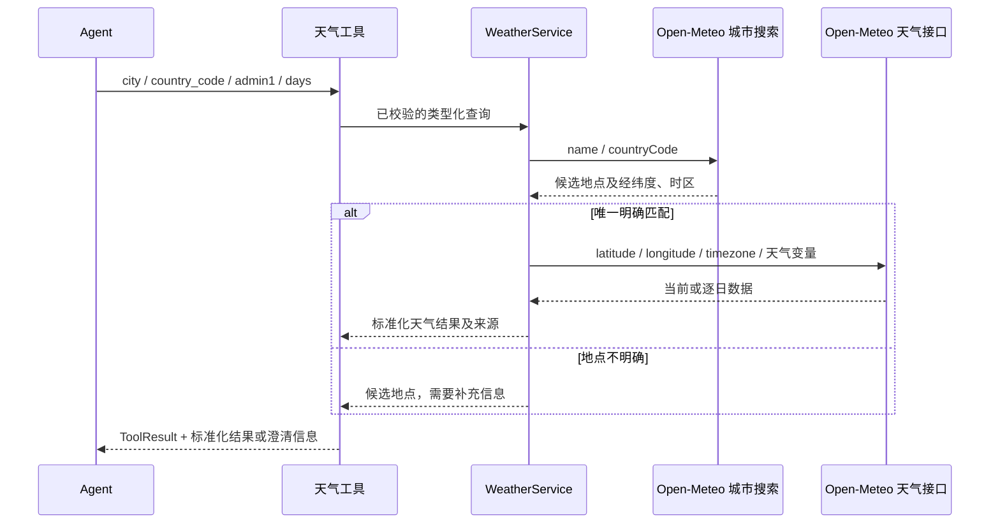

# 天气能力实现方案 v1

日期：2026-11-01（Asia/Shanghai） · 状态：已实现；实施验证日期为 2026-11-02

[项目](../../README.md) · [当前架构](../01-architecture.md) · [三模式方案](agent-execution-technical-design.md)

## 1. 首版做什么

Agent 对外提供两个工具：`current_weather` 查询当前天气，`weather_forecast` 查询从当地今天起、包含今天的未来 1–7 天逐日预报。两个工具共用地点解析和 Open-Meteo 客户端。首版用于个人学习，无需注册、API key 或新的依赖。

工具提供事实，Agent 负责选择、组合和解读。例如比较北京与上海的天气，需要分别查询两个城市；是否带伞、如何安排出行，由 Agent 基于查询结果说明依据，不另建“带伞工具”或“旅游天气工具”。

| 能力 | 首版处理 |
| --- | --- |
| 当前气温、体感、湿度、天气状况、风速 | `current_weather` |
| 每日天气、最高/最低温、最大降水概率、最大风速 | `weather_forecast`，默认 7 天 |
| 城市搜索、国家和省级地区限定、同名地点消歧 | 两个工具共用的内部能力 |
| 时区、当地日期、单位、来源、查询时间 | 所有成功结果必须携带 |
| 逐小时、分钟降水、历史天气、空气质量、天气预警 | 首版不提供；需求明确后分别设计 |
| 任意地址、街道定位、经纬度由模型直接指定 | 首版不提供 |

Open-Meteo 免费接口面向非商业用途，教育使用属于其列出的场景；使用时遵守请求限额并注明来源。免费服务和数据许可是不同约束。[服务条件](https://open-meteo.com/en/terms)、[数据许可](https://open-meteo.com/en/licence)

## 2. 两个工具的输入与选择规则

### 2.1 当前天气

```json
{
  "name": "current_weather",
  "arguments": {
    "city": "北京",
    "country_code": "CN",
    "admin1": "北京市"
  }
}
```

用于“现在多少度”“当前风大吗”等当前状况查询。当前天气使用 API 提供的模型估计，并不表示取得了某个气象站的直接观测。[当前天气定义](https://open-meteo.com/en/docs#current)

### 2.2 逐日预报

```json
{
  "name": "weather_forecast",
  "arguments": {
    "city": "北京",
    "country_code": "CN",
    "admin1": "北京市",
    "days": 7
  }
}
```

| 参数 | 类型与约束 | 是否必填 |
| --- | --- | --- |
| city | 非空城市名，去首尾空白后最多 100 字符；不能混入国家、省份或整段提问 | 是 |
| country_code | 有效的 ISO 两字母国家代码，规范化为大写，例如 CN；不隐式设为中国 | 否 |
| admin1 | 省、州或直辖市名称，最多 100 字符，例如北京市 | 否 |
| days | JSON 整数 1–7，省略时为 7；字符串、小数、null 和越界值均拒绝 | 仅预报工具使用 |

两个工具都拒绝未知字段、重复字段、错误类型和空字符串。可选字符串可以省略，显式 null 也拒绝。当前天气工具不接受 days。固定使用摄氏度、km/h 和百分比，首版不开放单位切换。

| 用户表达 | 工具使用方式 |
| --- | --- |
| “北京现在天气怎么样” | current_weather |
| “北京今天天气怎么样” | weather_forecast，days=1，报告当天范围而非仅当前值 |
| “北京明天天气怎么样” | weather_forecast，days=2，再按返回的当地日期选择明天 |
| “未来七天” | weather_forecast，days=7；明确今天是否已包含 |
| “比较北京、上海未来七天天气” | 两次 weather_forecast，再比较同日期、同单位的数据 |
| “八天后”“上周天气”“分钟级降雨” | 说明首版覆盖范围，不将七天数据当作所问日期的数据 |

工具描述明确上述边界，模型按问题选择。相对日期以工具返回的 localDate 和 timezone 为准，不用服务器所在时区推算城市的“今天”。

## 3. 工具参数不是外部 API 参数

`city`、`country_code`、`admin1`、`days` 是我们定义的工具输入。Open-Meteo 天气接口接收经纬度，所以每次查询先解析城市，再查天气。模型不负责猜经纬度。



### 3.1 城市搜索

实际接口为 `GET https://geocoding-api.open-meteo.com/v1/search`。city 映射到 name，country_code 映射到 countryCode；admin1 若提供，使用接口支持的英文逗号限定词，例如 `name=北京, 北京市`。固定 `language=zh`、`count=20`，所有参数通过 URL 编码器构造。[城市搜索参数](https://open-meteo.com/en/docs/geocoding-api)

```text
name=北京, 北京市
countryCode=CN
language=zh
count=20
```

admin1 不是该 API 的独立请求参数。城市名称也不保证可以原样使用“北京市，中国”这样的自然语言文本，不能直接透传先前讨论中的 location 字符串。

### 3.2 当前天气与预报

两种查询都调用 `GET https://api.open-meteo.com/v1/forecast`，仅请求各自需要的变量。

| 工具 | API 参数 |
| --- | --- |
| current_weather | current=temperature_2m,apparent_temperature,relative_humidity_2m,weather_code,wind_speed_10m |
| weather_forecast | daily=weather_code,temperature_2m_max,temperature_2m_min,precipitation_probability_max,wind_speed_10m_max；forecast_days=days |
| 共用 | 经地理编码取得的 latitude、longitude、timezone；temperature_unit=celsius；wind_speed_unit=kmh |

接口支持的预报长度大于首版工具范围；工具仍将 days 限定为 1–7，不把供应商的全部能力直接暴露给模型。[天气参数及返回定义](https://open-meteo.com/en/docs)

## 4. 地点怎么确定

CityResolver 负责这部分，Runner 不处理城市名称。首版采用保守选择：仅在候选地点明确唯一时查天气，不用人口、排名或“第一条”替用户决定行政地区。

1. 校验、去首尾空白；组合明确提供的 country_code 和 admin1。比较名称时做 Unicode 规范化和大小写处理，保留原文供展示。
2. 请求城市搜索，再核对返回地点的国家、行政地区和规范化名称；仅精确匹配可自动接受。只有前缀匹配、或输入名与本地化返回名不同的候选，都需要用户确认，不内置未经核验的别名库。
3. 如果零结果，且原城市以“市”结尾并有明确的中国国家限定，只允许去掉一次终末“市”再查一次。该回退只用于成功返回零结果的情况；不能在超时、429 或服务错误后自动换名字重试，也不做任意地址清洗或翻译。
4. 用供应商地点 ID 去重。唯一且精确匹配返回 GeoLocation；完全无候选返回 LOCATION_NOT_FOUND；多个匹配或有候选但名称仍不明确时，返回 NEEDS_CLARIFICATION 和最多 5 个候选。
5. 候选展示完整城市、admin1、国家和供应商地点 ID。超过展示上限时要求补充国家或省级地区，不暗示展示项已穷尽全部地点。
6. 用户确认后，模型将确认内容转为 city、country_code、admin1，下一轮重新查询；不让模型根据候选排名猜测，也不让它编造地点 ID。

名称匹配的规则必须有确定性样例；首版不实现任意地名翻译。英文输入与中文返回名不一致时，同样通过候选确认处理。省级地区限定优先使用候选返回的名称；无法核对时要求补充，而不是猜测。

**这意味着：** 用户只说“北京”而接口返回不同省份的同名地点时，可能需要补问一次。用户明确说“北京市”时，可结构化为 city=北京、admin1=北京市。首版接受这次交互成本，避免静默查错地方。

## 5. 哪些职责放在哪里

天气能力与出行、穿衣、旅游等使用场景分开；天气接口适配也与 Agent 编排分开。

| 组件 | 职责 |
| --- | --- |
| CurrentWeatherTool / WeatherForecastTool | 描述能力、解码参数、调用服务、将天气结果转为 ToolResult |
| WeatherService | 组合地点解析和天气查询，形成标准化结果 |
| CityResolver | 名称规范化、候选核对、消歧；不生成用户回答 |
| WeatherProvider | 查询地点、当前天气和逐日预报的类型化接口，便于替换供应商和注入测试替身 |
| OpenMeteoClient | 固定 HTTP 端点、外部 DTO、单位和时间转换、响应校验 |
| Runner / ReActEngine | 工具选择与调度、预算、证据、计划和最终回答 |

WeatherService 不读取 Session、Runner、提示词或浏览器状态；调用链仅共享已有 RunControl 以支持取消和剩余时限，不传入完整 RunContext。工具适配层负责接入预算、事件和证据。更换天气供应商时，先修改 WeatherProvider 实现与装配，不改变两个工具的使用含义。

首版仅实现 Open-Meteo，不加入供应商选择界面、自动降级或新的 SDK。多个城市仍由 Agent 发出多个独立工具调用，天气服务不理解“旅行计划”等上层任务。

## 6. 标准化输出与时间含义

天气服务保留明确 Java 类型：LocationQuery、GeoLocation、CurrentWeather、DailyForecast、ForecastDay、LocationCandidate。外部 DTO 仅存在于 OpenMeteoClient 边界，不把通用 JSON 树作为业务状态传递。以下 JSON 是标准化输出的形状示例；数值是固定测试夹具，不是当前预报。

```json
{
  "location": {
    "name": "北京",
    "countryCode": "CN",
    "admin1": "北京市",
    "latitude": 39.9075,
    "longitude": 116.39723
  },
  "timezone": "Asia/Shanghai",
  "localDate": "2026-11-01",
  "fetchedAt": "2026-11-01T04:00:00Z",
  "dataKind": "MODEL_FORECAST",
  "temperatureUnit": "°C",
  "windSpeedUnit": "km/h",
  "days": [
    {
      "date": "2026-11-01",
      "weatherCode": 3,
      "description": "阴",
      "temperatureMin": 5.0,
      "temperatureMax": 16.0,
      "precipitationProbabilityMax": 20,
      "windSpeedMax": 15.0
    }
  ]
}
```

当前天气使用独立 CurrentWeather 类型，包含 dataTime、temperature、apparentTemperature、relativeHumidity、weatherCode、description 和 windSpeed；不使用一个装满可空字段的“万能天气对象”。

| 字段或检查 | 规则 |
| --- | --- |
| fetchedAt | 本次取得数据的时间，不冒充供应商更新时间 |
| localDate | 用注入的 Clock 和返回地点时区计算，所有“今天/明天”据此解释 |
| dataTime | 当前天气变量的有效时间，必须带时区含义 |
| 预报日期 | 数量等于 days、连续、从 localDate 起；跨午夜导致日期错位时显式报错，下一轮可重新查询 |
| 坐标 | 地点坐标与天气网格坐标分开保存，不能将网格中心称为观测站 |
| 缺值 | 关键气温、时间、天气代码缺失则失败；非关键概率、湿度、风速等可为 null，并附 missingFields，不能当作 0 |
| 数据校验 | 经纬度、有效时区、数组对齐、最低温不高于最高温、概率 0–100；异常响应不进入成功证据 |
| 天气代码 | 按官方 WMO 表映射；未知代码保留原值并显示“未知天气代码”，不猜天气 |

7 天结果控制在现有单证据 8,000 字符内。若仍超限，遵守现有截断标记，不能把截断结果当作完整七天预报。

## 7. 先打通通用工具扩展点

目前新工具不能仅靠注册接入，现有代码存在这些具体限制：

| 当前代码 | 本次必要改造 |
| --- | --- |
| ToolInput 为仅允许三种参数类型的 sealed interface | 改为可扩展接口，天气类型放到 tool.weather，无需继续维护 permits 清单 |
| ToolInputDecoder 按工具名 switch | 各 AgentTool 实现 decode(String)；通用严格读取留在工具参数辅助类 |
| ReActRunner 写死 calculator/search/bash | 通过 ToolExecutionService.availableTools() 取得当前注册目录 |
| EvidenceBinder 判断具体参数类型，剩余分支强转 BashInput | 通过参数类型提供的字符串访问/映射方法绑定，不认识天气字段 |
| RewooPlanParser 直接用统一 switch 解码 | 接收 ToolRegistry，由注册工具解码，再做计划和依赖校验 |
| ToolSpec.PropertySchema 只有 type/description | 增加可选 minimum/maximum/maxLength/pattern 等约束，保留原有构造方式 |
| ReWOO 提示词写明“所有参数都是字符串” | 改为遵守各工具 Schema；整数 days 不能变成字符串 |

采用的扩展契约如下，正式实现每个 public 类型独立落盘：

```java
public interface AgentTool {
    ToolSpec definition();
    ToolInput decode(String arguments) throws IOException;
    ToolResult execute(ToolInput input, RunScope scope, RunContext context) throws Exception;
}

public interface ToolInput {
    String toolName();
    List<String> templateStrings();
    ToolInput mapStrings(UnaryOperator<String> mapper);
}
```

每个类型负责列出、映射允许模板替换的字符串字段。天气输入首版仅允许 city、admin1 参与；country_code 必须是通过校验的常量，数值 days 原样保留，缺省字段不参与绑定。绑定器只替换原模板中的 #E 引用，替换出来的内容不递归解析；绑定后再次经过注册工具的 decode 校验。既有 E1/E10、未知工具、非法 JSON、原生调用 ID 配对和 Bash 确认行为必须保持。

ToolRegistry 增加 decode(name, arguments) 和 names()；ToolExecutionService.availableTools() 委托目录。AgentTool 的旧文本实验入口也委托本工具 decode。DefaultToolExecutionService 使用注册目录解码，不出现 current_weather/ weather_forecast 分支。当前 calculator 缓存与 Bash 重复执行策略保持既有行为，不扩展成通用插件系统。

## 8. 三模式中的行为与澄清

| 模式 | 接入后的执行 |
| --- | --- |
| ReAct | 模型从目录中选择天气工具；保留原生工具调用与对应结果 |
| ReWOO | Planner 可直接规划两个城市的天气调用；天气工具内部完成定位，Worker 不增加模型调用 |
| P&E | 高层步骤限定所需天气工具；StepExecutor 用现有 ReActEngine，证据仍受共享预算限制 |

天气 JSON 是结构化观察，不是可直接代入 calculator 的数值字符串。ReWOO Worker 不负责从整段天气结果中提取温度；对比和总结交给 Solver。首版不增加通用 JSONPath，也不声称静态 Worker 可以完成任意气象计算链。

### 8.1 需要补充地点是正常分支

已新增通用 `ToolStatus.NEEDS_INPUT` 与 `ExecutionStatus.NEEDS_INPUT`，页面显示“待补充信息”。天气只提供候选事实，不生成澄清文案；普通模型回复、Solver 或 Finalizer 生成问题。

- 该工具结果 executed=true、hasValue=false，保存候选信息与来源；不能引用为成功天气证据，也不能绑定给下游天气节点。
- 本轮出现未解决的 NEEDS_INPUT 时，不自动更换城市或重试候选。ReAct 不再执行本批剩余调用，补齐 SKIPPED 配对结果，随后只允许一次无工具模型回复；若没有模型额度，宿主使用固定模板展示候选。
- ReWOO 记录本节点及依赖跳过，停止后续 Worker，将已有证据交给预留 Solver。P&E 在该步骤后进入终结，不再 review/revise，使用预留 Finalizer。
- 最终结果为 NEEDS_INPUT，可同时说明本轮已经查到的其他事实，但不标为整个天气任务完成。Controller 发 run_result 后正常 done，不能追加“运行异常”。
- 问答记忆保留本轮问题与澄清回复；下一条用户消息是新请求，可以沿用或切换执行模式，根据共享对话上下文重新规划和查询，不恢复旧计划、预算或原始证据。
- RunLease 完成清理后释放占用；下一条消息恢复模式选择。已有正常工具错误、硬取消和基础设施异常继续走既有路径。

该状态是通用的“工具需要用户补充信息”，Runner 只识别通用状态，不检查 WEATHER、城市名或供应商响应。并发、取消和传输规则继续由[三模式方案](agent-execution-technical-design.md)管理。

### 8.2 其他失败

| 场景 | ToolStatus / errorCode | 结果含义 |
| --- | --- | --- |
| 参数非法 | ERROR / INVALID_ARGUMENTS | 不发送 HTTP，executed=false |
| 城市无匹配 | ERROR / LOCATION_NOT_FOUND | 已查询但没有天气值，executed=true |
| 多个地点无法确定 | NEEDS_INPUT / LOCATION_AMBIGUOUS | 等待补充信息，hasValue=false |
| HTTP 429 | ERROR / WEATHER_RATE_LIMITED | 明确限流，不自动重试 |
| HTTP 5xx、网络错误 | ERROR / WEATHER_UNAVAILABLE | 保留错误原因分类，不伪造天气 |
| 完整响应超时 | TIMEOUT / WEATHER_TIMEOUT | 停止本次查询 |
| 缺关键字段、错误日期或单位 | ERROR / WEATHER_INVALID_RESPONSE | 不产生可用证据 |
| RunControl 取消 | CANCELLED / CANCELLED | 中止等待和请求，不进入最终天气汇总 |

发送 HTTP 前取消则 executed=false；至少已发送一次 HTTP 后，后续失败或取消也仍为 executed=true。实现时由天气调用边界记录此事实，不从异常类型猜测是否执行。

## 9. HTTP、预算和前端展示

一次天气工具尝试正常包含一次地理编码和一次天气请求；受控名称回退时最多三次 HTTP。RunBudget 中仍是一次 toolAttempt 和一次逻辑工具执行，HTTP 次数单独记录。拒绝非法参数只消耗工具尝试，不计实际执行。

- 整个工具调用最多 30 秒；每次完整 HTTP 响应最多 12 秒，并受工具剩余时间和 RunControl.remaining 限制。
- 使用 Java HttpClient 的异步请求；取消回调取消关联 future/关闭响应体，finally 注销。超时覆盖响应体读取，不能只限制等待响应头。
- 固定 HTTPS 端点，最多读取 256 KiB 响应体，HTTP 和解析均有边界；不接受模型提供 URL。
- 首版不增加应用缓存、自动重试或供应商切换。端到端统计分别记录工具尝试、执行、HTTP 次数与耗时。

### 来源与页面

ToolResult 增加 `List<ToolSource>`，ToolSource 包含 label 和 url；保留原六参数构造方式，默认空列表。保存、截断、原生结果包装和缓存复制都保留来源。来源在标准化结果与模型观察中可见，证据引用校验仍检查真实 Evidence，不把 URL 当作完成证明。

前端根据 Evidence.result.sources 渲染通用来源链接，不解析天气 JSON、不按天气工具名称写分支。对同一回答去重，至少展示 Open-Meteo 天气来源与 GeoNames 地点来源；链接只允许 HTTPS，通过 textContent 显示标签。这样最终模型未主动写出来源时，页面仍有明确归属。[地点数据来源](https://open-meteo.com/en/docs/geocoding-api#attribution)

不增加天气模式、供应商设置或天气专用输入表单。执行模式栏仍在对话框上方，每轮发送前可选、运行中只读；该规则由通用会话功能管理。

## 10. 文件改造与实施顺序

Java 路径相对于 `src/main/java/dev/learning/agent/`，测试跟随生产包。

| 位置 | 改动 |
| --- | --- |
| tool/AgentTool、ToolInput、ToolRegistry、ToolInputDecoder | 注册工具自主解码；参数字符串映射；通用字段辅助读取取代按名称 switch |
| tool/ToolExecutionService、DefaultToolExecutionService | 暴露工具目录；按目录解码；保留来源和真实 executed 状态 |
| model/ToolSpec | 支持整数及可选 Schema 约束，保留既有协议适配 |
| core/react、core/rewoo | 动态目录、通用绑定与注册解码；NEEDS_INPUT 停止和配对处理 |
| core/planexecute、core/planning | NEEDS_INPUT 终结、无工具汇总、澄清问答记忆与状态检查 |
| tool.weather/ | 两个工具、两个输入类型、WeatherService、CityResolver、WeatherProvider、OpenMeteoClient |
| tool.weather/WeatherModels.java | 嵌套的地点、当前天气、预报、候选与供应商无关结果类型；外部 DTO 留在客户端内部 |
| tool/ToolResult、ToolStatus、ToolSource；core/ExecutionStatus | 通用来源信息与 NEEDS_INPUT 状态 |
| app/chat/AgentSessions | 装配一个天气服务，注册两个工具，保持每对话生命周期规则 |
| app/chat/ChatController、static/app.js | NEEDS_INPUT 正常终态、来源显示；不改模式选择交互 |
| resources/prompts/rewoo-planner.txt | 修正旧的全字符串假设，按目录 Schema 使用参数 |
| README、架构说明、三模式方案 | 随实现同步当前能力、状态和契约；保留实施前研究快照 |

按三个可独立验收的步骤实施：

1. **工具扩展点**：改目录、参数解码和绑定；既有 calculator/search/bash、三协议与三模式行为回归通过。
2. **天气能力**：实现两个工具、服务、地点消歧、HTTP、输出和来源；先使用可控替身与本地 HTTP fixture，不依赖真实网络跑单元测试。
3. **交互与联调**：接 NEEDS_INPUT、来源 UI、问答记忆；三模式离线验证后，再跑显式的真实 API/模型样例并记录范围。

上述三个实施步骤已落地，实际验证结果见第 13 节。

## 11. 验收标准

| 样例 | 必须满足 |
| --- | --- |
| 北京市当前天气 | 唯一行政地区；有数据有效时间、单位、来源；使用 current_weather |
| 北京市未来七天 | 有连续且完整的 7 个当地日期；使用 weather_forecast，days 为整数 |
| 天气字段中 null | 不显示成 0；关键字段缺失不能成功 |
| 仅输入北京，返回三个同名地点 | 进入 NEEDS_INPUT，不按人口或第一条静默选中，不发送天气请求 |
| 补充“北京市” | 同一模式新请求结合问答记忆取得天气；不复用旧轮预算或假造旧证据 |
| 北京市零结果 | 仅一次受控“市”后缀回退；保留原查询与实际查询信息 |
| 北京/上海七天对比 | 各自地点正确、同日期同单位，两次工具尝试，分别有真实来源 |
| days="7"、0、8、7.5、null | 参数校验拒绝且没有 HTTP |
| 时间临近午夜、纽约与北京日期不同 | 使用各城市当地日期；固定 Clock 的测试不依赖机器日期 |
| 429、慢响应体、错误数组、截断、取消 | 有明确分类；不自动重试；资源停止，执行计数真实 |
| ReWOO 新天气类型与 #E 引用 | 无 Bash 强转；只映射字符串，整数不变，替换不递归，绑定后重新校验 |
| 原有 Bash 输出拒绝 | 原输出仍不进入天气工具、来源、证据、模型请求或日志 |
| 工具目录 | 三种模式都能发现两个天气工具；算法包不导入天气具体类 |
| 来源展示 | 不依赖模型文本；候选、成功结果和截断结果的来源不丢失 |

真实接口验收与离线测试分别记录：天气 API 用北京/上海及一组重名城市；模型用“当前天气、七日预报、双城比较、地点澄清”四类问题。先固定 DeepSeek Flash / Off 验证三模式，再补三协议及非 Off 的必要组合，不将未跑组合写为通过。

每个工具必须有至少五个确定性测试；至少覆盖正常、参数/缺值、地点歧义、供应商失败和取消。使用实际返回日期范围与数据一致性验收，不把某个温度数值固化成长期真值。保留 UNVERIFIED：证据格式和数量检查不证明最终建议在语义上完全正确。

## 12. 已研究内容与仍待验证的部分

### 本轮城市实测

2026-11-01 使用真实 Geocoding API，`countryCode=CN`、`language=zh`、`count=5`，得到：

| name | 观察结果 |
| --- | --- |
| 北京 | 3 项：北京市、重庆市、四川的同名地点，供应商 ID 不同 |
| 北京市 | 0 项 |
| 北京, 北京市 | 唯一地点：北京 / 北京市 / CN，ID 1816670，经纬度 39.9075 / 116.39723 |

这组结果证明城市别名和行政限定需要处理；它是当时的服务返回快照，不是所有城市的匹配保证。此前本次对话已实测 forecast_days=7 返回 HTTP 200 和 2026-11-01 至 2026-11-07 的 7 个日期；本轮没有重复查询天气值。

### 核验来源

- [Open-Meteo 城市搜索](https://open-meteo.com/en/docs/geocoding-api)：查询参数、行政限定、地点字段和 GeoNames 归属。
- [Open-Meteo 天气接口](https://open-meteo.com/en/docs)：天气变量、时间与单位、当前状况含义和 WMO 代码。
- [Open-Meteo 服务条件](https://open-meteo.com/en/terms)：免费调用限制、教育用途与非商业约束。
- [Open-Meteo 数据许可](https://open-meteo.com/en/licence)：数据来源与许可说明。

上文保留方案阶段的研究记录；天气工具和通用扩展点的实施结果见下一节。

## 13. 实施与验证（2026-11-02）

两个天气工具、注册目录解码、类型化字符串绑定、NEEDS_INPUT 流程与来源展示均已接入。Java/Spring Boot 依赖没有新增。WeatherProvider 提供数据来源，WeatherService/CityResolver 不访问 Session 或 RunContext；更换 Provider 时不会保留错误的 Open-Meteo 标签。

### 离线验证

`mvn package` 通过 123 项 Java 测试，包含两个工具、严格参数、地点歧义、受控回退、跨时区日期、缺值、错误单位、HTTP 429、超大响应体、响应体超时、取消、三模式澄清后续轮次、跳过剩余调用、来源截断保留和 HTTP 正常终态。Node 标准测试器 8 项通过，包含来源协议限制和跨证据事件去重。三个算法包的架构检查禁止直接导入 tool.weather。

### 真实接口与模型

固定 DeepSeek Flash、推理 Off，三种模式 × 三种协议 × 当前/七日预报，共 18 组均最终返回 COMPLETE，并取得目标天气工具的 SUCCESS 证据和两条来源。七日样例实际返回 2026-11-02 至 2026-11-08 的连续日期。此检查验证真实数据通路和工具选择，不表示完成了最终文字的全面语义评估。

| 协议 | 模式 | 查询 | 模型请求 | 工具尝试/执行 | 总耗时 ms |
| --- | --- | --- | ---: | --- | ---: |
| CHAT_COMPLETIONS | REACT | current | 2 | 1/1 | 7446 |
| CHAT_COMPLETIONS | REACT | forecast | 2 | 1/1 | 10413 |
| CHAT_COMPLETIONS | REWOO | current | 2 | 1/1 | 7111 |
| CHAT_COMPLETIONS | REWOO | forecast | 2 | 1/1 | 3739 |
| CHAT_COMPLETIONS | PLAN_EXECUTE | current | 5 | 1/1 | 7933 |
| CHAT_COMPLETIONS | PLAN_EXECUTE | forecast | 7 | 1/1 | 10908 |
| RESPONSES | REACT | current | 2 | 1/1 | 8978 |
| RESPONSES | REACT | forecast | 2 | 1/1 | 5019 |
| RESPONSES | REWOO | current | 2 | 1/1 | 3852 |
| RESPONSES | REWOO | forecast | 2 | 1/1 | 3716 |
| RESPONSES | PLAN_EXECUTE | current | 8 | 1/1 | 11440 |
| RESPONSES | PLAN_EXECUTE | forecast | 7 | 1/1 | 11526 |
| ANTHROPIC | REACT | current | 3 | 2/2 | 14750 |
| ANTHROPIC | REACT | forecast | 2 | 1/1 | 7807 |
| ANTHROPIC | REWOO | current | 2 | 1/1 | 4248 |
| ANTHROPIC | REWOO | forecast | 2 | 1/1 | 3245 |
| ANTHROPIC | PLAN_EXECUTE | current | 7 | 1/1 | 10048 |
| ANTHROPIC | PLAN_EXECUTE | forecast | 7 | 1/1 | 11852 |

Anthropic / ReAct / current 首次天气工具调用 TIMEOUT，随后模型发起第二次逻辑工具调用并成功；客户端没有内部自动重试。两次尝试均计入预算，原始事件保留失败记录。其他组合各调用一次目标天气工具。每个成功工具调用的 httpRequests=2，代表该次调用的地理编码与天气请求，不是把此前失败尝试忽略后得到的整轮 HTTP 总数；失败调用的内部请求数写入工具完成日志。

当前数据与未来预报会更新，不把本次温度数值固化为长期测试真值。原始事件、回答、证据、工具统计和时间范围保存在忽略目录 target/weather-matrix/，生成文件不提交。非 Off 推理等级、双城比较和所有国家/城市的真实模型质量未在此矩阵覆盖；取消等边界使用本地可控服务器验证。

### 浏览器验证

以下为天气初版验证；会话永久锁定已在 2026-11-02 改为逐轮选择，当前规则见三模式方案。Chromium 当时实际操作通过：ReWOO 七日预报、两条独立来源链接、模式锁定；新对话切为 ReAct，对未指定 admin1 的北京查询返回 NEEDS_INPUT，页面恢复输入；补充“我指北京市”后成功取得当前天气。来源按回答独立展示，同一回答去重。390px 视口无水平溢出，未出现应用 JavaScript 异常。截图位于忽略目录 target/weather-browser/；验证容器缺少中文字体，截图中文显示为缺字，DOM 中文内容与交互断言通过。

### 复现

在 learning-artifacts/agent-loop 运行：

```bash
mvn test
node --test src/test/js/*.test.js
mvn package
python3 experiments/weather_matrix.py --protocol CHAT_COMPLETIONS --mode REACT
```

省略 protocol/mode 参数时执行 18 组完整矩阵。脚本需要已有 DEEPSEEK_API_KEY，会真实调用模型并产生对应费用；天气本身无需凭据。临时目录保存协议设置，使用端口 19081–19083，不更改用户 config/settings.json。
