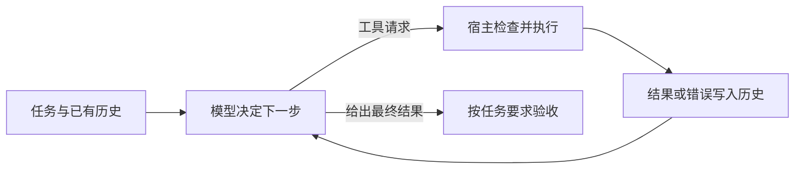

# Phase 14 前五课：Agent 怎样把一个问题逐步解决

> 复习主线：下一步怎样决定，走错了怎样调整，凭什么相信已经做好。

[返回复习目录](README.md)

前五课可以连成一个问题：**在模型可能判断错误、环境信息不完整、执行预算有限的情况下，怎样组织求解过程？**

第一课让模型能够行动并接收结果；第二课把多步行动组织成计划；第三课让失败经验进入下一次尝试；第四课让求解保留多条候选路线；第五课让已有产物接受批评、核验和修改。

这些能力作用在不同位置，可以组合。下面先建立整体关系，再用同一个例子推演：**某个接口偶发超时，需要找到原因、提交修复，并用证据说明修复有效。** 示例是为复习设计的情境，不是课程实验结果。

## 先看清：每种方法到底改变了什么

| 方法 | 核心问题 | 主要维护的状态 | 收到反馈后改变什么 |
| --- | --- | --- | --- |
| ReAct | 根据刚看到的结果，下一步做什么？ | 行动与观察历史 | 下一步行动 |
| ReWOO | 哪些步骤和依赖可以提前确定？ | 计划、证据引用、执行结果 | 按预定引用填入证据，供后续步骤和最终汇总使用 |
| Plan-and-Execute | 任务怎样分解，剩余计划是否仍然成立？ | 子目标、完成状态、剩余计划 | 后续步骤及其顺序 |
| Reflexion | 一次尝试失败后，下次应改变什么？ | 尝试记录、评估反馈、反思记忆 | 下一次尝试采用的策略 |
| ToT | 多条思路中，哪些值得继续展开？ | 候选部分解、评分、搜索边界 | 保留和扩展的分支 |
| LATS | 哪条行动路线值得继续投入预算？ | 搜索树、观察、访问次数、价值估计、反思 | 搜索预算在路线之间的分配 |
| Self-Refine | 当前产物哪里不好，怎样修改？ | 产物版本、批评、修改历史 | 当前产物 |
| CRITIC | 用工具核验后，当前产物哪里需要修正？ | 产物、工具证据、批评和修改历史 | 当前产物及其证据支持 |

读这张表时，留意两件事：**状态存在哪里，反馈回到哪里。** 同样是“再试一次”，重写一句话、改剩余计划、重跑整个任务、换一条搜索分支，是不同的控制流。

## 第一课：让行动结果真正影响下一步

面对接口超时，模型第一次可能不知道原因。它先请求查看日志，宿主执行工具并返回结果；发现超时集中在数据库访问后，再查看查询耗时；发现某条查询异常后，再看执行计划。

这就是 ReAct 的关键：**下一步决策依赖刚取得的观察。** 推理与行动交替进行，行动带回模型原先没有的信息。来源：[ReAct 原论文](https://arxiv.org/abs/2210.03629)。



这里有三个工程职责：模型提出行动；宿主负责执行；历史把结果送入下一轮。工具调用只有变成真实执行，并且执行结果被后续决策使用，反馈循环才成立。失败也要成为观察，例如“日志服务无权限”，这样模型才有依据改变办法。

ReAct 可以有计划，也可以修改计划。它的特点是行动与观察持续交织；“没有规划能力”并不是它的定义。

代价也来自这里：如果每轮都携带不断增长的完整历史，就会反复读取旧信息。路径越长，越需要控制上下文和预算。此外，模型停止调用工具，只能说明本轮执行结束；接口超时是否修好，还需要验收。

## 第二课：把能够预先决定的工作组织起来

故障排查需要临场判断，但其中也有可预先确定的部分。例如，每次都要收集受影响版本、该版本的变更记录和错误指标。没有必要为每个固定步骤重新做一次全局决策。

**ReWOO 把规划、取证和汇总拆开。** Planner 先写出带引用的步骤，Worker 执行并填入证据，Solver 根据证据回答。规划时尚不知道某一步的具体结果，可以先用变量表示。来源：[ReWOO 原论文](https://arxiv.org/abs/2305.18323)。

```text
#E1 = 获取故障时间段内受影响的版本
#E2 = 查询版本 #E1 的变更记录
#E3 = 查询版本 #E1 的错误率与延迟指标
Solver = 根据 #E1、#E2、#E3 汇总排查材料
```

执行 `#E2` 前，执行器把 `#E1` 替换成真实版本号。因此，**步骤可以提前确定，参数仍然可以依赖执行结果。** “Without Observations”指规划阶段与工具观察解耦；Worker 和 Solver 仍然使用证据。

这带来明确的依赖关系：`#E2`、`#E3` 都等待 `#E1`。若执行器支持并发，后二者可以并行；写出引用并不意味着已经实现并行。角色也只是职责划分，不要求使用三个模型。

静态计划的边界是：新证据可能改变接下来应该做的事。如果指标显示数据库正常、外部服务延迟异常，原来“分析 SQL”的步骤就需要调整。

**带重规划的 Plan-and-Execute 将观察送回规划层。** 先安排“复现、定位、修复、验证”，执行一个阶段后，根据结果决定完成、继续还是修订剩余计划。一个阶段内部仍然可以用 ReAct 排查。来源：[LangChain 对规划模式的说明](https://www.langchain.com/blog/planning-agents)。

区分两者可以问：**观察只是填入预先留下的空位，还是会改变剩余工作？** 前者体现 ReWOO 的静态依赖执行；后者需要重规划。节省多少成本取决于重复上下文、子任务开销和重规划频率，不能仅凭模式名称判断。

## 第三课：让失败改变下一次尝试

假设第一轮修复把接口超时阈值从 3 秒调到 10 秒，测试仍然失败。日志还显示慢查询在高并发下持续占用连接。重新运行同一个提示，未必会改变策略。

Reflexion 在两次尝试之间插入三个动作：评估刚才的执行、提炼反思、把反思放入下一次 Actor 的上下文。Actor 执行，Evaluator 提供反馈，Self-Reflector 形成经验，episodic memory 保存经验。来源：[Reflexion 原论文](https://arxiv.org/abs/2303.11366)。

有用的反思应当让下一步行动发生可解释的变化：

> 在这次压测中，增大超时阈值后请求仍然失败，连接占用时间没有下降。下一轮先检查慢查询与连接释放情况，再决定是否调整超时配置。

这条反思有失败证据、适用情境和下一步策略。“以后认真检查”“不要再犯错”无法提供同样的信息。

这里的学习发生在上下文中，模型权重没有更新。保存反思只是前半段；下一次读取相关反思并据此调整行动，才完成经验复用。原方法可以围绕同一个任务反复尝试，跨任务复用还需要判断经验是否适用。

也要保留因果上的谨慎：观察到一次失败，未必已经知道根因。反思可以提出待验证的假设，错误归因一旦进入记忆，也会反复影响后续决策。

## 第四课：当一条路线不够时，显式搜索多条路线

故障可能来自 SQL、连接池或外部服务。可以先沿一个判断不断行动，也可以把不同候选保留下来，比较后再决定投入多少排查预算。

**ToT 把中间思路或部分解变成可扩展、可评估的搜索节点。** 生成候选只是开始，还要评分、选择、继续展开，必要时回溯。仅让模型列出三个原因，还没有形成这种搜索过程。来源：[ToT 原论文](https://arxiv.org/abs/2305.10601)。

| 搜索策略 | 怎样探索 | 需要理解的取舍 |
| --- | --- | --- |
| BFS | 按深度逐层展开 | 能覆盖同层候选，但分支多时开销增长快 |
| DFS | 沿一条分支深入，走不通再回溯 | frontier 较小，但可能在错误分支上耗时 |
| Beam | 每层从全部新候选中只保留 Top K | 控制宽度，但被剪掉的正确路线可能无法恢复 |

**LATS 进一步把行动、环境观察、价值评估和失败反思组织进 MCTS。** 它根据已有探索结果决定下一轮去哪里搜索，兼顾已经表现好的路线与探索不足的路线。来源：[LATS 原论文](https://arxiv.org/abs/2310.04406)。

一轮 MCTS 包含选择、扩展、模拟和回传。选择要继续探索的节点，生成后继，向后试走并获得反馈，再沿路径更新访问次数和价值估计。这里的“回传”更新搜索树统计量，不更新模型权重。

对故障案例，可以在可复现环境中尝试不同修复路线，利用执行和测试反馈继续搜索。分支需要可隔离、可恢复的状态；树上回到父节点，并不会自动撤销已经改动的文件或远端环境。

搜索依赖两个判断：中间状态是否值得继续，最终结果是否满足要求。两者应分开。看起来接近成功的分支可能是死路，模型评分高也不等于测试通过。预算越多，越需要可靠的评价，否则只是在更努力地寻找符合错误评分标准的答案。

## 第五课：已有产物怎样变好，怎样变得可信

现在已经得到一个补丁和一份故障说明。接下来可以检查说明是否清晰、补丁是否遗漏边界条件，并据此修改。

**Self-Refine 用模型生成反馈，再让模型结合反馈和历史修改当前产物。** 同一个模型可以承担生成、批评、修改三种角色，无须更新权重。它适用于多种任务；但如果生成与批评共享同一个错误认识，循环可能一直漏掉它。来源：[Self-Refine 原论文](https://arxiv.org/abs/2303.17651)。

例如，模型指出故障说明缺少“触发条件”和“验证范围”，随后补齐这些内容。这改善了产物，但文字变完整本身不能证明补丁有效。

**CRITIC 在批评过程中引入工具交互与外部反馈。** 对补丁运行测试、对数值进行计算、对事实查找来源，再根据证据修正输出。工具提供观察，模型还需要判断观察支持什么修改。来源：[CRITIC 原论文](https://arxiv.org/abs/2305.11738)。

在这个案例中，测试发现“正常请求通过，但取消请求后连接没有释放”，这就为下一轮修改提供了具体依据。修改之后要重新核验；上一版的测试结果不能直接用于下一版。

调用过工具也不代表结论必然正确。测试覆盖不足、检索结果不相关、模型误读输出，都可能产生错误验收。可靠性取决于**证据是否覆盖所声称的结论**。

## 最容易混淆的地方：反馈究竟回到哪里

同样是“测试失败”，不同机制会做不同的事：

| 机制 | 反馈后的动作 | 故障案例中的体现 |
| --- | --- | --- |
| ReAct | 决定下一步行动 | 读取失败测试对应的日志 |
| 重规划 | 修改剩余工作 | 将“提交修复”替换为“检查连接释放，再回归验证” |
| Self-Refine / CRITIC | 修改当前产物 | 根据失败信息修正补丁；CRITIC 的批评有工具证据支撑 |
| Reflexion | 为下一次尝试保存经验 | 下一轮先排查连接占用，避免重复只增大超时阈值 |
| ToT / LATS | 调整候选分支及探索投入 | 降低某条修复路线的优先级，继续探索其他路线 |

一次测试结果可以同时服务于多个机制。因此这些名称描述的是求解过程中的不同作用，实际系统不必只能归入一类。

一种可解释的组合是：外层用 Plan-and-Execute 维护阶段，定位阶段用 ReAct 获取证据，补丁形成后用 CRITIC 式循环核验与修改，整次尝试失败后用 Reflexion 形成下一轮经验。只有当多个候选确实值得比较、评价可靠且预算允许时，再加入搜索。

这是一种组合示意；每增加一个循环，都应明确它能解决哪一种已经观察到的失败。

## 把名字还原成代码，需要保存什么

下面是概念级状态清单，帮助对照实现；它不是要求所有系统都采用同一套类结构。

```text
ReAct                 history + tool_executor + stop_policy
ReWOO                 plan + evidence_by_id + dependency_executor + solver
Plan-and-Execute      plan + completed_steps + observations + replanner
Reflexion             actor + evaluator + reflector + reflection_memory
ToT                   frontier + candidate_generator + scorer + search_policy
LATS                  tree + environment_state + visits/value + reflection_memory
Self-Refine            output + critique + revision_history + refiner
CRITIC                output + tool_evidence + critique + refiner
```

实现时可以沿一条反馈追问：**它写到了哪个状态里？哪个组件会读它？它能够改变什么决定？** 如果反思写入文件后从未被读取，或工具结果记录在日志里却没有送回模型，那么对应的反馈机制还没有真正接通。

所有循环还需要区分两件事：什么时候停止运行，什么时候判定成功。达到预算、重复无进展、模型表示结束，都可以让运行停止；任务成功则需要满足约定的验收条件。预算耗尽时应保留候选结果、已有证据和未完成原因。

## 读课程示例时，要知道它演示到了哪一步

课程代码适合观察控制流。以下是阅读当前源码得到的边界，不是对原论文方法的效果判断。

| 示例 | 已实现的演示 | 不能据此推断的能力 |
| --- | --- | --- |
| 第三课 `Actor.act` | 根据记忆条数切换预设答案 | 没有读取反思文本，因此不能证明模型理解并利用了反思 |
| 第四课 `tot_bfs` | 按层生成候选并保留 Top K | 实际有 beam 剪枝，不是无剪枝 BFS |
| 第四课 `mcts` | 算术状态上的选择、模拟和统计回传 | 没有实现完整 LATS 的语言模型策略和失败反思闭环 |
| 第五课 `run_loop` | 比较两种反馈函数及其后续修改 | 自批评分支已经发现问题，但反馈措辞没有触发脚本生成器的修正规则；不能把不收敛全归因于“模型不会核验” |

第五课尤其值得追踪：自反馈写的是“double-check capital”，生成器却检查批评中有没有 `germany`。这个反馈与修改器之间的不匹配，也会让输出原地踏步。调试 Agent 时，应当分别检查反馈是否正确、修改器是否使用反馈、修改后是否通过验收。

对应源码：[第三课](../../phases/14-agent-engineering/03-reflexion-verbal-rl/code/main.py)、[第四课](../../phases/14-agent-engineering/04-tree-of-thoughts-lats/code/main.py)、[第五课](../../phases/14-agent-engineering/05-self-refine-and-critic/code/main.py)。

## 合上笔记后，用这五问检查理解

1. **ReWOO 的计划还不知道 `#E1` 的具体值，为什么能写出 `#E2`？** 因为提前确定的是操作与依赖，执行时再代入证据；若连后续操作都要依赖观察决定，就需要动态决策或重规划。
2. **让模型再检查一遍为什么不能直接证明正确？** 检查可能沿用生成时的错误认识，必须判断反馈来源和验收依据。
3. **Self-Refine 和 Reflexion 都有历史，区别是什么？** 前者主要用历史修改当前产物，后者把一次尝试的评估转成经验，影响后续尝试的策略。
4. **多生成几个候选为什么未必提高成功率？** 需要有效的候选覆盖、评价和选择；错误评分与过早剪枝都可能淘汰正确路线。
5. **程序正常退出、工具调用成功、任务完成为什么要分开？** 它们分别说明运行终止、某次操作执行成功、用户目标满足，三者不能互相代替。

复习时真正要能解释的是：**行动怎样获得新信息，规划怎样安排工作，搜索怎样分配探索预算，修正怎样利用反馈，经验怎样影响下一次决策。** 再进一步，能指出每一步的证据和失败边界。

课程入口：[01 Agent Loop](../../phases/14-agent-engineering/01-the-agent-loop/docs/en.md) · [02 ReWOO / Plan-and-Execute](../../phases/14-agent-engineering/02-rewoo-plan-and-execute/docs/en.md) · [03 Reflexion](../../phases/14-agent-engineering/03-reflexion-verbal-rl/docs/en.md) · [04 ToT / LATS](../../phases/14-agent-engineering/04-tree-of-thoughts-lats/docs/en.md) · [05 Self-Refine / CRITIC](../../phases/14-agent-engineering/05-self-refine-and-critic/docs/en.md)。
