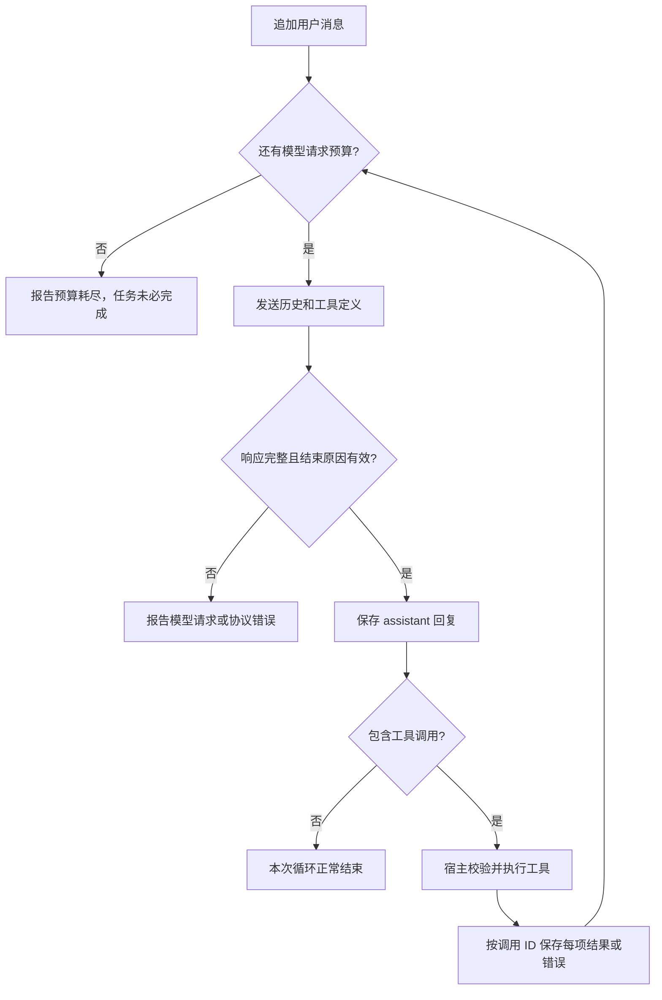

# 01 · The Agent Loop 复盘

[返回复习目录](README.md) · [原文](../../phases/14-agent-engineering/01-the-agent-loop/docs/en.md) · [课程 Python 示例](../../phases/14-agent-engineering/01-the-agent-loop/code/main.py) · [个人 Java 实践](../agent-loop/README.md)

> 核心：模型提出行动，宿主执行行动；工具结果成为下一轮决策的输入。

## 一、文章梳理

### 1. 解决什么问题

只做一次文本生成，无法形成“执行操作，再检查操作结果”的闭环。Agent Loop 把模型调用、工具执行和结果回传连接起来，让下一步决策能够使用环境中的新证据。

ReAct 将推理与行动交替组织，行动取得外部信息，后续推理据此调整。它强调的是反馈闭环；复习时先理解这个机制，不必背论文中的基准分数。[ReAct 论文](https://arxiv.org/abs/2210.03629)

### 2. Thought、Action、Observation 分别负责什么

| 部分 | 含义 | 在个人项目中的对应 |
| --- | --- | --- |
| Thought / Reasoning | 模型产生的推理内容；并非每种模式都会对外返回 | `AssistantTurn.reasoningContent()` 及协议内容块 |
| Action | 模型提出工具名称、参数和调用 ID | `ToolCall` |
| Observation | 宿主实际执行后得到的结果或错误 | `ChatMessage.tool(call.id(), result)` |

工具调用是一份执行请求，不是已经完成的操作。模型说“我要计算”也不是计算器已经运行。是否执行、是否允许执行、执行结果是什么，都需要宿主程序确认。

### 3. 文章的五个组成部分

| 组成部分 | 作用 | 缺失后常见的问题 |
| --- | --- | --- |
| Message buffer | 保存用户、助手、调用和结果的历史 | 下一次模型请求不知道之前发生了什么 |
| Tool registry | 将工具名映射到实现，并暴露参数定义 | 模型提出的调用无法被可靠分发 |
| Stop condition | 判断正常结束和异常停止 | 过早结束，或停不下来 |
| Turn budget | 对模型轮次等资源设硬上限 | 重复失败、成本失控 |
| Observation formatter | 将工具结果和可恢复错误变成模型可读输入 | 工具失败被丢失，或被误当作成功 |

这是本课实现工具型 Agent 的检查框架，不必把“五项缺一就不是 Agent”当成所有系统通用的定义。

### 4. 最小控制流

图中的“正常结束”是程序的控制流状态，仍需要单独判断任务完成条件。

### 5. 推理内容的表示会变，闭环仍需要保留

原文从显式 `Thought:` 文本讲到独立的 reasoning 内容。复习重点是区分：普通回答文本、协议返回的推理内容、工具调用、工具结果。

个人项目按三种协议分别保存相关字段或内容块。协议适配器要保留下一次请求所需的信息；界面只展示模型实际返回的内容。不能从“没有显示思考”推断模型没有推理，也不能将一种接口的 reasoning 表示推广到所有提供方。

## 二、课程案例总结：价格、税额和 KV

课程脚本执行以下流程：

| 步骤 | 行动 | 观察 |
| --- | --- | --- |
| 1 | `kv_set(base, 120)` | 已保存 base |
| 2 | `calculator(120 * 0.15)` | `18.0` |
| 3 | `kv_set(tax, 18.0)` | 已保存 tax |
| 4 | `calculator(120 + 18.0)` | `138.0` |
| 5 | `kv_get(base)` | `120` |
| 6 | 返回 `finish` | 最终回答含税总价 `138.0` |

这个案例演示了注册、分发、观察回传和退出。`ToyLLM` 按固定脚本走，后续参数也已写死；它没有真正读取观察后自主决定下一步。**测试证明循环接线正确，不代表已经验证真实模型的规划和纠错能力。**

## 三、个人案例复盘：Java + 浏览器 + 工具

### 1. 从课程骨架扩展了什么

| 能力 | 当前项目里的实现 | 学到的关键点 |
| --- | --- | --- |
| 真实模型接入 | `ChatModel` 与三个 DeepSeek 协议客户端 | 核心循环使用统一接口，报文差异留在适配层 |
| 工具执行 | calculator、Bash、Exa search | 工具定义帮助模型选择，真正执行发生在 Java |
| 多轮状态 | 每个页面独立的 `AgentLoop` 历史 | 用户轮次与模型请求是两种粒度 |
| 流式交互 | 上游 SSE，下游 NDJSON | 模型协议事件与浏览器事件不是同一种流 |
| 执行确认 | Bash 命令与输出分享分别确认 | 运行命令与发送命令输出是两个操作 |
| 可观察性 | 模型、工具、助手及 reasoning 轨迹 | 要能回到具体轮次、参数、结果和结束原因 |

这些是已有产物的能力盘点，不代表本次逐项做过浏览器验收。

### 2. 用一次计算串起所有概念

当模型选择调用 calculator 时，`(120+18)/3` 的历史依次为：

| 顺序 | 消息 | 生产者 | 用途 |
| --- | --- | --- | --- |
| 1 | system 行为规则 | 宿主 | 给出工具使用与数据处理规则 |
| 2 | user 计算问题 | 用户 | 提供任务目标 |
| 3 | assistant 调用 calculator，带参数和 ID | 模型 | 提出行动 |
| 4 | tool 返回 `46`，引用该调用 ID | 宿主 | 提供执行证据 |
| 5 | assistant 最终回答 | 模型 | 用观察回答用户 |

这是 **1 次用户轮次、2 次模型请求、1 次工具调用**。如果模型直接回答，则实际轨迹不同。

代码入口：[AgentLoop.java](../agent-loop/src/main/java/dev/learning/agent/core/AgentLoop.java)。阅读顺序为 `run`、`requestModel`、`validateFinishReason`、`executeTool`，再看 [ToolRegistry](../agent-loop/src/main/java/dev/learning/agent/tool/ToolRegistry.java)。

### 3. 协议复盘：同一段语义，三种表示

以下是**当前项目三个适配器**使用的映射，完整报文见 [协议图解](../agent-loop/docs/06-three-protocols-by-example.md)。

| 项目客户端 | 调用表示 | 结果表示 | 配对字段 |
| --- | --- | --- | --- |
| Chat Completions | assistant 的 `tool_calls` | `role: tool` | `id` → `tool_call_id` |
| Responses | `function_call` item | `function_call_output` item | `call_id` |
| Anthropic Messages | assistant 的 `tool_use` 块 | user 中的 `tool_result` 块 | `id` → `tool_use_id` |

这里 Anthropic 格式的 `user` 是协议承载角色，内容仍由宿主工具产生。项目中的三种客户端连接 DeepSeek 的兼容接口；Bedrock 只有既有文档对照，没有项目客户端。

同名工具可以有多次调用，所以必须靠调用 ID 关联结果。界面生成的 `tool-<requestId>-<序号>` 用于轨迹展示，不能拿它替换模型调用 ID。乱序完成也仍需满足目标协议的结果分组与顺序要求。

### 4. 流式实现的关键点

上游协议适配器接收分片：普通文本可立即展示，工具名称与 JSON 参数需要先组装完整。若只收到 `{"expression":"1+`，就不能提前执行。

流正常结束还需检查结束原因。当前循环将客户端统一后的无工具 `stop` 视为正常结束，将有工具 `tool_calls` 视为可执行；`length` 等情况报错。具体协议自己的结束标记由适配层转换，不能直接在所有接口中硬套同一个字段值。

对应阅读：[协议、流式输出和轨迹](../agent-loop/docs/03-protocols-and-streaming.md)。

## 四、三个实验留下的结论

实验与记录来源：[工具调用上限与对话记录](../agent-loop/docs/05-tool-calls-and-transcripts.md)、[离线实验测试](../agent-loop/src/test/java/dev/learning/agent/deepseek/ToolTranscriptExperimentTest.java)、[循环测试](../agent-loop/src/test/java/dev/learning/agent/core/AgentLoopTest.java)。

### 实验 A：模型给出三个调用，只允许执行两个

`call_a: 1+2`、`call_b: 4*5`、`call_c: 6-1`。保留三个调用，却只返回前两个结果，第三个就悬空了。正确的限额处理可以为第三个返回“未执行：达到执行上限”，并保留原调用 ID。

既有真实 API 记录时间为 2026-11-01（Asia/Shanghai），模型 `deepseek-flash`，关闭思考，非流式。三种兼容接口各做一次生成调用和三组对照，共 12 次请求：

| 后续历史 | Chat Completions | Responses | Anthropic 兼容接口 |
| --- | --- | --- | --- |
| 三个调用都有真实结果 | 200 | 200 | 200 |
| 第三个结果缺失 | 400 | 400 | 400 |
| 第三个补“未执行”结果 | 200 | 200 | 200 |

这些是已有实测，本次整理没有重新调用远端模型。它证明上述请求条件下的行为；不证明其他厂商原生服务、其他模式或自动重试的结果。

**实现状态：**执行两个并补错误的策略目前在实验里；实际应用循环仍逐个执行返回的全部工具。应用每次用户输入最多 8 次模型请求，这不是“最多 8 次工具调用”。

### 实验 B：无工具调用就结束，任务一定完成了吗

模拟模型回复“接下来会计算”，同时不返回工具调用，结束原因为 `stop`。循环正常结束，但计算没有发生。

应分别判断：

1. **协议可接受：**服务端是否接受这一组消息。
2. **循环正常结束：**响应完整、结束原因符合预期。
3. **任务完成：**是否满足用户要求，必要证据是否存在。

显式 `finish` 也可能被模型过早调用。要提高可靠性，需要宿主核验结果或证据；仅换一个退出信号不够。

### 实验 C：结果倒序返回

离线测试将结果按 `c → b → a` 组织，仍能通过 ID 得到 `a → 3`、`b → 20`、`c → 5`。按位置配对会错；按工具名也会错，因为三个都叫 calculator。

这证明项目适配器在该构造历史下保留了关联关系，没有证明实际循环已并行执行，也没有做倒序结果的远端兼容性实测。

## 五、失败处理与补充复习点

| 情况 | 当前项目行为或边界 | 复习时要问什么 |
| --- | --- | --- |
| 工具名不存在、参数错误、工具 I/O 失败 | 注册表返回错误观察 | 下一轮是否拿到了明确失败信息？ |
| 模型 HTTP、流解析或结束原因异常 | 本轮报错 | 页面已有部分文字是否可能被误当成完整结果？ |
| 模型请求轮次耗尽 | 报错；最后一轮工具结果仍记录 | 停止是否被错误描述为成功？ |
| 搜索结果包含操作指令 | 系统规则要求作为数据处理 | 是否有把外部内容直接升格为授权的路径？ |
| 多轮历史增长 | 当前没有持久化或自动裁剪 | 下一次是否携带了必要且完整的调用往返？ |

文章中“失败都变成观察”适合工具级可恢复错误；模型请求本身失败时，不应凭空编一条工具结果。当前 Java 实现已经区分这两类路径。

建议后续补三个验收点：给关键任务定义完成证据；区分单批工具上限与整轮总预算；为有副作用的工具设计重试和幂等策略。它们是后续增强项，不计入已完成能力。

## 六、复习完成标准

- [ ] 不看笔记，画出 `user → assistant 调用 → tool 结果 → assistant 回答`。
- [ ] 说清一次用户输入为什么可能触发多次模型请求。
- [ ] 在代码里指出谁生成调用、谁实际执行、谁记录结果。
- [ ] 解释为何缺少结果、倒序结果、工具失败是三个不同问题。
- [ ] 解释“无工具调用正常停止”和“任务完成”的区别。
- [ ] 能从轨迹定位一次工具的参数、结果、耗时与所属模型轮次。
