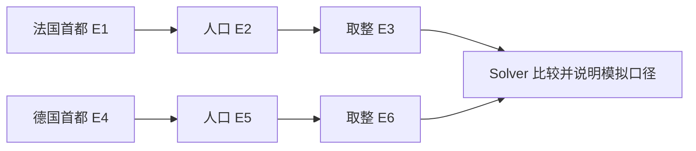

# 02 · ReWOO 与 Plan-and-Execute 实践 TODO

[返回复习目录](README.md) · [第二章复盘](02-rewoo-plan-and-execute.md)

状态：**个人实践未开始，所有任务保持未勾选。** 本页给出可执行的练习顺序和验收条件，不代表已经运行或实现。

目标：先做出可解释的离线计划执行器，再验证并行、失败传播与重规划；最后才决定是否接真实模型。

## 产物放在哪里

继续在 `learning-artifacts/agent-loop/` 的 Java 项目中迭代，复用模型客户端、工具、确认和浏览器界面。接口、执行流程和实施顺序以 [三模式技术方案](../agent-loop/docs/design/agent-execution-technical-design.md) 为准；课程 Python 示例用作原理对照。

| 计划产物 | 应保存的内容 |
| --- | --- |
| 项目 `README.md` | 模式选择、运行命令、数据为模拟值的说明 |
| `src/main/java/dev/learning/agent/core/rewoo/` | 计划、校验、执行与求解，接入现有入口 |
| `src/test/java/dev/learning/agent/core/rewoo/` | 确定性的计划、依赖、失败与恢复测试 |
| `outputs/plan.json` | 本人设计的计划，注明模拟数据与工具约定 |
| `outputs/run-record.md` | 执行证据、失败观察、模式对比和结论边界 |

以上是未来实现产物；当前仅已有方案文档。学习顺序先完成静态串行 ReWOO，再做独立的 Plan-and-Execute 模式；它的步骤级 ReAct 与有界重规划已进入本轮设计，节点并行可稍后增加。

## P0 · 跑通并讲明白原版

- [ ] 在仓库根目录运行课程示例：

  ```bash
  python3 phases/14-agent-engineering/02-rewoo-plan-and-execute/code/main.py
  ```

- [ ] 在运行前手写预测：完整计划、E1/E2/E3 的结果、最终模板答案。
- [ ] 在运行后记录实际输出，与预测逐项对照。
- [ ] 标出 `ScriptedPlanner`、`topological`、`resolve_references`、`run_workers`、`ScriptedSolver` 的调用顺序。
- [ ] 将一个固定问题换成新问题，观察脚本是否仍给出旧计划；解释它为什么不是真实 Planner。
- [ ] 说明输出里的字符数、论文 token 效率和真实 API 费用分别是什么。

**验收：**能脱离原文讲清三个工具节点，指出示例没有并发、没有模型推理、没有自动重规划。把结果写入个人运行记录，不能只保存最终答案。

## P1 · 完成一个可靠的串行执行器

### 1. 自己定义计划和证据

- [ ] 定义节点的 `id`、`tool`、`args`；明确依赖由引用推导还是单独声明，若同时存在则检查一致性。
- [ ] 定义证据的 `step_id`、`status`、`value`、`error`，至少区分 `success`、`error`、`skipped`。
- [ ] 为本次练习限定引用语法和类型规则。最小版可以只允许字符串参数，但必须明确拒绝不支持的嵌套结构。
- [ ] 保留原始计划与实际绑定参数，便于解释“计划是什么”和“实际执行了什么”。

### 2. 执行前校验

- [ ] 拒绝重复节点 ID、自引用、环和不存在的引用；错误指出具体节点。
- [ ] 检查工具是否注册、参数名称和基本类型是否符合工具约定。
- [ ] 确认非法计划在执行任何工具前就被拒绝。
- [ ] 用乱序节点列表验证执行顺序由依赖决定；不要求执行顺序等于原列表。

### 3. 执行与失败传播

- [ ] 只在上游依赖成功后绑定参数；执行前确认没有残留的证据占位符。
- [ ] 将工具异常记录为该节点的失败，保留错误类型或简要原因。
- [ ] 上游失败时跳过依赖节点，继续运行不受影响的分支。
- [ ] Solver 按任务所需证据判断完整回答、部分回答或无法回答；不能把 `error: ...` 当作事实插入答案。

**验收：**正常链得到预期答案；非法计划不产生工具副作用；失败分支有明确状态，独立分支仍可完成。

## 后续增强 · 用同一任务比较串行与并行

练习任务：比较两座“模拟首都”的人口四舍五入结果。为两条链预置稳定数据：法国链 `Paris → 11.2 million metro → 11 million`；德国链 `Berlin → 6.1 million simulated → 6 million`。这些数值仅供测试，尤其德国链是新增的人工夹具，不表达真实人口。



- [ ] 先用串行执行器跑这份六节点计划，保存证据和调用记录。
- [ ] 使用标准库并发工具执行就绪节点，设置最大并发量。
- [ ] 通过就绪队列或调度状态避免重复提交同一节点；结果仍按节点 ID 保存。
- [ ] 让两条分支的完成顺序变化，确认答案不依赖完成顺序。
- [ ] 用可控事件/屏障验证两条独立分支确实重叠，不用严格毫秒阈值做单元测试。
- [ ] 单独记录演示用耗时；串行耗时通常接近各节点耗时之和，并行受关键路径及调度开销约束。

**验收：**两条分支有重叠，同一分支遵守依赖，结果一致，没有重复执行。不要将一次本机耗时差异当作普遍加速倍数。

## P2 · 实现独立的 Plan-and-Execute 模式

按[技术方案第 9 节](../agent-loop/docs/design/agent-execution-technical-design.md)完成高层步骤与步骤级 ReAct，再验证剩余计划修订；不把静态工具计划加一次重试当作完整实现。

- [ ] 定义高层步骤的目标、验收条件、允许工具和依赖，区分 S 步骤 ID 与 E 工具证据 ID。
- [ ] 提取可返回结构化结果的 ReActEngine；为每个步骤使用局部历史，并消费外层共享预算。
- [ ] 每个步骤结束后检查进展，明确区分 CONTINUE、REVISE、FINISH 与 STOP。

- [ ] 给一个人口查询工具注入可重复的失败，观察静态执行器的错误与跳过状态。
- [ ] 增加一个脚本 Replanner，在符合条件时生成新的高层步骤，使用预置的备用查询路径。
- [ ] 将用户目标、已成功证据、失败原因和剩余步骤传入 Replanner；对新计划重新校验。
- [ ] 保留成功且仍有效的证据，明确哪些下游节点需作废重算。
- [ ] 设置计划修订与全轮步骤尝试上限，步骤内模型/工具限额与全局限额同时生效；重复失败后明确报告不足。
- [ ] 记录工具调用次数，验证已经成功的独立分支没有被无故重跑。
- [ ] 如将来加入写操作，再设计幂等键或去重规则；本次最小练习先用只读工具。

**验收：**修订日志能说明为什么改计划、复用了什么、重跑了什么；备用工具成功时恢复，备用工具失败时按预算停止。

## 最小测试清单

至少覆盖下列情形。预期行为是本练习拟实现的契约，不是课程原版已经具备的行为。

| 测试 | 预期结果 |
| --- | --- |
| 正常三节点链 | 首都、人口、取整证据均正确 |
| 节点列表乱序 | 拓扑调度仍正确 |
| 未注册工具 | 执行前拒绝，工具执行次数为 0 |
| 重复 ID | 执行前拒绝，不覆盖证据 |
| 缺失引用、自引用、成环 | 明确报错，不进入工具执行 |
| 引用参数类型不匹配 | 明确拒绝，不能靠字符串拼接蒙混 |
| 不支持的嵌套参数 | 按已声明契约拒绝，或完整递归替换 |
| 上游工具失败 | 依赖节点 skipped；独立分支继续 |
| 独立节点乱序完成 | 证据按 ID 对齐，最终结果不变 |
| 并发上限 | 运行中工具数不超过上限，无重复提交 |
| 重规划后恢复 | 保留有效成功证据，失败分支得到新结果 |
| 重规划预算耗尽 | 停止且报告缺失证据，不宣称完成 |

## 可选进阶：真实模型与规划质量

- [ ] 保留 Worker 工具和测试夹具，先只将 Planner 换成真实模型。
- [ ] 对模型输出解析并做同样的硬校验；模型自称“计划有效”不能替代代码校验。
- [ ] 区分“格式合法率”“计划可执行率”“最终任务成功率”，人工核对失败样本。
- [ ] 再替换 Solver，对照其回答是否完全由证据支持。
- [ ] 同一批问题比较 ReAct、静态 ReWOO、带重规划版本；记录质量、调用次数、usage、耗时与失败原因。
- [ ] 若以后做 Planner 蒸馏，另列训练数据和评估设计：问题、工具目录、可执行计划、保留的测试集；不将“换成小模型”视为蒸馏完成。

真实模型接入与蒸馏不属于基础版完成条件。先把可确定验证的执行语义做扎实。

## 实践后填写的复盘模板

```markdown
# ReWOO 个人实践记录

## 任务与完成标准
说明用户问题、模拟数据口径、必须取得的证据。

## 原计划与实际执行
列出节点、引用、绑定参数、结果、状态和执行次数。

## 失败与恢复
记录故障注入、受影响分支、重规划内容和预算停止情况。

## 与 Agent Loop 的对照
哪些决定在执行前做，哪些决定必须等待观察？

## 成本与结论边界
分开列调用次数、字符/真实 usage、耗时；注明是否调用真实模型。

## 本次仍未验证的问题
列出尚无证据的能力，不将它们写成已完成。
```
