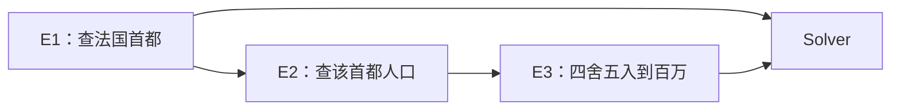

# 02 · ReWOO 与 Plan-and-Execute 复盘

[返回复习目录](README.md) · [原文](../../phases/14-agent-engineering/02-rewoo-plan-and-execute/docs/en.md) · [课程 Python 示例](../../phases/14-agent-engineering/02-rewoo-plan-and-execute/code/main.py) · [个人实践 TODO](02-practice-todo.md)

> 核心：把“决定要查什么”与“取回实际结果”拆开，用证据引用把它们重新接上。

状态：文章已经过完；个人实践未做。下面的案例分析来自阅读课程代码，不作为个人实践完成记录。

## 一、文章梳理

### 1. 为什么从 Agent Loop 走到显式计划

ReAct 式循环可在每次观察后调整决策，但若每轮都携带不断增长的完整历史，旧信息就会被反复输入。对于依赖结构已知的查询任务，可以先列计划，再集中取证，最后汇总，减少中间决策对完整上下文的反复消费。

ReWOO 的关键约束是：**Planner 生成本轮计划时不读取该计划执行中的工具观察**。不等于整个系统不用观察；Worker 产生证据，Solver 必须使用这些证据。

### 2. Planner / Worker / Solver 的职责

| 角色 | 输入 | 输出 | 要守住的边界 |
| --- | --- | --- | --- |
| Planner | 问题、可用工具及其参数约定 | 节点、参数、证据引用组成的计划 | 可以预留未知值，不能把猜测当作已查证结果 |
| Worker / 执行器 | 计划、已完成证据、工具注册表 | 每个节点的结果 | 先满足依赖，再替换引用和调用工具 |
| Solver | 原问题、计划、证据 | 回答或不足说明 | 不能把失败或缺失证据编造成成功 |

本课中 Worker 是普通函数分发，不需要额外调用模型；Planner 和 Solver 也是脚本。真实系统是否用模型、用几个模型，是实现选择。

### 3. 证据引用如何表达未知值

下面是从课程示例整理的计划表示，不是模型已经执行过的记录：

```json
{
  "steps": [
    {"id": "E1", "tool": "search", "args": {"query": "capital of France"}},
    {"id": "E2", "tool": "search", "args": {"query": "population of #E1"}},
    {"id": "E3", "tool": "round_million", "args": {"text": "#E2"}}
  ]
}
```

Planner 不必先知道首都是 Paris；它只需知道第二步使用第一步的产出。执行时才把 `#E1` 替换成 `evidence["E1"]`。

`E1` 是计划节点 ID，用来组织数据依赖；第一章的工具调用 ID 用来配对一次协议调用与结果。若某个节点需要重试或调用模型，它可能关联多个实际请求 ID，不能把两层标识混为一谈。

### 4. DAG、拓扑排序与并行



这是一个 DAG，但也是一条依赖链，三个工具节点不能彼此同时执行。DAG 允许表达分支，不保证一定有并行收益。

若另有一条独立的德国查询链，两条链的就绪节点可以并行。拓扑排序只保证顺序合法；要真正并行，还需并发执行器、并发上限、结果汇合和失败策略。

## 二、案例静态复盘：法国首都的人口

### 1. 实际代码做了什么

| 步骤 | 执行前参数 | 引用替换后 | 内置假工具结果 |
| --- | --- | --- | --- |
| E1 | `capital of France` | 不变 | `Paris` |
| E2 | `population of #E1` | `population of Paris` | `11.2 million metro` |
| E3 | `#E2` | `11.2 million metro` | `11 million` |
| Solver | 模板中的 `{E1}`、`{E3}` | 代入 evidence | 首都 Paris，四舍五入人口 11 million |

原文概述为“两步计划”，运行示例实际上还有 `round_million`，所以是 **三个工具节点**。最后的模板格式化属于 Solver，不是第四个工具节点。

人口字符串是 `fake_search` 的固定教学数据，且写了 `metro`；不应当作真实、最新的巴黎市人口。真实检索还需要明确城市/都会区口径、统计年份和来源。

### 2. 代码阅读地图

| 函数或类型 | 看懂后应能回答 |
| --- | --- |
| `PlanStep` / `Plan` | 计划保存了哪些字段？依赖是显式列表还是从引用推导？ |
| `ScriptedPlanner.plan_for` | 为什么换问题仍可能得到同一份计划？ |
| `topological` | 何时一个节点可运行？什么时候抛出异常？ |
| `resolve_references` | 哪些类型会被替换？没有找到证据时怎么办？ |
| `run_workers` | 参数何时绑定？为什么当前执行是串行的？ |
| `ScriptedSolver.solve` | 为什么它不能真正判断证据是否充分？ |
| `run_react_mock` / `run_rewoo` | 统计了什么，漏了什么？ |

代码的依赖不是 `depends_on` 字段，而是从 `args` 的字符串表示中找 `#E数字`。这让示例短小，也带来了下一节的限制。

### 3. 目前具备什么，还没具备什么

| 检查项 | 课程示例现状 | 实践应该补什么 |
| --- | --- | --- |
| 基本依赖顺序 | 已有拓扑扫描 | 用乱序输入证明它靠依赖而非列表位置工作 |
| 环和缺失引用 | 都以同一个 RuntimeError 拒绝 | 区分原因并指出节点和引用 |
| 重复节点 ID | 没有专门校验，证据可能覆盖 | 执行前拒绝重复 ID |
| 未注册工具 | 分发时返回错误字符串 | 规划验收阶段先检查工具存在 |
| 引用替换 | 只处理参数的直接字符串值；未知引用原样保留 | 递归处理或明确拒绝嵌套结构；不允许静默遗留引用 |
| 参数类型 | 主要靠调用函数后的异常 | 约束引用输出与目标参数的类型 |
| 并发 | `for` 循环串行执行 | 调度独立就绪节点并控制并发量 |
| 上游失败 | 错误字符串仍可传到下游 | 区分 success / error / skipped，阻断受影响分支 |
| Solver 判断 | 模板插值 | 检查所需证据，缺失时明确报告 |
| 自动重规划 | 没有 | 增加触发条件、状态保留与预算 |

[课程输出的 Planner skill](../../phases/14-agent-engineering/02-rewoo-plan-and-execute/outputs/skill-rewoo-planner.md) 写了更严格的验收要求；这些要求没有全部在 `main.py` 中实现。复习时应区分“文字要求”与“可执行检查”。

## 三、成本分析：到底省了什么

### 1. 二次增长指累计输入，不是单次 prompt

设初始上下文为 `Q`，每步新增历史平均为 `h`，共发生 `N` 次模型请求。忽略压缩与缓存，则累计输入约为：

```text
第 i 次模型请求输入 ≈ Q + (i - 1)h
累计输入 ≈ NQ + h × N(N - 1) / 2
```

在这个假设下，单次输入长度随步骤线性增长，累计输入的历史项为二次增长。不能把它说成“每次请求长度都是二次增长”；历史裁剪、缓存、不同观察长度也会改变实际成本。

ReWOO 的纯工具执行版本主要在 Planner 和 Solver 使用模型，中间按依赖调工具。因此能够减少反复交给模型的历史。但如果 Worker 内部也调用模型、反复重规划，或者最终证据非常长，就要把这些费用一起计入。

### 2. 怎样理解论文数字

ReWOO 论文报告了 HotpotQA 上约 5 倍 token 效率和 4% 的准确率改善，并展示从大模型向 7B 模型迁移推理能力的实验。这些是特定实验条件下的结果，不是任意任务的保证。[ReWOO 论文](https://arxiv.org/abs/2305.18323)

课程 demo 打印的是 Python 字符串长度的粗估，使用脚本和假工具。它没有调用 tokenizer 或真实模型，也没有准确核算完整请求、推理输出、缓存与计费，不能用它验证“省了 5 倍费用”或“质量提高”。

此外，`worker_chars` 统计的是原计划参数的字符串长度，没有使用引用替换后的实际参数长度。实践中应按节点 ID 记录实际参数与结果，避免把占位符的长度当作真正执行时的数据量。

### 3. 复盘至少分开记录三类指标

| 指标 | 要记录什么 | 常见误读 |
| --- | --- | --- |
| 调用次数 | Planner、Solver、Worker 内部模型调用与工具调用各多少 | 只数工具，遗漏模型重试与重规划 |
| token / 费用 | 真实服务 usage、模型、输入/输出及缓存口径 | 用字符数直接当 token 或金额 |
| 端到端耗时 | 规划、工具关键路径、汇总、重试的时间 | 有并行就认为一定更快 |

比较前先固定正确性标准；不能靠删掉必要步骤获得看似更低的成本。

## 四、模式选择与补充辨析

| 场景 | 适合从哪种方案开始 | 原因 |
| --- | --- | --- |
| 一次计算后解释结果 | 单次工具调用或最小循环 | 额外规划未必有收益 |
| 边排查边发现新文件、新问题 | ReAct 式循环 | 下一步强依赖刚取得的观察 |
| 固定工具、明确依赖的多项检索 | ReWOO | 可先表达依赖，集中取证后汇总 |
| 已有结构，但执行结果经常改变后续步骤 | 带重规划的 Plan-and-Execute | 对剩余计划做局部修订 |
| 复杂网页中的高层目标与低层操作 | 研究 Planner / Executor 分层 | 需要区分策略规划、环境动作和反馈 |

这是基于本课机制的工程判断，不是按“少于 3 步”或“大于 30 步”机械分类。Anthropic 的模式文章建议从满足需求的简单方案开始，并通过测量决定是否增加复杂度。[Building Effective Agents](https://www.anthropic.com/research/building-effective-agents)

Plan-and-Execute 是更广泛的规划/执行模式，不能严格定义成“ReWOO 加一个节点”。本课可以把在静态 ReWOO 上加入有预算的重规划作为最小练习。

Plan-and-Act 关注高层 Planner、低层 Executor，以及从成功轨迹生成、扩展规划训练数据；论文也讨论动态重规划。因此不宜只记成“超过 30 步”或“把 DAG 改成列表”。[Plan-and-Act 论文](https://arxiv.org/html/2503.09572v3)

## 五、容易漏掉的工程问题

1. **计划结构合法不等于能完成任务。** 无环、引用存在、工具存在，只能证明计划可被调度；还要检查每个步骤是否与目标相关、证据是否充分。
2. **错误字符串不等于可靠降级。** 若 E1 返回错误文本，E2 仍可能搜索 `population of error: ...`。可靠执行需要错误状态和依赖传播策略。
3. **并行需要业务独立性。** 图中无数据引用，不代表对同一个共享资源的写操作可以安全并发。
4. **重规划必须保留已完成事实。** 对剩余计划修订时，不能随意重放有副作用的操作；还要有重规划次数上限。
5. **小模型 Planner 需要训练和验收。** “不看工具观察”让输入输出更容易独立组织，不代表任何 7B 模型直接替换就会保持质量。

## 六、复习完成标准

- [ ] 不看原文，解释为什么 ReWOO 仍然要读取观察。
- [ ] 画出 E1、E2、E3 的依赖，手工替换两个引用。
- [ ] 解释 DAG、拓扑排序、并发执行之间的关系。
- [ ] 写出单次上下文长度与累计输入的区别。
- [ ] 指出示例中三个尚未实现的验收能力。
- [ ] 给出需要重规划的具体触发条件与停止条件。

个人实践的完成情况只在 [TODO](02-practice-todo.md) 中更新，不由阅读本页自动勾选。
